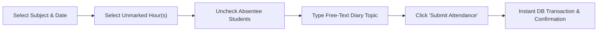
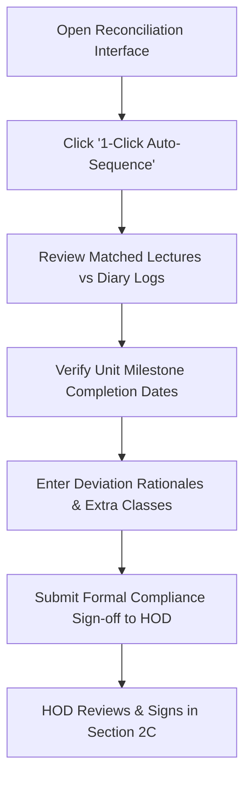

# SMART ACADEMIC RECORD BOOK (SARB)
## FACULTY OPERATIONS & COMPLIANCE USER MANUAL
### Autonomous Academic Regulations & Accreditation Management System

---

**Document Reference:** SARB-DOC-FAC-UM-2026-V1  
**Target Role:** Faculty Member / Course Instructor / Lab In-Charge  
**Academic System:** Outcome-Based Education (OBE), Autonomous Regulations (R20 / R23), NBA / NAAC Compliance  
**Last Updated:** Academic Year 2025–2026  

---

<style>
@media print {
  .page-break {
    page-break-before: always;
    break-before: page;
  }
}
.page-break {
  page-break-after: always;
  break-after: page;
}
</style>

# Document Overview & How to Use This Manual

Welcome to the **Faculty Operations Manual** for the **Smart Academic Record Book (SARB)**. This comprehensive manual has been structured in the traditional, step-by-step institutional guide format. It walks faculty members through every operational aspect of their teaching term—from initial syllabus outcome formulation to daily classroom attendance, examination scoring, accreditation attainment audits, and quality improvement actions.

### Structure of This Manual
To support individual feature reference, training, and hard-copy printing:
1. **Strict Page Separation**: Every single feature starts on its own dedicated page.
2. **Standardized Feature Anatomy**: Each feature follows a consistent, easy-to-follow structure:
   - **Feature Identification & Breadcrumb Path**: Exactly where to click.
   - **Operational Purpose**: Why and when this feature is used.
   - **Prerequisites & System Rules**: What must be done beforehand.
   - **Step-by-Step Instructions**: Chronological, click-by-click instructions.
   - **Concrete Running Example**: A complete, real-world example illustrating fields, values, and calculations.
   - **System Validations & Integrity Rules**: What the system checks behind the scenes.
   - **Troubleshooting & FAQs**: Solutions to common mistakes or edge cases.

### Standard Reference Example Used Throughout This Manual
To provide cohesive continuity across all features, this manual follows a single concrete teaching assignment:

- **Faculty Name**: Dr. A. Sharma (Associate Professor, Dept. of Computer Science & Engineering)
- **Course Name**: Database Management Systems (DBMS)
- **Course Code**: `20A05401T` (Autonomous Regulation R20, 3 Credits: 3-0-0)
- **Class Cohort**: B.Tech CSE III Year - I Semester, Section A (Academic Year: 2025-2026)
- **Class Size**: 60 Enrolled Students (Roll Numbers: `21021A0501` to `21021A0560`)
- **Associated Practical Course**: Database Management Systems Laboratory (`20A05401P`)

---

# Table of Contents

| Part | Section / Feature Title | Module Code | Primary URL |
|:---:|:---|:---:|:---|
| **Part I** | **System Fundamentals & Daily Scheduling** | | |
| 1 | Feature 1: Portal Authentication, Home Dashboard & Weekly Timetable | System Core | `index.php`, `fachome.php` |
| 2 | Feature 2: Knowledge Base & OBE Terminology Primer | System Core | `facknowledgebase.php` |
| **Part II** | **Curriculum Design & Pedagogical Planning** | | |
| 3 | Feature 3: Course Outcomes (COs) Definition & Bloom's Tagging | `MOD_CO_PO` | `facaddcos.php` |
| 4 | Feature 4: CO-PO & CO-PSO Articulation Matrix Configuration | `MOD_CO_PO` | `facarticulationmatrix.php` |
| 5 | Feature 5: Lecture Lesson Planning & Bulk CSV Schedule Ingestion | `MOD_LESSON_PLAN` | `facaddlessonplan.php` |
| **Part III** | **Classroom Conduction, Attendance & Diary Logging** | | |
| 6 | Feature 6: Daily Attendance Marking & Frictionless Teaching Diary | `MOD_ATTENDANCE` | `facaddattendance.php` |
| 7 | Feature 7: Attendance Register, Session Diary & e-Bluebook Export | `MOD_ATTENDANCE` | `facshowattendance.php` |
| 8 | Feature 8: Single Student Attendance Status Correction (7-Day Rule) | `MOD_ATTENDANCE` | `facupdatestudentattendance.php` |
| 9 | Feature 9: Exceptional Attendance for Late Entrants & Approved OD | `MOD_ATTENDANCE` | `facexceptionalattendance.php` |
| 10 | Feature 10: Add Diary Only (Without Class Attendance) | `MOD_CLASS_DIARY` | `facadddairy.php` |
| 11 | Feature 11: Attendance Deletion Requests (HoD Audited Gateway) | `MOD_ATT_REQUESTS` | `facadddelattrequest.php` |
| **Part IV** | **Electives, Shared Subjects & Grouped Cohorts** | | |
| 12 | Feature 12: Grouped Cohorts Attendance for Multi-Section Courses | `MOD_GROUPED_ATT` | `facaddgroupedattendance.php` |
| 13 | Feature 13: Grouped Assessment Data & Attachments Import | `MOD_GROUPED_ATT` | `facgroupedcia.php` |
| **Part V** | **Continuous Internal Assessments (CIA) & Attachments** | | |
| 14 | Feature 14: CIA Question Blueprint, Bloom Levels & CO Tagging | `MOD_CIA_METADATA` | `facciacomp.php`, `facquestionco.php` |
| 15 | Feature 15: UG Theory CIA Marks Entry (Descriptive, Objective, Assignment) | `MOD_CIA_MARKS` | `facciamarks.php`, `facmarksentry.php` |
| 16 | Feature 16: Condensed CIA Marks Ledger & Weighted Aggregates | `MOD_CIA_MARKS` | `facciamarkscondensed.php` |
| 17 | Feature 17: UG Laboratory Day-to-Day & Internal Exam Assessment | `MOD_CIA_MARKS` | `facaddcialabmarks.php` |
| 18 | Feature 18: Postgraduate (PG) and UG Project Assessment Workflows | `MOD_CIA_MARKS` | `facaddpgciamarks.php`, `facaddprojectciamarks.php` |
| 19 | Feature 19: CIA Examination Artifacts & Document Attachments | `MOD_CIA_METADATA` | `facciaattachments.php` |
| **Part VI** | **Semester End Examinations (SEE) & Results** | | |
| 20 | Feature 20: Semester End Examination (SEE) Evaluation (Modes A, B, and C) | `MOD_SEE_MARKS` | `facseemarks.php`, `facseedirectmarks.php`, `attainmentimport.php` |
| **Part VII** | **Accreditation Analytics, Compliance & Continuous Quality** | | |
| 21 | Feature 21: Course Delivery Reconciliation & NBA Criterion 2.2 Audit | `MOD_LESSON_PLAN` | `faclessonplanreconciliation.php` |
| 22 | Feature 22: OBE Direct & Indirect Attainment Analysis Dashboard | `MOD_OBE_ANALYSIS` | `facciaanalysis2.php` |
| 23 | Feature 23: Student Feedback Analytics & Exit Survey Reports | `MOD_FEEDBACK` | `facviewfeedback.php` |
| 24 | Feature 24: Course Review, CQI Action Tracking & Optional AI Assistance | `MOD_CQI_ACTION_TRACKING` / `MOD_AI_ASSISTANCE` | `reviewqueue.php`, `aiassistance.php` |
| **Part VIII**| **Security & Session Management** | | |
| 25 | Feature 25: Account Security & Self-Service Password Management | System Core | `facchgpwd.php`, `logout.php` |

<div class="page-break"></div>

# Feature 1: Portal Authentication, Home Dashboard & Weekly Timetable

### 1.1 Navigation Path
- **Login URL**: `https://<institution-domain>/index.php`
- **Dashboard**: **Top Navigation Bar** &rarr; **Home** (`fachome.php`)
- **Weekly Schedule**: **Home Dashboard** &rarr; **My Weekly Timetable** (`faculty_weekly_timetable.php`)

---

### 1.2 Purpose & Scope
This feature allows faculty members to authenticate into their secure academic workspace, review institutional notices, inspect system feature configurations, and view their personalized weekly lecture timetable across allocated course sections.

---

### 1.3 Prerequisites & Access Rules
1. Your faculty profile must be registered by the College Administration or Department Head (HOD).
2. You must have received your official Username (Faculty ID or Registered Email) and Default Password.
3. Your teaching assignments must be mapped by the Head of Department (HOD) in the Department Operations Hub.

---

### 1.4 Step-by-Step Instructions

#### A. Logging In
1. Open any modern web browser (Google Chrome, Mozilla Firefox, or Microsoft Edge).
2. Enter the institution's attendance portal URL.
3. On the login screen, select or enter your **Username** and **Password**.
4. Click **Sign In**. Upon successful validation, the system establishes a secure HTTPS session and routes you to the **Faculty Home Dashboard** (`fachome.php`).

#### B. Understanding the Home Dashboard
The Dashboard displays:
- **Alert Banner**: Any system-wide messages regarding attendance cut-off dates or feedback survey windows.
- **Action Links**: Direct access to the **Course Review & Action Tracking Queue** (`reviewqueue.php`) and **My Weekly Timetable** (`faculty_weekly_timetable.php`).
- **Feature Quick-Links**: Overview of active modules according to institutional settings.

#### C. Inspecting Your Weekly Timetable
1. On the dashboard header, click the blue button labeled **My Weekly Timetable**.
2. The system loads `faculty_weekly_timetable.php` filtered strictly to your faculty identifier.
3. View the period-by-period matrix (Monday through Saturday, Periods 1 to 7).
4. Each timetable cell indicates:
   - Class Cohort & Section (e.g., `CSE - III-I - Sec A`)
   - Course Name & Short Code (e.g., `DBMS [20A05401T]`)
   - Assigned Lecture Room / Laboratory Hall

---

### 1.5 Concrete Example in Action

> **User**: Dr. A. Sharma (`fac_id = 104`)  
> **Action**: Log in and verify Monday timetable allocations.

**Screen View (Timetable Matrix):**

| Day | Period 1 (09:00 - 10:00) | Period 2 (10:00 - 11:00) | Period 3 (11:15 - 12:15) | Period 4 (12:15 - 01:15) | Period 5 (02:00 - 03:00) | Period 6 (03:00 - 04:00) |
|---|:---:|:---:|:---:|:---:|:---:|:---:|
| **Monday** | **CSE III-I Sec A**<br>`DBMS (20A05401T)`<br>Room: CS-301 | *Department Library Duty* | **CSE III-I Sec B**<br>`DBMS (20A05401T)`<br>Room: CS-302 | *Lunch Break* | **CSE III-I Sec A Lab**<br>`DBMS Lab (20A05401P)`<br>Lab Hall 2 (P5-P7) | &larr; Continued &rarr; |

---

### 1.6 System Validations & Integrity Rules
- **Role Isolation**: Only accounts with `role = 'faculty'` or dual-role privileges can access `fachome.php`. Unauthorized attempts are redirected to `index.php` with an access denial flag.
- **CSRF Protection**: All form submissions throughout the portal include a cryptographic `secretcode` token preventing cross-site request forgery.

---

### 1.7 Troubleshooting & Common Questions
- **Q: My timetable appears empty even though classes have commenced.**  
  *Fix*: Timetables are mapped by your Head of Department (HOD) via `hodmanage_timetable.php`. Contact your HOD to verify that your faculty ID has been attached to the scheduled periods.

<div class="page-break"></div>

# Feature 2: Knowledge Base & OBE Terminology Primer

### 2.1 Navigation Path
- **Navigation**: **Home Dashboard** &rarr; **Other Options** &rarr; **Additional Resources** &rarr; **Click here to learn key strategies for successful OBE** (`facknowledgebase.php`)

---

### 2.2 Purpose & Scope
The Knowledge Base acts as a reference handbook for Outcome-Based Education (OBE) principles, National Board of Accreditation (NBA) compliance metrics, and Bloom's Revised Taxonomy levels. It provides faculty members with standardized definitions to formulate rigorous Course Outcomes, question papers, and assessment rubrics.

---

### 2.3 Prerequisites & Access Rules
- Open to all authenticated faculty members at any time during the academic semester.

---

### 2.4 Step-by-Step Instructions
1. Navigate to **Other Options** from the top menu, or scroll to the footer section of the **Home Dashboard**.
2. Click on the link **Knowledge Base (`facknowledgebase.php`)**.
3. Review the foundational hierarchy:
   $$\text{Institutional Vision \& Mission} \longrightarrow \text{PEOs} \longrightarrow \text{POs / PSOs} \longrightarrow \text{COs} \longrightarrow \text{Bloom's Cognitive Tagging}$$
4. Use the reference tables when defining syllabus outcomes or designing question paper rubrics.

---

### 2.5 Key Educational Framework Reference

#### A. Foundational OBE Hierarchy
- **Mission & Vision**: Futuristic goal of the institution and the operational vehicle to achieve it.
- **Program Educational Objectives (PEOs)**: Broad career and professional accomplishments expected of graduates within 3 to 5 years of graduation.
- **Program Outcomes (POs)**: 12 mandatory graduate attributes defined by NBA (Engineering Knowledge, Problem Analysis, Design/Development, Modern Tool Usage, Ethics, Life-long Learning, etc.).
- **Program Specific Outcomes (PSOs)**: 2 to 4 discipline-specific capabilities defined by the department.
- **Course Outcomes (COs)**: 4 to 6 measurable statements describing what students should know and perform at the conclusion of a specific course.

#### B. Bloom's Revised Taxonomy Cognitive Levels
| Level | Action Verb Examples | Cognitive Target | Typical Question Formulation |
|:---:|:---|:---|:---|
| **L1: Remember** | Define, State, List, Recall, Identify | Memory recall of specific facts, terminology | "Define ACID properties in transaction processing." |
| **L2: Understand**| Explain, Discuss, Illustrate, Classify | Comprehension and interpretation of concepts | "Explain the differences between B-Tree and B+ Tree indexing." |
| **L3: Apply** | Compute, Solve, Demonstrate, Execute | Applying rules or algorithms to new situations | "Construct an E-R diagram for a hospital management database." |
| **L4: Analyze** | Differentiate, Compare, Deconstruct | Breaking material into parts and examining relations | "Analyze the given relation and decompose it into 3NF." |
| **L5: Evaluate** | Justify, Critique, Optimize, Validate | Making informed judgments based on criteria | "Evaluate whether Two-Phase Locking guarantees serializability." |
| **L6: Create** | Design, Formulate, Construct, Synthesize | Creating a novel structure or holistic solution | "Design a distributed database architecture for an e-commerce hub." |

---

### 2.6 Concrete Example in Action
Dr. Sharma consults the Knowledge Base when framing question paper components for Mid-Term 1. By selecting the target Bloom level (e.g., L3-Apply for relational algebra queries), the system ensures alignment between the classroom exam questions and the published Course Outcomes.

<div class="page-break"></div>

# Feature 3: Course Outcomes (COs) Definition & Bloom's Tagging

### 3.1 Navigation Path
- **Navigation**: **Top Menu** &rarr; **Other Options** &rarr; **Curriculum Outcomes & Planning** Card &rarr; **Add / View Course Outcomes (COs)** (`facaddcos.php`)

---

### 3.2 Purpose & Scope
This feature enables faculty instructors to formulate 4 to 6 measurable Course Outcomes (CO1 through CO6) for their assigned subject. These outcomes form the foundation for all downstream operations: lecture lesson planning, student feedback surveys, exam question blueprints, and NBA accreditation attainment calculations.

---

### 3.3 Prerequisites & Access Rules
1. The subject must be assigned to you by your HOD.
2. If your institution has a centralized Board of Studies (BOS) master syllabus, default Course Outcomes may already be populated. Faculty can customize or review them before term lock.
3. Feature toggle `MOD_CO_PO` must be enabled (`VISIBLE` or `READONLY`).

---

### 3.4 Step-by-Step Instructions
1. Navigate to **Other Options** &rarr; click **Add / View Course Outcomes (COs)**.
2. Select your assigned subject from the **Subject Selection Dropdown** (e.g., `DBMS - CSE - III-I - Sec A`).
3. Click **Fetch / View COs**.
4. The system presents the **Course Outcome Management Table**.
5. To add or edit a Course Outcome:
   - **CO Number**: Select `CO1`, `CO2`, `CO3`, `CO4`, `CO5`, or `CO6`.
   - **CO Description**: Type the formal outcome statement using observable action verbs (e.g., *Understand*, *Apply*, *Design*).
   - **Cognitive Level (Bloom's Taxonomy)**: Select the primary cognitive target from the dropdown (`L1-Remember`, `L2-Understand`, `L3-Apply`, `L4-Analyze`, `L5-Evaluate`, `L6-Create`).
   - **Target Threshold (%)**: Set the minimum benchmark percentage of marks a student must score to attain this outcome (Institution default is typically `60.00%`).
6. Click **Save Course Outcome**. The table updates immediately.

---

### 3.5 Concrete Example in Action

> **Instructor**: Dr. A. Sharma  
> **Course**: Database Management Systems (`20A05401T`)

**Configured Course Outcomes Table:**

| CO Code | Course Outcome Statement | Bloom's Level | Benchmark Target (%) |
|:---:|:---|:---:|:---:|
| **CO1** | Understand fundamental database concepts, data models, and relational schema principles. | `L2 - Understand` | 60.00% |
| **CO2** | Design Entity-Relationship diagrams and translate them into normalized relational database schemas. | `L3 - Apply` | 60.00% |
| **CO3** | Formulate complex relational algebra queries and SQL statements to manage and retrieve data. | `L3 - Apply` | 60.00% |
| **CO4** | Analyze relational schemas and apply normalization algorithms (1NF, 2NF, 3NF, BCNF) to eliminate redundancies. | `L4 - Analyze` | 60.00% |
| **CO5** | Evaluate transaction processing schedules, concurrency control protocols, and database recovery techniques. | `L5 - Evaluate` | 60.00% |
| **CO6** | Design storage structures, indexing schemes (B-Trees), and query optimization strategies. | `L3 - Apply` | 60.00% |

---

### 3.6 System Validations & Integrity Rules
- **Outcome Statement Completeness**: Descriptions cannot be left blank.
- **Threshold Bounds**: The target threshold must be a decimal value between `30.00%` and `100.00%`.
- **Unique Sequence Constraint**: Duplicate CO numbers (e.g., two entries for CO1) are blocked by database constraints.
- **Centralized BOS Inheritance**: If the Academic Section has locked master BOS syllabus outcomes, the input fields will display in read-only mode to maintain institutional consistency.

---

### 3.7 Troubleshooting & Common Questions
- **Q: Can I edit Course Outcomes after entering internal assessment marks?**  
  *Rule*: It is strongly recommended to finalize COs before entering assessment marks. If assessment questions have already been tagged to COs in `facquestionco.php`, altering CO definitions may invalidate question-to-outcome mapping.

<div class="page-break"></div>

# Feature 4: CO-PO & CO-PSO Articulation Matrix Configuration

### 4.1 Navigation Path
- **Navigation**: **Top Menu** &rarr; **Other Options** &rarr; **Curriculum Outcomes & Planning** Card &rarr; **Add / View CO-PO/PSO Articulation Matrix** (`facarticulationmatrix.php`)

---

### 4.2 Purpose & Scope
The Articulation Matrix maps each Course Outcome (CO1 through CO6) to the 12 Graduate Attributes (PO1–PO12) and 2–4 Program Specific Outcomes (PSO1–PSO4). This correlation matrix is mandatory for National Board of Accreditation (NBA) Criterion 3 compliance, enabling the system to calculate overall program outcome attainment automatically.

---

### 4.3 Prerequisites & Access Rules
1. Course Outcomes (CO1 to CO6) must be formulated in `facaddcos.php`.
2. Program Outcomes (PO1 to PO12) and PSOs must be defined by the Department or SuperAdmin in `po_pso`.

---

### 4.4 Step-by-Step Instructions
1. Navigate to **Other Options** &rarr; click **Add / View CO-PO/PSO Articulation Matrix**.
2. Select your course from the dropdown and click **Load Matrix**.
3. The system renders an interactive grid where rows represent your Course Outcomes (CO1 to CO6) and columns represent PO1 through PO12 plus PSO1 to PSO4.
4. For each cell intersection, select the correlation level:
   - `-` or `0`: **No Correlation** (The outcome does not address this graduate attribute).
   - `1`: **Slight / Low Correlation** (Marginal exposure or basic application).
   - `2`: **Moderate / Medium Correlation** (Substantial classroom focus and assignment evaluation).
   - `3`: **Substantial / High Correlation** (Core competence, extensive design, and rigorous testing).
5. Review the row-wise and column-wise averages dynamically computed by the system.
6. Click **Save Articulation Matrix**.

---

### 4.5 Concrete Example in Action

> **Subject**: Database Management Systems (`20A05401T`) — Dept. of CSE

**Articulation Matrix ($3 \times 6$ extract for key POs):**

| Course Outcome | PO1 (Engg Knowledge) | PO2 (Problem Analysis) | PO3 (Design/Dev) | PO4 (Investigation) | PO5 (Tool Usage) | PO8 (Ethics) | PO12 (Life-Long) | PSO1 (System SW) | PSO2 (Data Engg) |
|:---:|:---:|:---:|:---:|:---:|:---:|:---:|:---:|:---:|:---:|
| **CO1** | 3 | 2 | - | - | - | - | 1 | 2 | 3 |
| **CO2** | 3 | 3 | 3 | 2 | 2 | - | 1 | 2 | 3 |
| **CO3** | 3 | 3 | 3 | 2 | 3 | - | 2 | 2 | 3 |
| **CO4** | 3 | 3 | 2 | 2 | - | - | 1 | 1 | 3 |
| **CO5** | 3 | 2 | 2 | 3 | 1 | 1 | 2 | 2 | 3 |
| **CO6** | 3 | 2 | 3 | 2 | 2 | - | 2 | 2 | 3 |
| **Average** | **3.00** | **2.50** | **2.60** | **2.20** | **2.00** | **1.00** | **1.50** | **1.83** | **3.00** |

*Interpretation: The subject demonstrates substantial contribution to PO1 (3.00), PO2 (2.50), PO3 (2.60), and PSO2 Data Engineering (3.00).*

---

### 4.6 System Validations & Integrity Rules
- **Scale Restrictions**: Only integer weights `0, 1, 2, 3` are accepted.
- **Audit Logging**: Every matrix modification records a timestamped entry in `fac_activity_logs`.
- **Dossier Integration**: This saved matrix is automatically injected into Section 1 of the official university e-Bluebook and the NBA Attainment Dossier PDF.

---

### 4.7 Troubleshooting & Common Questions
- **Q: Why are PO columns beyond PO12 greyed out or hidden?**  
  *Fix*: POs 1–12 are universal across engineering programs. PSOs (1 to 4) are customized per department. If PSOs are missing, notify your HOD to verify `superadminpopso.php` settings.

<div class="page-break"></div>

# Feature 5: Lecture Lesson Planning & Bulk CSV Schedule Ingestion

### 5.1 Navigation Path
- **Navigation**: **Top Menu** &rarr; **Other Options** &rarr; **Curriculum Outcomes & Planning** Card &rarr; **Add / View Lesson Plan (Course Delivery Plan)** (`facaddlessonplan.php`)

---

### 5.2 Purpose & Scope
This feature enables instructors to plan their entire semester lecture delivery schedule in advance. To satisfy NBA Criterion 2.2 ("Teaching-Learning Process"), faculty schedule planned topics mapped to Units, Lecture Numbers, Course Outcomes, Bloom's Cognitive Levels, and Pedagogical Delivery Modes.

---

### 5.3 Prerequisites & Access Rules
1. Course Outcomes (CO1 to CO6) must be defined first in `facaddcos.php`.
2. Feature toggle `MOD_LESSON_PLAN` must be enabled.

---

### 5.4 Step-by-Step Instructions

#### Option A: 1-Click Tailored CSV Bulk Import (Fastest & Recommended)
1. In `facaddlessonplan.php`, select your subject.
2. Click **Download Tailored CSV Template**.
   - *Technical Note*: The template downloads with a UTF-8 Byte Order Mark (BOM) ensuring zero character corruption in Microsoft Excel. It automatically embeds your subject's active Course Outcomes as sample values.
3. Open the CSV file in Microsoft Excel or Google Sheets.
4. Fill in the columns:
   - `unit`: Unit number (1, 2, 3, 4, 5).
   - `lecture_number`: Sequential lecture number (1 to 45+).
   - `topic_planned`: Syllabus topic description.
   - `co_code`: Associated outcome (e.g., `CO1`, `CO2`).
   - `bloom_level`: Cognitive depth (e.g., `L2-Understand`, `L3-Apply`).
   - `pedagogy`: Teaching method (`Chalk & Talk`, `PPT/LCD`, `Coding Demo`, `Video Lecture`, `Flipped Classroom`).
   - `textbook_ref`: Chapter/Page references (e.g., `Silberschatz Ch. 3`).
5. Save the file in CSV format.
6. In `facaddlessonplan.php`, click **Choose File**, select your completed CSV, and click **Bulk Upload Lesson Plan**.

#### Option B: Manual Lecture Form Entry
1. Fill out the lecture form fields individually at the top of the page.
2. Click **Add Lecture**. The lecture appears in the schedule table below.
3. Use the inline **Edit** button to update any lecture entry or **Delete** to remove a specific lecture.

---

### 5.5 Concrete Example in Action

> **Subject**: Database Management Systems (`20A05401T`)  
> **Extract of Planned Lectures (Unit 1):**

| Unit | Lecture No. | Topic Planned | Target CO | Bloom Level | Pedagogy Mode | Text Reference |
|:---:|:---:|:---|:---:|:---:|:---:|:---|
| **Unit 1** | Lec 01 | Course Overview, Database Architecture & Evolution | `CO1` | `L1 - Remember` | Chalk & Talk | Silberschatz Ch 1 |
| **Unit 1** | Lec 02 | File Processing Systems vs DBMS, Data Abstraction | `CO1` | `L2 - Understand` | PPT / LCD Slides | Silberschatz Ch 1 |
| **Unit 1** | Lec 03 | Data Independence (Physical & Logical), Data Models | `CO1` | `L2 - Understand` | Chalk & Talk | Elmasri Navathe Ch 2 |
| **Unit 1** | Lec 04 | Database System Structure, Storage & Query Engines | `CO1` | `L2 - Understand` | PPT / LCD Slides | Silberschatz Ch 1 |
| **Unit 1** | Lec 05 | Entity-Relationship (ER) Model Concepts & Symbols | `CO2` | `L2 - Understand` | Chalk & Talk | Silberschatz Ch 6 |
| **Unit 1** | Lec 06 | Extended ER Features: Specialization, Generalization | `CO2` | `L3 - Apply` | Chalk & Talk | Silberschatz Ch 6 |
| **Unit 1** | Lec 07 | Case Study: Designing ER Diagram for University DB | `CO2` | `L3 - Apply` | Coding / Live Demo | Lecture Notes |

---

### 5.6 System Validations & Integrity Rules
- **Unique Lecture Number**: Each lecture number for a given subject must be unique (`UNIQUE(sub_id, lecture_number)`).
- **Flexible Parser**: The CSV parser automatically normalizes common formatting variations (e.g., "Unit 1", "U1", or "1"; "CO 1" vs "CO1").
- **Statutory Export**: When generating the official university e-Bluebook, this delivery plan automatically populates **Section 2A: Lecture Lesson Plan**.

<div class="page-break"></div>

# Feature 6: Daily Attendance Marking & Frictionless Teaching Diary

### 6.1 Navigation Path
- **Navigation**: **Top Menu** &rarr; **Mark Attendance** (`facaddattendance.php`)

---

### 6.2 Purpose & Scope
This is the core daily operational module for faculty members. It allows instructors to mark hourly student presence/absence and log daily classroom teaching diary topics. Designed with a **Zero-Friction Architecture**, daily marking focuses 100% on fast, natural topic entry with no disruptive popups or complex tagging during class hours.

---

### 6.3 Prerequisites & Access Rules
1. The class session must fall within the official **Academic Calendar Term Dates** (marking is automatically disabled after the term end date).
2. Students must be enrolled in the subject roster by the Administration or HOD.
3. The selected period(s) must not have already been marked for that subject and date.

---

### 6.4 Step-by-Step Instructions



1. Navigate to **Mark Attendance** (`facaddattendance.php`).
2. Select your **Subject** from the dropdown menu (e.g., `DBMS - CSE - III-I - Sec A`).
3. Select the **Date** (defaults to today's date).
4. The system triggers an instant background check:
   - It queries all periods configured in the institutional bell schedule.
   - It displays checkboxes **only for unmarked hours** (e.g., `[x] Hour 1`, `[x] Hour 2`). Periods already recorded are hidden to prevent accidental double-marking.
5. Check the hour(s) you conducted. For block classes (e.g., a 2-hour lecture or 3-hour lab), select multiple hours simultaneously.
6. **Student Attendance Roster**:
   - The student list loads automatically in alphabetical order by Roll Number.
   - **Default State**: All enrolled students are pre-checked as **Present** ($P$).
   - Simply **uncheck** the checkbox for students who are **Absent** ($A$).
   - Quick utility buttons (**Select All** / **Deselect All**) are available at the top of the roster.
7. **Daily Teaching Diary**:
   - In the text box labeled **Class Diary / Syllabus Topics Covered**, enter a brief, natural summary of what you taught during the period.
   - *Design Tip*: Keep it natural and concise (e.g., *"Third Normal Form (3NF) definitions, transitive dependencies, and decomposition examples"*).
8. Click **Submit Attendance**.

---

### 6.5 Concrete Example in Action

> **Date**: October 14, 2026 | **Subject**: DBMS (`20A05401T`) | **Hour Selected**: Period 1 (09:00 - 10:00 AM)  
> **Class Size**: 60 Students | **Absentees**: Roll Numbers `21021A0514`, `21021A0528`, `21021A0542`

**Diary Entry Entered**:
> *"Covered Boyce-Codd Normal Form (BCNF) requirements. Compared 3NF vs BCNF using functional dependency sets. Solved 2 practice problems on lossless join decomposition."*

**Submission Result:**
- 57 students marked **Present** ($P$).
- 3 students marked **Absent** ($A$).
- 1 diary entry logged in the statutory 4-column register for Period 1.

---

### 6.6 System Validations & Integrity Rules
- **Atomic Transactions**: Attendance and diary records are committed inside a database transaction (`begin_transaction`). If an error occurs, the entire operation rolls back.
- **Duplicate Prevention**: If Hour 1 has already been marked for that date, the Hour 1 checkbox will not appear.
- **Mandatory Diary**: Attendance cannot be submitted with an empty diary entry.

---

### 6.7 Troubleshooting & Common Questions
- **Q: I accidentally unchecked the wrong student. How do I fix it?**  
  *Fix*: You can immediately update a single student's status within 7 days using **Feature 8 (`facupdatestudentattendance.php`)**.
- **Q: Why are all hours disabled or missing on a particular date?**  
  *Check*: Either all periods have already been marked for that date, or the date falls outside the active academic calendar semester window configured by the SuperAdmin.

<div class="page-break"></div>

# Feature 7: Attendance Register, Session Diary & e-Bluebook Export

### 7.1 Navigation Path
- **Navigation**: **Top Menu** &rarr; **Show Attendance** (`facshowattendance.php`)
- **Bluebook Download**: **Show Attendance** &rarr; **Download e-Bluebook PDF** (`download_bluebook.php`)

---

### 7.2 Purpose & Scope
This feature provides instructors with complete visibility over classroom attendance records. Instructors can inspect aggregate student percentages, drill down into day-by-day/hour-by-hour logs, review past diary entries, and download the university's official, statutory **e-Bluebook PDF** ready for academic inspection.

---

### 7.3 Prerequisites & Access Rules
- At least one class session must have been marked in `facaddattendance.php`.

---

### 7.4 Step-by-Step Instructions

#### A. Viewing Cumulative Attendance
1. Navigate to **Show Attendance** (`facshowattendance.php`).
2. Select your **Subject** from the dropdown.
3. The system displays the **Cumulative Attendance Summary**:
   - Total Classes Conducted to date.
   - Table of all enrolled students showing: Roll Number, Student Name, Classes Attended, and Cumulative Percentage ($\%$).
   - Color-coded alerts: Highlighted in red if below condonation threshold ($< 75\%$).

#### B. Viewing Detailed Day-Wise & Hourly Logs
1. Click the tab or radio button labeled **Detailed / Date-Wise Attendance**.
2. Select a date range or specific lecture period.
3. Inspect the exact presence/absence status of each student for that period alongside the registered Teaching Diary entry.

#### C. Generating the Official University e-Bluebook PDF
1. On the attendance view screen, click the button labeled **<i class="bi bi-file-earmark-pdf"></i> Download Official e-Bluebook**.
2. The system executes `services/EBluebookPDFService.php` (alongside `services/CourseMasterFilePDFService.php` for full course dossiers via `download_course_dossier.php`) and dynamically compiles a complete, publication-grade document containing:
   - **Cover Page & Section 1**: Institutional header, course details, faculty credentials, and student nominal roll.
   - **Section 2A**: Formulated Lecture Lesson Plan (Planned Schedule).
   - **Section 2B**: Statutory 4-Column Lecturer Diary (Date, Hour, Topic Covered, Faculty Signature).
   - **Section 2C**: Course Delivery Compliance & Deviation Report (NBA 2.2 milestone completion dates, pedagogical deviations, compensatory classes).
   - **Section 3**: Complete Period-by-Period Student Attendance Register Grid.
   - **Section 4**: Continuous Internal Assessment (CIA) Marks Register with component breakdowns.
3. Save or print the PDF for departmental auditing.

---

### 7.5 Concrete Example in Action

> **Subject**: DBMS (`20A05401T`) | **Total Classes Conducted**: 40 Hours

**Sample Extract from Cumulative Summary Table:**

| Roll Number | Student Name | Classes Conducted | Classes Attended | Percentage (%) | Status / Alert |
|:---:|:---|:---:|:---:|:---:|:---:|
| `21021A0501` | A. Bhavani | 40 | 38 | 95.00% | Satisfactory |
| `21021A0502` | B. Charan Teja | 40 | 34 | 85.00% | Satisfactory |
| `21021A0514` | K. Dinesh | 40 | 28 | 70.00% | **Shortage (< 75%)** |
| `21021A0528` | M. Harika | 40 | 39 | 97.50% | Satisfactory |
| `21021A0542` | P. Sai Kumar | 40 | 25 | 62.50% | **Severe Detention Risk** |

---

### 7.6 System Validations & Integrity Rules
- **Mathematical Consistency**: Total attended classes can never exceed total conducted classes.
- **Direct PDF Rendering**: Bluebooks are streamed directly from memory using mPDF with standard institutional fonts and watermarks.

<div class="page-break"></div>

# Feature 8: Single Student Attendance Status Correction (7-Day Rule)

### 8.1 Navigation Path
- **Navigation**: **Top Menu** &rarr; **Other Options** &rarr; **Class Diary & Attendance Utilities** Card &rarr; **Update Single Student Attendance** (`facupdatestudentattendance.php`)

---

### 8.2 Purpose & Scope
To provide instructors with a self-service correction mechanism for clerical mistakes made during daily attendance marking (such as inadvertently marking a present student as absent), without requiring administrative escalation to the Head of Department.

---

### 8.3 Prerequisites & Strict Policy Rules
1. **The 7-Day Window Rule**: Attendance status can **only** be modified for sessions conducted within the last **7 calendar days**.
2. Modifying dates older than 7 days is strictly blocked by the system to maintain institutional audit integrity. Corrections beyond 7 days require a formal deletion request to the HOD (see Feature 11).
3. The subject must be actively assigned to the logged-in faculty member.

---

### 8.4 Step-by-Step Instructions
1. Navigate to **Other Options** &rarr; click **Update Single Student Attendance** (`facupdatestudentattendance.php`).
2. Select your **Subject** from the dropdown list.
3. Select the **Date** on which the session occurred (must be within the last 7 days).
4. Select the specific **Hour / Period** you wish to modify.
5. Select the **Student** by Roll Number / Name.
6. The system displays the student's current recorded status:
   - Current Status: **Absent** ($A$) or **Present** ($P$).
7. Choose the **New Status** from the dropdown:
   - Select **Present** (if rectifying an accidental absentee mark) or **Absent**.
8. In the **Mandatory Reason** box, enter a concise explanation for the correction (e.g., *"Student arrived on time with approved departmental pass; marked absent in error"*).
9. Click **Update Attendance Status**.
10. The system updates the record and logs the change in the audit trail.

---

### 8.5 Concrete Example in Action

> **Faculty**: Dr. A. Sharma  
> **Subject**: DBMS (`20A05401T`)  
> **Date**: October 12, 2026 (2 days ago &mdash; within 7-day limit)  
> **Period**: Hour 2 (10:00 - 11:00 AM)  
> **Student**: `21021A0514` (K. Dinesh)

**Action Taken:**
- Recorded Status: `Absent`
- Selected New Status: `Present`
- Reason Entered: *"Student was present in the front row; accidentally unchecked during mobile submission."*
- Click: **Update Attendance Status**.
- Result: Record immediately flipped to `Present`. K. Dinesh's attended hours increase from 27 to 28.

---

### 8.6 System Validations & Integrity Rules
- **Automated Date Boundary Check**: The system validates:
  $$\text{Date Difference} = \text{Current Date} - \text{Session Date} \le 7 \text{ Days}$$
  If $\text{Date Difference} > 7$, the submission is rejected with the message: *"Attendance modifications are restricted to sessions within the last 7 days. Please submit a formal HoD Deletion Request."*
- **Audit Logging**: The modification timestamp, old status, new status, and faculty user ID are logged into `fac_activity_logs`.

---

### 8.7 Troubleshooting & Common Questions
- **Q: I need to change an attendance mark from 10 days ago.**  
  *Solution*: Use **Feature 11: Attendance Deletion Requests** (`facadddelattrequest.php`) to request that the HOD unlock or delete the affected session.

<div class="page-break"></div>

# Feature 9: Exceptional Attendance for Late Entrants & Approved OD

### 9.1 Navigation Path
- **Navigation**: **Top Menu** &rarr; **Other Options** &rarr; **Class Diary & Attendance Utilities** Card &rarr; **Mark Attendance (For Exceptional Cases)** (`facexceptionalattendance.php`)

---

### 9.2 Purpose & Scope
This utility handles specialized academic adjustments, specifically:
1. **Lateral Entry (LE) Students**: Students admitted into the second or third year several weeks after the semester commences.
2. **Approved On-Duty (OD) Students**: Students representing the institution in university sports, NCC/NSS camps, or academic conferences with prior administrative sanction.
3. **Re-admitted / Transferred Students**: Students whose official enrollment orders were processed late by the academic branch.

---

### 9.3 Prerequisites & Access Rules
1. The student must now be enrolled in the subject roster.
2. The dates for which exceptional attendance is awarded must correspond to legitimate past class sessions conducted for that subject.

---

### 9.4 Step-by-Step Instructions
1. Navigate to **Other Options** &rarr; click **Mark Attendance (For Exceptional Cases)** (`facexceptionalattendance.php`).
2. Select the **Subject**.
3. Select the target **Student** from the enrolled student roster.
4. Select the **Date Range** or specific **Past Date & Hour**.
5. The system lists all class sessions held during that window where the student is currently unrecorded or marked absent.
6. Check the sessions you wish to credit.
7. Select the award status (**Present**).
8. Enter the official administrative approval reference in the **Remarks** field (e.g., *"Principal Order No. JNTU/LE/2026/04 dated 05-10-2026"*).
9. Click **Submit Exceptional Attendance**.

---

### 9.5 Concrete Example in Action

> **Student**: `22025A0501` (R. Suresh &mdash; Lateral Entry Admitted in Week 4)  
> **Subject**: DBMS (`20A05401T`)  
> **Sessions Conducted Before Suresh's Admission**: 12 Hours

**Action Taken:**
- Dr. Sharma selects Suresh's roll number.
- In accordance with college academic council regulations for lateral entry orientation, Suresh is awarded attended credit for the 12 orientation periods.
- Suresh's attendance record is updated to reflect $12 / 12$ conducted sessions, preventing him from starting the semester with a false zero attendance penalty.

---

### 9.6 System Validations & Integrity Rules
- **No Ghost Sessions**: Exceptional attendance can only be credited against dates on which a valid class session was actually conducted by the faculty.
- **Permission Check**: The system validates that the user is the mapped faculty member for the course.

<div class="page-break"></div>

# Feature 10: Add Diary Only (Without Class Attendance)

### 10.1 Navigation Path
- **Navigation**: **Top Menu** &rarr; **Other Options** &rarr; **Class Diary & Attendance Utilities** Card &rarr; **Add Diary Only (No Attendance)** (`facadddairy.php`)

---

### 10.2 Purpose & Scope
During an academic semester, scheduled class hours may be interrupted due to institutional events, technical symposiums, sports meets, guest lectures, or sudden administrative holiday declarations. This feature allows faculty members to log what occurred during those scheduled timetable periods in their official Academic Record Book **without marking student attendance** (avoiding false presence or unmerited absence penalties).

---

### 10.3 Prerequisites & Access Rules
- The subject must be assigned to you in your weekly timetable.

---

### 10.4 Step-by-Step Instructions
1. Navigate to **Other Options** &rarr; click **Add Diary Only (No Attendance)** (`facadddairy.php`).
2. Select your **Subject** from the dropdown.
3. Select the **Date** of the session.
4. Select the **Hour / Period** (e.g., Period 3).
5. In the **Diary / Activity Description** box, describe the circumstance:
   - *Example A (Suspended Instruction)*: *"Classes suspended by Principal notification due to College Annual Day rehearsals."*
   - *Example B (Guest Lecture)*: *"Special Expert Seminar conducted by Industry Speaker on Cloud Database Migrations in Seminar Hall 1."*
   - *Example C (Technical Fest)*: *"Students participated in Departmental National Coding Hackathon."*
6. Click **Save Diary Entry**.
7. The entry is recorded in the statutory lecturer diary and will appear in Section 2B of your official e-Bluebook.

---

### 10.5 Concrete Example in Action

> **Subject**: DBMS (`20A05401T`)  
> **Date**: October 02, 2026 | **Period**: Hour 4 (12:15 - 01:15 PM)

**Entry Logged:**
> *"Gandhi Jayanti &mdash; National Holiday observed. No instructional classes conducted."*

**Outcome:**
- The lecture log appears in the official chronological diary.
- No attendance records are generated, leaving student attendance percentages unaffected.

---

### 10.6 System Validations & Integrity Rules
- **Independent Table Target**: Records are inserted exclusively into the `diary` table with period tracking, leaving the `attendance` table untouched.
- **Audit Reflection**: Helps reconcile discrepancies between the total calendar days and the actual instructional contact hours during end-of-semester course delivery audits.

<div class="page-break"></div>

# Feature 11: Attendance Deletion Requests (HoD Audited Gateway)

### 11.1 Navigation Path
- **Submit Request**: **Other Options** &rarr; **Attendance Deletion Requests** Card &rarr; **Submit New Deletion Request** (`facadddelattrequest.php`)
- **Track Status**: **Other Options** &rarr; **Attendance Deletion Requests** Card &rarr; **View Submitted Requests** (`facshowdelattrequests.php`)

---

### 11.2 Purpose & Scope
If a faculty member marks an attendance session under the wrong subject, on the wrong date, or during an incorrect period, direct deletion by faculty is prohibited to prevent unilateral tampering. Instead, the platform provides an audited institutional workflow: faculty submit a formal deletion request with a written justification, which must be reviewed and approved by the Head of Department (HOD) before any records are expunged.

---

### 11.3 Prerequisites & Access Rules
- You must have marked the session you wish to delete.

---

### 11.4 Step-by-Step Instructions

#### A. Submitting a Deletion Request
1. Navigate to **Other Options** &rarr; click **Submit New Deletion Request** (`facadddelattrequest.php`).
2. Select your **Subject**.
3. Select the **Date** of the erroneous class.
4. Select the specific **Hour / Period** (e.g., Period 4).
5. The system confirms the existing record details (number of students marked present/absent).
6. In the **Reason for Deletion Request** box, type a clear explanation (e.g., *"Mistakenly marked Section A attendance under Section B code; requesting deletion so it can be re-entered accurately under Section A"*).
7. Click **Submit Request to HOD**.
8. The system assigns a unique Request Tracking ID and places the request into the HOD's review queue with status `PENDING`.

#### B. Tracking Request Status
1. Navigate to **Other Options** &rarr; click **View Submitted Requests** (`facshowdelattrequests.php`).
2. Review the status column for your requests:
   - `PENDING`: Awaiting HOD review.
   - `APPROVED`: HOD has approved and executed the deletion; you may now re-mark the period correctly.
   - `REJECTED`: HOD has declined the request; review the HOD's remarks for details.

---

### 11.5 Concrete Example in Action

> **Faculty**: Dr. A. Sharma  
> **Subject**: DBMS (`20A05401T`)  
> **Error**: On October 09, Period 2 was accidentally marked twice due to a browser reload.

**Request Submitted:**
- Date: `2026-10-09` | Hour: `2`
- Justification: *"Duplicate attendance submission caused by network timeout retry. Please delete the second entry."*
- **HOD Action**: HOD verifies the duplicate timestamp and clicks **Approve & Delete** in `hodviewdelrequests.php`.
- **Final Result**: The duplicate session is cleanly removed from the database, and Dr. Sharma is notified via the portal status dashboard.

---

### 11.6 System Validations & Integrity Rules
- **Two-Man Rule Governance**: Faculty cannot delete historical attendance unilaterally; HOD approval is mandatory.
- **Cascading Removal**: When approved by the HOD, the system safely deletes both the student records in `attendance` and the lecture note in `diary` inside a single atomic database transaction.

<div class="page-break"></div>

# Feature 12: Grouped Cohorts Attendance for Multi-Section Courses

### 12.1 Navigation Path
- **Navigation**: **Top Menu** &rarr; **Other Options** &rarr; **Electives & Shared Subjects Utilities** Card &rarr; **Mark Attendance (For Grouped Sessions)** (`facaddgroupedattendance.php`)

---

### 12.2 Purpose & Scope
This specialized tool is designed for **Open Electives**, **Interdisciplinary Courses**, **Skill Enhancement Courses (SECs)**, or combined lectures where a single instructor teaches students drawn from multiple sections or departments simultaneously in a single classroom or auditorium. Rather than marking attendance repeatedly across separate section rosters, instructors mark attendance **once for the combined cohort**.

---

### 12.3 Prerequisites & Access Rules
1. You must be mapped to all participating sections or elective offerings.
2. Feature toggle `MOD_GROUPED_ATT` must be enabled.

---

### 12.4 Step-by-Step Instructions
1. Navigate to **Other Options** &rarr; click **Mark Attendance (For Grouped Sessions)** (`facaddgroupedattendance.php`).
2. In the **Group Selection Panel**, select your primary offering and check the boxes for all **Linked Subject Sections** that share the lecture (e.g., `Open Elective: Cloud Computing - CSE Sec A, CSE Sec B, and ECE Sec A`).
3. Select the **Date** and **Period / Hour**.
4. Click **Load Combined Student Roster**.
5. The system constructs a single unified roster containing students from all selected cohorts, neatly grouped or sorted by Roll Number with clear department/section badges.
6. Uncheck any students who are absent.
7. Enter the unified **Class Diary / Syllabus Topic Covered**.
8. Click **Submit Grouped Attendance**.
9. The system processes the attendance in parallel, writing records to each individual subject cohort simultaneously.

---

### 12.5 Concrete Example in Action

> **Course**: Open Elective &mdash; *Big Data Technologies*  
> **Instructor**: Dr. A. Sharma  
> **Participating Sections**:
> - CSE III-I Sec A (25 students registered)
> - CSE III-I Sec B (20 students registered)
> - IT III-I Sec A (15 students registered)  
> **Total Combined Cohort**: 60 students

**Execution:**
- Dr. Sharma marks attendance once on Friday Period 5.
- Enters topic: *"Hadoop HDFS Architecture & NameNode Federation."*
- Unchecks 2 absentees (1 from CSE-A, 1 from IT-A).
- Submits form.
- **System Result**: All 3 department registers are updated simultaneously with identical diary entries and precise student attendance records.

---

### 12.6 System Validations & Integrity Rules
- **Multi-Subject Transaction Integrity**: The system validates unmarked hour availability across **all** selected subjects. If one section already has attendance recorded for that hour, the system alerts the instructor before submission to prevent partial sync errors.

<div class="page-break"></div>

# Feature 13: Grouped Assessment Data & Attachments Import

### 13.1 Navigation Path
- **Navigation**: **Top Menu** &rarr; **Other Options** &rarr; **Electives & Shared Subjects Utilities** Card &rarr; **Import Grouped CIA Data** (`facgroupedcia.php`)

---

### 13.2 Purpose & Scope
When an instructor conducts a common Continuous Internal Assessment (e.g., Mid-Term 1 or a Common Assignment) for an Open Elective taught across multiple sections, configuring question paper blueprints, Bloom's levels, and uploading question paper PDFs repeatedly for every section is tedious. This utility allows the instructor to configure the assessment once in Section A and **1-click clone / replicate the metadata and attachments** to all other sections.

---

### 13.3 Prerequisites & Access Rules
1. The source section (e.g., Section A) must already have its CIA components and question paper metadata configured.
2. Feature toggle `MOD_GROUPED_ATT` must be active.

---

### 13.4 Step-by-Step Instructions
1. Navigate to **Other Options** &rarr; click **Import Grouped CIA Data** (`facgroupedcia.php`).
2. **Select Source Subject**: Choose the section where you have already set up the assessment (e.g., `Cloud Computing - CSE Sec A`).
3. **Select Assessment**: Choose `Mid-1` or `Mid-2`.
4. **Select Target Subjects**: Check the checkboxes for the other sections where you want to replicate this structure (e.g., `Cloud Computing - CSE Sec B`, `Cloud Computing - ECE Sec A`).
5. Choose Replication Options:
   - `[x] Clone Question Paper Component Blueprint & Maximum Marks`
   - `[x] Clone Bloom's Taxonomy & CO Mappings`
   - `[x] Replicate Uploaded Question Paper & Answer Key Attachments`
6. Click **Execute CIA Replication**.
7. The system creates the target records and copies the document links.

---

### 13.5 Concrete Example in Action

> **Source**: `OE: Cloud Computing (CSE Sec A)`  
> **Target**: `OE: Cloud Computing (CSE Sec B)`

**Outcome of Import:**
- Mid-1 Subjective questions (Q1 to Q5) with Bloom tags (L2, L3) and CO tags (CO1, CO2) are instantly populated in Section B.
- Dr. Sharma can now immediately enter student marks for Section B without re-entering the question paper blueprint.

---

### 13.6 System Validations & Integrity Rules
- **Safety Overwrite Protection**: The import will **not** overwrite target sections if student marks have already been entered in that target section, preventing accidental score erasure.

<div class="page-break"></div>

# Feature 14: CIA Question Blueprint, Bloom Levels & CO Tagging

### 14.1 Navigation Path
- **Assessment Components**: **Other Options** &rarr; **Assessments & Analysis** Card &rarr; **Enter CIA Marks & MetaData** &rarr; **Configure Components** (`facciacomp.php`)
- **Question Definitions**: **facciacompques.php**
- **CO Mapping**: **facquestionco.php**

---

### 14.2 Purpose & Scope
Continuous Internal Assessment (CIA) under autonomous regulations requires direct outcome attainment analysis. This feature allows faculty to configure the exact question paper architecture for Mid-1 and Mid-2 (Part A Objective/Quiz, Part B Subjective Descriptive), setting maximum marks, assigning cognitive Bloom levels, and mapping each question to target Course Outcomes.

---

### 14.3 Prerequisites & Access Rules
1. Course Outcomes (CO1 to CO6) must be formulated in `facaddcos.php`.
2. Feature toggle `MOD_CIA_MARKS` must be enabled.

---

### 14.4 Step-by-Step Instructions

#### Step 1: Component Definition (`facciacomp.php`)
1. Select your subject and examination (e.g., `Mid-1`).
2. Add assessment components:
   - **Descriptive / Subjective Test** (e.g., Max Marks: 20 or 30).
   - **Objective / Online Quiz** (e.g., Max Marks: 10).
   - **Assignment / Seminar / LMS Activity** (e.g., Max Marks: 5).

#### Step 2: Question Specification (`facciacompques.php`)
1. For each component (e.g., Mid-1 Descriptive), specify the individual questions:
   - **Question Label**: `Q1a`, `Q1b`, `Q2`, `Q3`, etc.
   - **Maximum Marks**: Enter the allocated marks (e.g., `5.00` marks).
   - **Bloom's Cognitive Level**: Select from dropdown (`L1-Remember` through `L6-Create`).
   - **Question Type**: Compulsory or Either/Or Choice.

#### Step 3: Question-to-CO Mapping (`facquestionco.php`)
1. In the mapping matrix, link each question to its evaluated Course Outcome (e.g., `Q1a` evaluates `CO1`; `Q2` evaluates `CO2`).
2. Click **Save Blueprint & CO Mappings**.

---

### 14.5 Concrete Example in Action

> **Subject**: DBMS (`20A05401T`) | **Exam**: Mid-Term 1 Descriptive (Total: 30 Marks)

**Configured Question Blueprint:**

| Question No. | Question Description Summary | Max Marks | Cognitive Bloom Level | Mapped CO |
|:---:|:---|:---:|:---:|:---:|
| **Q1a** | Define 3-schema architecture with diagram | 5.0 | `L2 - Understand` | **CO1** |
| **Q1b** | Differentiate physical vs logical data independence | 5.0 | `L2 - Understand` | **CO1** |
| **Q2** | Construct an ER diagram for a hospital management database | 10.0 | `L3 - Apply` | **CO2** |
| **Q3** | Convert given ER diagram into relational schemas with keys | 10.0 | `L3 - Apply` | **CO2** |

---

### 14.6 System Validations & Integrity Rules
- **Sum of Marks Verification**: The sum of individual question marks must equal the component total marks configured in step 1.
- **Dependency Protection**: Once student marks have been entered for a question, deleting that question from the blueprint is blocked by foreign key constraints until the student marks are removed.

<div class="page-break"></div>

# Feature 15: UG Theory CIA Marks Entry (Descriptive, Objective, Assignment)

### 15.1 Navigation Path
- **Navigation**: **Top Menu** &rarr; **Other Options** &rarr; **Assessments & Analysis** Card &rarr; **Enter CIA Marks & MetaData** (`facciamarks.php`)
- **Granular Question Marks**: **facmarksentry.php**

---

### 15.2 Purpose & Scope
This feature provides instructors with two flexible methods for recording undergraduate theory internal assessment scores:
- **Direct Mode**: Record consolidated scores for Subjective (Descriptive), Objective (Quiz), and Assignment components.
- **Granular Mode (Question-Level)**: Record marks scored on individual questions (Q1a, Q1b, Q2, etc.) to automatically compute question-level Bloom performance and direct Course Outcome attainment.

---

### 15.3 Prerequisites & Access Rules
1. Students must be enrolled in the subject roster.
2. The examination blueprint must be configured (for granular mode).

---

### 15.4 Step-by-Step Instructions

#### Option A: Component Marks Entry (`facciamarks.php`)
1. Navigate to **Enter CIA Marks & MetaData**.
2. Select your **Subject** and choose the **Assessment** (`Mid-1` or `Mid-2`).
3. Click **Load Marks Roster**.
4. The system presents the enrolled student roster with columns:
   - Roll Number & Student Name.
   - **Subjective Marks** (e.g., out of 30).
   - **Objective Marks** (e.g., out of 10).
   - **Assignment Marks** (e.g., out of 5).
5. Enter marks for each student.
   - *Absentee Rule*: If a student was absent for the exam, enter `AB` or leave blank as instructed by your institutional exam cell.
6. The system computes the student's Total on the fly.
7. Click **Save Marks**.

#### Option B: Granular Question-Level Entry (`facmarksentry.php`)
1. Click **Enter Detailed Question Scores**.
2. A spreadsheet grid loads with individual columns for `Q1a [Max: 5]`, `Q1b [Max: 5]`, `Q2 [Max: 10]`, `Q3 [Max: 10]`.
3. Enter scores directly into each cell. Pressing **Tab** or **Enter** moves to the next cell.
4. Click **Submit Detailed Scores**.
5. The system saves the individual question marks in `student_marks` and aggregates the component totals automatically.

---

### 15.5 Concrete Example in Action

> **Subject**: DBMS (`20A05401T`) | **Assessment**: Mid-1 Descriptive (30 Marks)

**Granular Score Entry Sample:**

| Roll No. | Student Name | Q1a (5.0) | Q1b (5.0) | Q2 (10.0) | Q3 (10.0) | Total (30.0) | Attainment Target Met? |
|:---:|:---|:---:|:---:|:---:|:---:|:---:|:---:|
| `21021A0501` | A. Bhavani | 4.5 | 4.0 | 9.0 | 8.5 | **26.0** | Yes (86.7% &ge; 60%) |
| `21021A0502` | B. Charan | 3.5 | 3.0 | 6.5 | 6.0 | **19.0** | Yes (63.3% &ge; 60%) |
| `21021A0514` | K. Dinesh | 2.0 | 2.0 | 5.0 | 4.0 | **13.0** | No (43.3% < 60%) |

---

### 15.6 System Validations & Integrity Rules
- **Ceiling Checks**: The system prevents entering marks greater than the maximum marks allowed for that question (e.g., entering 6.0 in a 5.0 max field triggers an instant validation error).
- **Auto-Recalculation**: Any change to question scores immediately recalculates the student's component totals and updates the attainment matrix.

<div class="page-break"></div>

# Feature 16: Condensed CIA Marks Ledger & Weighted Aggregates

### 16.1 Navigation Path
- **Navigation**: **Top Menu** &rarr; **Other Options** &rarr; **Assessments & Analysis** Card &rarr; **Enter CIA Marks & MetaData** &rarr; **View Condensed Internal Marks** (`facciamarkscondensed.php`)

---

### 16.2 Purpose & Scope
Under autonomous academic regulations (e.g., R20, R23), final internal assessment marks are not determined by simple averaging. The regulatory engine applies specific weighting formulas to reward student improvement across Mid-1 and Mid-2. This feature calculates and displays the official, consolidated continuous assessment ledger.

---

### 16.3 Autonomous Regulatory Calculation Rules
The weighting formula is dynamically governed by `SettingsService` based on the regulation assigned to the cohort:
$$\text{Final Internal} = \left( W_{\text{best}} \times \max(\text{Mid}_1, \text{Mid}_2) \right) + \left( W_{\text{worst}} \times \min(\text{Mid}_1, \text{Mid}_2) \right)$$

- **Under R20 / R23 Regulations**:
  - $W_{\text{best}} = 0.80$ (80% weightage given to the higher score).
  - $W_{\text{worst}} = 0.20$ (20% weightage given to the lower score).
- **Alternative Autonomous Regulations**:
  - Configurable to $0.75 / 0.25$ or best-of-two depending on degree guidelines.

---

### 16.4 Step-by-Step Instructions
1. Navigate to `facciamarkscondensed.php`.
2. Select your **Subject**.
3. The system generates the **Consolidated Continuous Internal Assessment Award Sheet**:
   - Column 1: Roll Number & Student Name.
   - Column 2: Mid-1 Scaled Score (out of 30.00).
   - Column 3: Mid-2 Scaled Score (out of 30.00).
   - Column 4: Better Score ($80\%$ component).
   - Column 5: Lower Score ($20\%$ component).
   - Column 6: Assignment / Continuous Evaluation Score (out of 5.00).
   - Column 7: **Final Internal Score** (out of 30.00 or 40.00 rounded up per university rules).
4. Inspect the summary statistics (Class Average, Highest Mark, Lowest Mark, Pass Percentage).
5. Click **Download PDF Award Sheet** or **Export to Excel** for departmental sign-off.

---

### 16.5 Concrete Example in Action

> **Student**: `21021A0501` (A. Bhavani)  
> **Mid-1 Score**: 24.00 / 30.00  
> **Mid-2 Score**: 28.50 / 30.00

**Calculation:**
$$\text{Best Score} = 28.50 \quad (\text{Weight } 0.80) \implies 28.50 \times 0.80 = 22.80$$
$$\text{Worst Score} = 24.00 \quad (\text{Weight } 0.20) \implies 24.00 \times 0.20 = 4.80$$
$$\text{Weighted Total} = 22.80 + 4.80 = \mathbf{27.60} \quad \left(\text{Rounded up to } \mathbf{28} / 30\right)$$

---

### 16.6 System Validations & Integrity Rules
- **Locking Mechanism**: After internal marks are finalized and submitted to the Academic Examination Branch, the ledger is locked against further editing.

<div class="page-break"></div>

# Feature 17: UG Laboratory Day-to-Day & Internal Exam Assessment

### 17.1 Navigation Path
- **Navigation**: **Top Menu** &rarr; **Other Options** &rarr; **Assessments & Analysis** Card &rarr; **Enter CIA Marks & MetaData** &rarr; **Add / View Lab Internal Marks** (`facaddcialabmarks.php`)
- **Condensed Lab View**: `facuglabciamarkscondensed.php`

---

### 17.2 Purpose & Scope
Laboratory courses follow a distinct continuous assessment methodology compared to theory lectures. This feature enables lab instructors to track continuous **Day-to-Day Practical Performance** (regularity, experiment execution, lab record submission, viva-voce) and record the formal **Internal Laboratory Examination** marks.

---

### 17.3 Regulatory Lab Evaluation Breakdown (Example: R20 Lab 30 Marks)
1. **Day-to-Day Continuous Evaluation (15 Marks)**:
   - Practical Experiment Conduction & Results: 10 Marks
   - Lab Record Maintenance: 5 Marks
2. **Internal Lab Practical Examination (15 Marks)**:
   - Test Experiment / Program Coding: 10 Marks
   - Viva-Voce Examination: 5 Marks
3. **Total Lab Internal**: $15 + 15 = \mathbf{30 \text{ Marks}}$

---

### 17.4 Step-by-Step Instructions
1. Navigate to **Add / View Lab Internal Marks** (`facaddcialabmarks.php`).
2. Select your Laboratory subject (e.g., `DBMS Lab - 20A05401P`).
3. For each student, enter:
   - **Day-to-Day Performance Score** (or use the Bulk Day-to-Day tool `facbulkd2dmarks.php` to average experiment scores).
   - **Internal Lab Examination Score**.
   - **Lab Viva-Voce Score**.
4. The system calculates the consolidated score.
5. Click **Submit Lab Marks**.
6. Switch to `facuglabciamarkscondensed.php` to verify the condensed laboratory internal award sheet.

---

### 17.5 Concrete Example in Action

> **Course**: Database Management Systems Laboratory (`20A05401P`)  
> **Student**: `21021A0501` (A. Bhavani)

| Evaluation Component | Maximum Marks | Marks Awarded | Remarks / Experiment Evaluated |
|:---|:---:|:---:|:---|
| **Day-to-Day Conduction** | 10.0 | 9.5 | Excellent SQL schema design & query execution |
| **Lab Record Maintenance**| 5.0 | 5.0 | Regular, timely submission of verified records |
| **Lab Practical Test** | 10.0 | 9.0 | PL/SQL Trigger implementation successful |
| **Viva-Voce** | 5.0 | 4.5 | Sound theoretical understanding of indexing |
| **Final Lab Internal Total**| **30.0** | **28.0** | **Grade: O (Outstanding)** |

---

### 17.6 System Validations & Integrity Rules
- **Component Ceiling Checks**: The system flags and rejects any value exceeding individual component limits.
- **Bluebook Compilation**: Lab internal marks automatically populate Section 4 of the Laboratory e-Bluebook.

<div class="page-break"></div>

# Feature 18: Postgraduate (PG) and UG Project Assessment Workflows

### 18.1 Navigation Path
- **Postgraduate Marks**: **Other Options** &rarr; **Assessments & Analysis** &rarr; **Add / View PG CIA Marks** (`facaddpgciamarks.php`, `facviewpgciamarks.php`)
- **UG Project Marks**: **Other Options** &rarr; **Assessments & Analysis** &rarr; **Add / View Project CIA Marks** (`facaddprojectciamarks.php`, `facviewprojectciamarks.php`)

---

### 18.2 Purpose & Scope
This feature provides specialized assessment templates tailored for Postgraduate (M.Tech / MCA) coursework and Undergraduate Final Year Capstone Project evaluation.

---

### 18.3 Evaluation Architecture

#### A. Postgraduate (PG) Theory Evaluation (`facaddpgciamarks.php`)
Under autonomous PG academic regulations:
- Mid-Term Test Score (scaled out of 25 or 30 marks).
- Technical Seminar / Research Term Paper Presentation (10 marks).
- Research Assignment / Literature Review (10 marks).

#### B. UG Capstone Project Evaluation (`facaddprojectciamarks.php`)
Project evaluation is conducted across multi-stage departmental reviews:
- **Phase Review 1**: Project Identification, Problem Formulation, Literature Survey.
- **Phase Review 2**: System Design, Architectural Modeling, Methodology.
- **Phase Review 3 / Pre-Submission**: Prototype Implementation, Experimental Validation, Draft Thesis.
- **Supervisor Continuous Assessment**: Regularity, initiative, technical competence.

---

### 18.4 Step-by-Step Instructions (UG Project Example)
1. Navigate to **Add / View Project CIA Marks** (`facaddprojectciamarks.php`).
2. Select your Project Course and Batch.
3. Select the Project Review Phase (e.g., `Review-1` or `Review-2`).
4. Enter the component scores for each project team / student:
   - Presentation & Defense (out of 10)
   - Methodology & Design (out of 15)
   - Progress & Work Diary (out of 15)
5. Enter supervisor continuous assessment marks.
6. Click **Save Project Assessment Marks**.

---

### 18.5 Concrete Example in Action

> **Project Title**: *"Decentralized Academic Credential Verification using Blockchain"*  
> **Student Batch**: Team 04 (`21021A0501`, `21021A0502`, `21021A0503`)  
> **Review Stage**: Phase Review 2 (Design & Modeling)

| Review Criterion | Max Marks | Team Score | Panel Remarks |
|:---|:---:|:---:|:---|
| Problem Definition & Scope | 10.0 | 9.0 | Well-defined smart contract architecture |
| Architectural Design (UML/DFD) | 15.0 | 13.5 | Comprehensive sequence and component diagrams |
| Working Prototype Progress | 15.0 | 12.0 | Ganache testnet smart contract deployment verified |
| **Phase 2 Sub-Total** | **40.0** | **34.5** | **Status: Approved to proceed to Phase 3** |

<div class="page-break"></div>

# Feature 19: CIA Examination Artifacts & Document Attachments

### 19.1 Navigation Path
- **Navigation**: **Top Menu** &rarr; **Other Options** &rarr; **Assessments & Analysis** Card &rarr; **Enter CIA Marks & MetaData** &rarr; **Add / View Attachments** (`facciaattachments.php`)

---

### 19.2 Purpose & Scope
Accreditation bodies (NBA / NAAC) require complete documentary evidence for all continuous internal assessments. Instructors must preserve and present official question papers, schemes of evaluation (answer keys), and sample student answer booklets. This feature provides a digital repository directly attached to the specific course offering.

---

### 19.3 Prerequisites & Access Rules
- Supported File Formats: PDF, PNG, JPG, or DOCX.
- Maximum File Size: 10 MB per attachment.

---

### 19.4 Step-by-Step Instructions
1. Navigate to **Add / View Attachments** (`facciaattachments.php`).
2. Select your **Subject** and choose the **Assessment** (`Mid-1` or `Mid-2`).
3. Select the **Attachment Category**:
   - `Question Paper`: The official printed question paper distributed to students.
   - `Scheme of Evaluation / Solution Key`: Step-by-step solutions and marks allocation scheme.
   - `Sample Student Answer Scripts`: Scanned copies of best, average, and weak answer scripts required for NBA Criterion 3 course files.
4. Enter an **Attachment Description / Title** (e.g., *"Mid-1 Official Question Paper with Bloom Tags"*).
5. Click **Choose File** and select your document.
6. Click **Upload Attachment**.
7. The uploaded document appears in the **Existing Course Artifacts Table** with upload timestamp and one-click download/view links.

---

### 19.5 Concrete Example in Action

> **Course**: DBMS (`20A05401T`) | **Exam**: Mid-Term 1

**Active Artifacts Table in System:**

| File Category | Document Description | Upload Date & Time | File Size | Actions |
|:---|:---|:---:|:---:|:---:|
| `Question Paper` | DBMS Mid-1 Question Paper (Approved BOS) | 2026-10-10 14:30 | 450 KB | [View] [Download] [Delete] |
| `Scheme of Evaluation`| DBMS Mid-1 Solution Key & Rubrics | 2026-10-10 14:32 | 820 KB | [View] [Download] [Delete] |
| `Sample Scripts` | High Scorer Sample Script (28/30) | 2026-10-12 11:15 | 3.2 MB | [View] [Download] [Delete] |
| `Sample Scripts` | Medium Scorer Sample Script (18/30) | 2026-10-12 11:18 | 2.9 MB | [View] [Download] [Delete] |
| `Sample Scripts` | Low Scorer Sample Script (11/30) | 2026-10-12 11:20 | 3.1 MB | [View] [Download] [Delete] |

---

### 19.6 System Validations & Integrity Rules
- **Anti-Tamper Document Stamping**: Uploaded files are renamed with cryptographically unique hashes and stored in the secure upload repository (`uploads/cia_attachments/`).
- **Direct Linking**: Uploaded question papers and schemes are automatically bundled into the digital Course File dossier during accreditation exports.

<div class="page-break"></div>

# Feature 20: Semester End Examination (SEE) Evaluation (Modes A, B, and C)

### 20.1 Navigation Path
- **Navigation**: **Top Menu** &rarr; **Other Options** &rarr; **Assessments & Analysis** Card &rarr; **Enter SEE Marks & MetaData** (`facseemarks.php`)
- **Direct Marks Ledger**: `facseedirectmarks.php`
- **Question Definitions**: `facseecompques.php`
- **CSV Marks & Attainment Import**: `attainmentimport.php`

---

### 20.2 Purpose & Scope
While continuous internal assessment (CIA) accounts for 30% to 40% of the course weightage, the **Semester End Examination (SEE)** conducted by the university accounts for 60% to 70%. To compute total Course Outcome direct attainment, external examination marks must be integrated. The platform provides three primary operational modes plus an audited CSV import tool to accommodate varying departmental procedures:
- **Mode A (Question-by-Question Granular Scoring)**: Evaluates detailed external exam questions mapped to COs (`evidence_basis = 'QUESTION_WISE'`).
- **Mode B (Direct Marks Ledger)**: Direct entry of consolidated external marks (`evidence_basis = 'DIRECT_GRADE_PROXY'`).
- **Mode C (1-Click Auto-Sync from Published Results)**: Automatically pulls official external marks from the central Academic Examination Branch results publication database (`evidence_basis = 'PUBLISHED_RESULT_SYNC'`).
- **CSV Bulk Import (`attainmentimport.php`)**: Supports dry-run validation and audited bulk import of `SEE_DIRECT` or `CO_DIRECT_SUMMARY` marks via `Services\AttainmentImportService`.

---

### 20.3 Step-by-Step Instructions

#### Mode C: 1-Click Auto-Sync (Fastest & Zero Data-Entry)
1. When the University Examination Section publishes the official semester grade results (via `academicsectionresults.php`), navigate to `facseemarks.php`.
2. Select your course offering.
3. Click the green button labeled **<i class="bi bi-arrow-repeat"></i> Sync from Published Results**.
4. The system executes `ExamResultsService::syncResultsToSeeMarks()`:
   - It matches student hall ticket numbers against the published university ledger.
   - It automatically extracts external marks, letter grades, and credits.
   - It writes them directly into the course SEE evaluation table without manual typing (and records a snapshot and `audit_logs` entry if replacing existing marks).

#### Mode B: Direct Marks Ledger Entry (`facseedirectmarks.php`)
1. If entering marks manually from university broadsheets, click **Direct SEE Marks Ledger**.
2. Enter the external marks (e.g., out of 70.00) directly for each student.
3. Click **Save SEE Ledger**.

#### Mode A: Question-Level Blueprint & Scoring (`facseecompques.php`)
1. Configure external question paper blueprints (compulsory short questions and Either/Or choice groups via `Services\SEEBlueprintService`).
2. Map external questions to Course Outcomes (CO1 to CO6).
3. Record question-by-question student marks.

#### CSV Bulk Import (`attainmentimport.php`)
1. Navigate to `attainmentimport.php` and download the CSV template for `SEE_DIRECT` or `CO_DIRECT_SUMMARY`.
2. Upload the completed CSV file to run a dry-run validation (`attainment_import_batches` and `attainment_import_rows`).
3. Confirm and commit the validated rows.

---

### 20.4 Concrete Example in Action

> **Course**: DBMS (`20A05401T`) | **External Max Marks**: 70.00 | **Pass Benchmark**: 28.00 (40%)

**Mode C Auto-Sync Results View:**

| Roll No. | Student Name | Internal Score (30) | Synced External (70) | Total Score (100) | Grade | Result Status |
|:---:|:---|:---:|:---:|:---:|:---:|:---:|
| `21021A0501` | A. Bhavani | 28.0 | 62.0 | **90.0** | **O** | **PASS** |
| `21021A0502` | B. Charan Teja | 20.0 | 48.0 | **68.0** | **B** | **PASS** |
| `21021A0514` | K. Dinesh | 14.0 | 32.0 | **46.0** | **D** | **PASS** |
| `21021A0542` | P. Sai Kumar | 12.0 | 22.0 | **34.0** | **F** | **FAIL** |

---

### 20.5 System Validations & Integrity Rules
- **Regulation Minimums**: The system verifies autonomous passing minimums (e.g., minimum 35% or 40% in SEE external and 40% overall total).
- **Attainment Feed**: Once synced, external scores feed directly into the comprehensive Direct Attainment calculation engine.

<div class="page-break"></div>

# Feature 21: Course Delivery Reconciliation & NBA Criterion 2.2 Audit

### 21.1 Navigation Path
- **Navigation**: **Top Menu** &rarr; **Other Options** &rarr; **Curriculum Outcomes & Planning** Card &rarr; **Course Delivery Audit & Reconciliation (NBA Crit 2.2)** (`faclessonplanreconciliation.php`)

---

### 21.2 Purpose & Scope
This mission-critical accreditation feature bridges the gap between planned instruction and actual classroom execution. At the conclusion of instructional delivery, instructors reconcile their chronological teaching diary logs against the planned lesson schedule. This audit fulfills **NBA Criterion 2.2**, capturing unit milestone completion dates, syllabus coverage percentage, pedagogical deviations, and compensatory classes for formal Head of Department (HOD) review.

---

### 21.3 Prerequisites & Access Rules
1. Planned Lesson Schedule must be created in `facaddlessonplan.php`.
2. Daily teaching diary records must be marked in `facaddattendance.php`.

---

### 21.4 Step-by-Step Instructions



1. Navigate to **Course Delivery Audit & Reconciliation** (`faclessonplanreconciliation.php`).
2. Select your **Subject**.
3. The interface displays side-by-side columns: **Planned Lecture Topics** on the left vs **Chronological Daily Diary Logs** on the right.
4. Click the button labeled **<i class="bi bi-magic"></i> 1-Click Auto-Sequence**:
   - The system automatically links diary entries to planned lectures in sequential order.
   - Instructors can manually adjust any dropdown to match specific makeup lectures or swapped topics.
5. Review the **Unit Milestone Completion Table**:
   - The system computes the exact completion date for Unit 1, Unit 2, Unit 3, Unit 4, and Unit 5.
   - It calculates the **Syllabus Coverage Percentage** (e.g., $100\%$).
6. Complete the **Qualitative Compliance Form**:
   - **Deviations from Planned Schedule**: Explain any topic order changes or delays (e.g., *"Unit 3 Normalization required 2 additional hours of practice due to initial student queries"*).
   - **Compensatory / Extra Classes Conducted**: Document remedial or tutorial sessions held.
   - **Innovative Teaching Methods Used**: ICT tools, coding simulations, or flipped classroom sessions.
7. Click **Submit Formal Compliance Sign-Off**.
8. Status updates to `SUBMITTED`. The audit is placed in the HOD's review queue.

---

### 21.5 Concrete Example in Action

> **Subject**: DBMS (`20A05401T`) | **Planned Lectures**: 45 | **Actual Lectures Conducted**: 48

**Milestone Completion Summary:**

| Unit | Planned Hours | Actual Hours Taken | Milestone Completion Date | Compliance Status |
|:---:|:---:|:---:|:---:|:---:|
| **Unit 1** | 8 | 8 | 2026-07-28 | Completed On Schedule |
| **Unit 2** | 9 | 10 | 2026-08-20 | +1 Hour Deviation (ER modeling extra tutorial) |
| **Unit 3** | 10 | 11 | 2026-09-18 | +1 Hour Deviation (BCNF practice problems) |
| **Unit 4** | 10 | 10 | 2026-10-04 | Completed On Schedule |
| **Unit 5** | 8 | 9 | 2026-10-14 | Completed On Schedule |
| **Total** | **45** | **48** | **Overall Coverage: 100.0%** | **Compliant with NBA Criterion 2.2** |

---

### 21.6 System Validations & Integrity Rules
- **e-Bluebook Section 2C Generation**: Once submitted and approved by the HOD, this entire compliance audit is automatically compiled into **Section 2C: Course Delivery Compliance & Deviation Report** of the official university e-Bluebook, complete with digital timestamps and signature blocks.

<div class="page-break"></div>

# Feature 22: OBE Direct & Indirect Attainment Analysis Dashboard

### 22.1 Navigation Path
- **Navigation**: **Top Menu** &rarr; **Other Options** &rarr; **Assessments & Analysis** Card &rarr; **View CIA Analysis & Attainment** (`facciaanalysis2.php`)
- **Accreditation Dossier PDF**: `download_obe_analysis.php`

---

### 22.2 Purpose & Scope
This is the analytical engine for Outcome-Based Education (OBE). It computes the multi-level Course Outcome (CO) attainment matrix by combining:
1. **Direct Attainment (80%)**: Derived from Continuous Internal Assessments (Mid-1, Mid-2, Quizzes, Labs) and Semester End Examinations.
2. **Indirect Attainment (20%)**: Derived from anonymous student Course Outcome exit surveys.
3. **Macro PO/PSO Attainment**: Maps final CO attainment values through the Articulation Matrix to compute institutional Program Outcome achievement.

---

### 22.3 Attainment Level Benchmark Rules
For each student evaluation:
$$\text{Success}(s, q) = \begin{cases} 1 & \text{if } \frac{\text{Marks Obtained}}{\text{Max Marks}} \ge \text{Target Benchmark (e.g., 60\%)} \\ 0 & \text{otherwise} \end{cases}$$

The percentage of students achieving the benchmark determines the Attainment Level:
- **Level 3 (High)**: $\ge 70.0\%$ of students scored above target.
- **Level 2 (Medium)**: $60.0\% - 69.9\%$ of students scored above target.
- **Level 1 (Low)**: $50.0\% - 59.9\%$ of students scored above target.
- **Level 0 (Unattained)**: $< 50.0\%$ of students scored above target.

$$\text{Final CO Attainment} = (0.80 \times \text{Direct Level}) + (0.20 \times \text{Indirect Survey Level})$$

---

### 22.4 Step-by-Step Instructions
1. Navigate to `facciaanalysis2.php`.
2. Select your course from the dropdown.
3. The interactive dashboard renders:
   - **Direct Attainment Breakdown Table** (question-by-question student pass percentages per CO).
   - **Indirect Student Survey Ratings** (Likert-scale conversion from student feedback).
   - **Combined Final CO Attainment Matrix**.
   - **PO / PSO Attainment Articulation Matrix**: Displays the final attained values for PO1–PO12 and PSO1–PSO4 based on the weighted articulation formulas.
4. Visual charts (bar charts and radar graphs) illustrate outcome achievement against target benchmarks.
5. Click **Download NBA/NAAC Course Attainment Dossier** (`download_obe_analysis.php`) to generate the official multi-page accreditation report.

---

### 22.5 Concrete Example in Action

> **Subject**: DBMS (`20A05401T`) | **Cohort**: 60 Students

**Final CO Attainment Table:**

| Course Outcome | Direct Attainment Level (80%) | Indirect Survey Level (20%) | Final Weighted Score | Target Benchmark | Attainment Status |
|:---:|:---:|:---:|:---:|:---:|:---:|
| **CO1** | 3.00 | 2.80 | **2.96** | 2.00 | **Attained (Exceeded)** |
| **CO2** | 2.50 | 2.60 | **2.52** | 2.00 | **Attained** |
| **CO3** | 2.80 | 2.70 | **2.78** | 2.00 | **Attained** |
| **CO4** | 2.10 | 2.40 | **2.16** | 2.00 | **Attained** |
| **CO5** | 2.00 | 2.20 | **2.04** | 2.00 | **Attained** |
| **CO6** | 2.60 | 2.50 | **2.58** | 2.00 | **Attained** |
| **Overall Course** | **2.50** | **2.53** | **2.51 / 3.00** | **2.00** | **Course Benchmark Satisfied** |

---

### 22.6 System Validations & Integrity Rules
- **Mathematical Decoupling**: Attainment formulas strictly honor choice options (Either/Or questions) so that student non-attempts on optional questions do not falsely degrade outcome percentages.

<div class="page-break"></div>

# Feature 23: Stakeholder Feedback Analytics & Survey Reports

### 23.1 Navigation Path
- **Navigation**: **Top Menu** &rarr; **Other Options** &rarr; **Assessments & Analysis** Card &rarr; **View Student Feedbacks** (`facviewfeedback.php`)

---

### 23.2 Purpose & Scope
Student feedback is a statutory quality assurance requirement for NAAC and NBA accreditation. At the end of each instructional period, the portal automatically activates a 7-day student feedback window. This feature allows faculty instructors to inspect their performance appraisal, Course Outcome indirect satisfaction ratings, and 5-domain Course End Surveys while **strictly maintaining student anonymity**.

---

### 23.3 The 3-Tier Survey Architecture
1. **Tier 1: Faculty Teaching Appraisal**: 10 pedagogical criteria (Punctuality, Subject Knowledge, Syllabus Coverage, Clarification of Doubts, Impartiality, etc.) rated on a 5-point Likert scale.
2. **Tier 2: Course Outcome Indirect Survey**: Student self-assessment of competency achieved for each Course Outcome statement (CO1 to CO6).
3. **Tier 3: Course End Survey (CES)**: Curriculum relevance, laboratory facilities, text availability, and qualitative suggestions for improvement.

---

### 23.4 Step-by-Step Instructions
1. Navigate to **View Student Feedbacks** (`facviewfeedback.php`).
2. Select your course offering.
3. Review the **Survey Turnout Statistics**:
   - Total Enrolled Students.
   - Total Completed Submissions.
   - Participation Response Rate (e.g., $91.6\%$).
4. Inspect the **Faculty Appraisal Dimension Scorecard**:
   - Metric-by-metric average scores (out of 5.00).
   - Overall Faculty Teaching Effectiveness Index (e.g., $4.62 / 5.00$ or $92.4\%$).
5. Inspect the **Course Outcome Indirect Ratings**:
   - Used directly in Feature 22 for indirect attainment.
6. Review the **Collapsible Qualitative Remarks Cards**:
   - Read constructive student suggestions regarding course pace, textbook availability, or practical demo needs.
7. Click **Export Feedback Dossier (PDF / Excel)** for inclusion in your annual Faculty Performance Appraisal (PBAS / CAS).

---

### 23.5 Concrete Example in Action

> **Instructor**: Dr. A. Sharma | **Course**: DBMS (`20A05401T`)  
> **Responses Received**: 55 / 60 Students ($91.7\%$ Turnout)

**Teaching Appraisal Scorecard (Extract):**

| Performance Dimension | Average Rating (/5.00) | Effectiveness Level |
|:---|:---:|:---:|
| 1. Punctuality and regularity in conducting classes | 4.85 | Excellent |
| 2. Thoroughness of subject preparation and clarity | 4.75 | Excellent |
| 3. Effective use of blackboard / ICT teaching aids | 4.60 | Very Good |
| 4. Encouraging student interaction and questions | 4.70 | Excellent |
| 5. Timely evaluation and feedback on internal exams | 4.55 | Very Good |
| **Overall Teaching Performance Index** | **4.69 / 5.00** | **93.8% (Outstanding)** |

---

### 23.6 Strict Anonymity & Security Protections
- **Zero Student Attribution**: The database stores responses with `is_anonymous = 1`. No roll numbers, names, IP addresses, or timestamps are ever visible to faculty instructors, guaranteeing completely candid student responses.

<div class="page-break"></div>

# Feature 24: Course Review, CQI Action Tracking & Optional AI Assistance

### 24.1 Navigation Path
- **Course Review & CQI Queue**: **Top Menu** &rarr; **Home** &rarr; Top Button **Course review and action tracking** (`reviewqueue.php`)
- **Optional AI Assistance**: **Other Options** &rarr; **AI Academic Assistance** (`aiassistance.php`, when `MOD_AI_ASSISTANCE` is enabled)

---

### 24.2 Purpose & Scope
Continuous Quality Improvement (CQI) is the core operational principle of modern accreditation. When Course Outcome attainment targets are not achieved, or when student feedback identifies curriculum gaps, faculty must not simply record the shortfall—they must document **Action Taken Reports (ATR)** and track corrective interventions through to verified closure (`Services\AcademicReviewService`). Additionally, when `MOD_AI_ASSISTANCE` is enabled by the institution, faculty can use `aiassistance.php` (`Services\AIJobService`) to generate advisory CO attainment narratives and ATR draft proposals.

---

### 24.3 Lifecycle State Machine
```
[PENDING / DEFICIT IDENTIFIED]
             │
             ▼  (HOD Review & Approval / Revision Request)
    [APPROVED / IN_PROGRESS]
             │
             ▼  (Faculty Interventions & Evidence Logged)
         [COMPLETED]
             │
             ▼  (HOD Verification & Closure Assessment)
     [VERIFIED -> CLOSED]
```

---

### 24.4 Step-by-Step Instructions
1. Navigate to **Home Dashboard** &rarr; click **Course review and action tracking** (`reviewqueue.php`).
2. The page renders two analytical sections:
   - **Course Delivery Submissions**: Shows the approval status of your end-of-term lesson plan compliance audits (`PENDING`, `APPROVED`, or `REVISION_REQUESTED`).
   - **Quality Improvement Actions (CQI)**: Shows all active action items linked to your courses.
3. To update an action item assigned to you:
   - Review the proposed action, target KPI, and due date.
   - In the **Observations / Execution Evidence** box, describe the corrective actions taken and attach supporting evidence URLs if applicable.
   - In the decision dropdown, select **IN_PROGRESS** or **COMPLETED**.
   - Click **Save Decision**.
4. The item escalates to the HOD for verification (`VERIFIED`) and formal closure (`CLOSED` with `closure_summary`, `effectiveness_status`, and `next_cycle_decision`).
5. Click **Download Action Taken Report (`download_atr.php`)** to export the signed statutory ATR document.
6. *(Optional)* If `MOD_AI_ASSISTANCE` is enabled, open `aiassistance.php` to request advisory suggestions for CQI action items, CO-Bloom alignment, or delivery gap summaries. Every AI suggestion is strictly advisory and requires explicit faculty review (`ACCEPTED` or `REJECTED`) before any record is updated.

---

### 24.5 Concrete Example in Action

> **Subject**: DBMS (`20A05401T`)  
> **Identified Deficit**: CO4 (Relational Normalization) attainment was 2.16 (target benchmark: 2.50).

**CQI Record in System:**
- **Action Proposed**: Conduct targeted remedial tutorial sessions on 3NF/BCNF decomposition and distribute step-by-step problem-solving worksheets.
- **Due Date**: November 15, 2026
- **Execution Evidence Entered by Dr. Sharma**:
  > *"Conducted two 2-hour weekend remedial workshops on October 25 and November 01. Thirty-two students attended. Re-tested with a diagnostic quiz where 84% demonstrated mastery of BCNF criteria."*
- **Action Selected**: `COMPLETED` &rarr; Saved.
- **HOD Verification & Closure**: HOD reviews attendance records and diagnostic quiz results, records `effectiveness_status = 'EFFECTIVE'` and `next_cycle_decision = 'STANDARDIZE'`, and transitions the item to `CLOSED`.

---

### 24.6 System Validations & Integrity Rules
- **Role-Based State Gates**: Faculty can transition actions from `REVISION_REQUESTED` to `REVISED` or from `APPROVED` to `IN_PROGRESS` / `COMPLETED`. Only the Head of Department (HOD) or Principal/SuperAdmin possesses authority to verify (`VERIFIED`) and close (`CLOSED`) an action item with a non-empty `closure_summary`. Every transition is immutably logged in `workflow_review_history` and `audit_logs`.

<div class="page-break"></div>

# Feature 25: Account Security & Self-Service Password Management

### 25.1 Navigation Path
- **Change Password**: **Top Menu** &rarr; **Change Password** (`facchgpwd.php`)
- **Logout**: **Top Menu** &rarr; **Logout** (`logout.php`)

---

### 25.2 Purpose & Scope
This feature enables faculty members to maintain account security by updating their login password periodically and terminating authenticated sessions safely on institutional or shared computers.

---

### 25.3 Password Security Recommendations
1. Choose a strong password containing at least 8 characters.
2. Combine uppercase letters (`A-Z`), lowercase letters (`a-z`), numbers (`0-9`), and special characters (`@`, `#`, `$`, `%`, etc.).
3. Avoid common dictionary words or predictable patterns (such as `password123` or your name).
4. Do not share your faculty login credentials with student teaching assistants or laboratory technicians.

---

### 25.4 Step-by-Step Instructions

#### A. Changing Your Password
1. In the top navigation menu, click **Change Password** (`facchgpwd.php`).
2. In the form fields:
   - **Current Password**: Enter your existing password.
   - **New Password**: Enter your desired new password.
   - **Confirm New Password**: Re-enter the new password to prevent typing errors.
3. Click **Update Password**.
4. The system validates:
   - Your current password matches institutional records.
   - The new password and confirmed password are identical.
   - The new password is not identical to the old password.
5. Upon successful update, a green confirmation banner appears: *"Password changed successfully."*
6. Your new password takes effect immediately for all subsequent logins.

#### B. Logging Out Safely
1. When completing your administrative work—especially when using computers in departmental staff rooms, computer centers, or shared classrooms—click **Logout** in the top navigation bar.
2. The system executes `logout.php`:
   - It invalidates your server-side PHP session.
   - It purges all authentication tokens in cookies and session cache.
   - It redirects you safely to the public login screen (`index.php`).

---

### 25.5 Concrete Example in Action

> **User**: Dr. A. Sharma (`asharma@jntuacea.ac.in`)  
> **Action**: Routine start-of-semester credential update.

**Form Input:**
- Current Password: `••••••••••••`
- New Password: `Dbms#Faculty2026!`
- Confirm Password: `Dbms#Faculty2026!`
- Result: Updated successfully. A timestamped security log is recorded in `audit_logs` (and `fac_activity_logs`).

---

### 25.6 System Validations & Integrity Rules
- **Secure Hash Encryption**: Passwords are never stored in plaintext. The application utilizes cryptographic hashing algorithms (`password_hash()` with `PASSWORD_DEFAULT` / Bcrypt) with per-user salt.
- **Forgot Password Protocol**: If you forget your password and cannot log in, contact your Department Head (HOD) or the Academic Examination Branch. Administrators can execute an **Audited Password Reset** (`adminresetfacultypwd.php`) requiring official justification remarks.

---

# Document Revision & Institutional Verification

| Version | Release Date | Summary of Major Additions & Compliance Alignments | Author / Office |
|:---:|:---:|:---|:---:|
| **1.0** | February 2025 | Initial Release covering Attendance & Internal Marks Entry | Academic IT Cell |
| **2.0** | October 2026 | Full 25-Feature Comprehensive Manual: NBA Criterion 2.2 Lesson Plan Reconciliation, Mode C SEE Auto-Sync, 3-Tier Stakeholder Feedback, Grouped Elective Attendance, Continuous Quality Improvement (CQI) Action Tracking, and e-Bluebook statutory PDF generation. | University Academic Standardization Committee |

---

*End of Faculty Operations & Academic Record Book User Manual*
