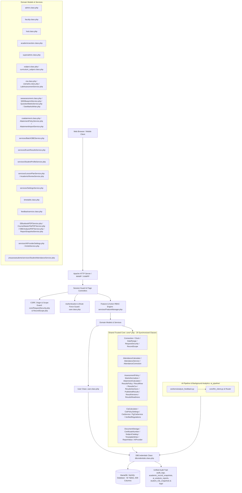

# JNTUACEA Class Attendance & CIA Marks Management System

Welcome to the technical and developer documentation for the JNTUACEA Class Attendance, Continuous Internal Assessment (CIA), Outcome-Based Education (OBE), and Institutional Governance System (`classattendance.in`).

This documentation suite provides a complete, ground-truth guide to the system's unified architecture, 92-table database schema (839 columns), 29 synchronized trusted core classes, role-based workflows, and operational procedures.

---

## 📚 Documentation Navigation

### 1. [Architecture](./architecture/)
- **[System Architecture Overview](./architecture/overview.md)**: High-level unified repository layout (`jntuacea/`, `jntuaceastudents/`, `ai_pipeline/`, `database/`, `tools/`, `tests/`, `docs/`), runtime environment (PHP 8.x / Apache / MAMP / XAMPP), CSRF & resource scope security (`\College\RequestSecurity` & `\College\RecordScope`), BCrypt migration, and unified forensic audit logging (`audit_logs`, `academic_record_snapshots`, `workflow_review_history`).
- **[Class Hierarchy & Object Model](./architecture/class-hierarchy.md)**: Complete object hierarchy rooted at `DBCredentials` and `User`, the 29 synchronized `\College\*` shared core classes (`core/`), 21 staff domain/enterprise service classes (`services/`), and 8 student portal services.
- **[Coding Standards & Conventions](./architecture/coding-standards.md)**: PHPDoc conventions, standardized method return arrays, atomic database transaction and snapshot patterns, MySQLi prepared statements, CSRF/scope enforcement, verified regulation profiles, and core parity synchronization.

### 2. [Database Documentation](./database/)
- **[Database Schema Reference](./database/schema.md)**: Complete field-by-field reference of all **92 tables** (839 columns), organized across 12 functional domains including `student_risk_snapshots` and `ai_analysis_reports`.
- **[Entity-Relationship Diagrams & Keys](./database/relationships.md)**: Mermaid ER diagrams, explicit foreign keys, and exact table join mechanisms (`users.username` joins, curriculum CO dual-sync, trusted core snapshots, risk snapshots, and AI analysis reports).
- **[Data Dictionary](./database/data-dictionary.md)**: Status flags, enumeration values (`assessment_components`), criteria operators, Bloom's taxonomy definitions, **28 feature toggle modules** (`system_feature_modules`), granular action permissions (`role_module_permissions`), academic settings categories, grade scales, custody statuses, risk categories, and AI report statuses.

### 3. [Workflows & Business Logic](./workflows/)
- **[Academic Regulations & Autonomous Course Structure Engine](./workflows/academic-regulations-and-course-structure.md)**: Statutory degree ceilings, category credit balancing math, course types, auto credit formula ($C = L + T + 0.5 \times \max(P, PR)$), semester roadmaps, live category compliance, BoS dossier export, and R23 Section 18 credit promotion simulation.
- **[Batch-Centric Governance & Full-Cycle OBE Hierarchy](./workflows/batch-obe-governance.md)**: Permanent student cohorts, Vision & Mission, PEOs, dual articulation mapping (PEO-Mission & PO-PEO), evidence-grounded macro-attainment rollups, and multi-batch longitudinal analytics.
- **[Results Publication & Automated SEE Marks Ingestion](./workflows/results-publication.md)**: Exam notifications (`DRAFT` &rarr; `REVIEWED` &rarr; `PUBLISHED`), bulk CSV results upload (`\College\ResultsCsv`), fractional grade points, student grade cards, dynamic SGPA, audited SEE marks auto-sync with replacement snapshots, and independent attainment CSV import (`attainmentimport.php`).
- **[Student Profile, Document Vault, Custody Ledger & Certificates](./workflows/student-profile-and-certificates.md)**: Student biographical dossier, private document vault (`COLLEGE_DOCUMENT_ROOT` via `\College\DocumentStorage`), physical original certificate custody tracking, atomic certificate numbering (`certificate_sequences`), and opaque CSPRNG token verification (`viewcertificate.php`).
- **[Attendance Marking & Diary Workflow](./workflows/attendance-marking.md)**: Subject selection via `Subject` class, hour validation, frictionless daily topic logging, atomic database transactions, shared attendance calculation engine (`\College\AttendanceService` & `\College\AttendanceCalculator`), and student attendance risk gauge.
- **[Lesson Planning, Reconciliation & Compliance Workflow](./workflows/lesson-plan-and-compliance.md)**: Lecture syllabus planning, bulk CSV upload, end-of-course daily topic reconciliation, serialized NBA Criterion 2.2 course completion compliance audits, closed-loop Continuous Quality Improvement (CQI) action tracking (`reviewqueue.php`), and evidence-based Action Taken Report (ATR) PDF generation (`download_atr.php`).
- **[Attendance Deletion & Correction Lifecycle](./workflows/attendance-deletion.md)**: Single-student 7-day attendance corrections with before/after snapshots (`facupdatestudentattendance.php`), faculty deletion requests, single-tier HOD review/approval with row locking and co-teaching ambiguity guards (`\College\AttendanceCorrection`), and institutional `audit_logs` history review.
- **[CIA & SEE Marks Entry & Calculations](./workflows/cia-marks-entry.md)**: Theory, Lab, PG, Project, and Semester End Exam (SEE) marks entry, atomic continuous laboratory rubrics engine (`Services\LabAssessmentService`), Bloom HOTS/LOTS advisory cognitive distribution meter, exact regulation policy resolution (`Services\SettingsService` & `academic_policy_versions`), protected SEE blueprint revisions (`Services\SEEBlueprintService`), regulation/subject attainment profiles (`superadminattainmentsettings.php`), official 14-page e-Bluebook (`Services\EBluebookPDFService`), and autonomous Course Master File (`Services\CourseMasterFilePDFService`).
- **[Timetable Management](./workflows/timetable-management.md)**: Class timing slots, effective date-range schedules, HOD allocation (`\College\TimetableWriter`), room/faculty/class conflict detection, support for parallel electives/labs within a class, and shared Open Electives across classes.
- **[CO-PO Attainment & OBE Analysis](./workflows/co-po-attainment.md)**: Course Outcomes (with curriculum master dual-sync), Bloom's levels, question-to-CO mapping, choice-aware and multi-CO equal-share attainment (`\College\AttainmentCalculator`), measured vs. estimated vs. missing coverage tracking, NBA SAR Form C-3 PDF export, PO/PSO Program Articulation Matrix, report snapshots (`report_snapshots`), and opt-in AI draft assistance (`aiassistance.php` & `tools/ai_worker.php`).
- **[Student Feedback & Institutional Surveys](./workflows/feedback-surveys.md)**: Course Outcomes indirect feedback, 5-domain Course End Surveys (CES), 19-criterion faculty appraisals, strict anonymity safeguards, and PDF/Excel exports.

### 4. [Roles & Permissions](./roles-and-permissions/)
- **[Master User, Feature, File & Database Table Mapping](./roles-and-permissions/user_feature_file_table_mapping.md)**: Exhaustive ground-truth mapping across all 6 roles, all 28 feature modules, physical PHP controllers/views/services/core classes, and all 92 database tables.
- **[Role Permission Matrix](./roles-and-permissions/matrix.md)**: Cross-cutting feature, route, module dependency, and granular action (`view`, `edit`, `approve`, `export`) access matrix across all six roles (`superadmin`, `admin`, `academic_section`, `hod`, `faculty`, `student`).
- **[Role Guides](./roles-and-permissions/role-guides.md)**: Comprehensive guide detailing responsibilities, script entrypoints, and underlying class methods for each role.
- **[Faculty User Manual](./user-guides/faculty-user-manual.md)**: Beginner-friendly instructions for 55 faculty features, with an [editable Word copy](./user-guides/faculty-user-manual.docx).
- **[Student User Manual](./user-guides/student-user-manual.md)**: Comprehensive user manual for students covering dashboard, attendance risk gauge, subject registers, timetable, 3-tier feedback surveys, results, document vault, and certificates.

### 5. [Deployment, Releases & Operations](./deployment/)
- **[Installation & Configuration](./deployment/configuration.md)**: System prerequisites, unified directory structure, `.env.php` configuration, private document storage (`COLLEGE_DOCUMENT_ROOT`), database initialization (92 tables, 839 columns), `ai_pipeline` configuration, and CLI management tools (`tools/`).
- **[Maintenance & Operations](./deployment/maintenance.md)**: Database backups, core parity checks (`tools/sync_core.php` across 29 classes), historical reconciliation (`tools/reconcile.php`), disposable test database provisioning (`tools/prepare_results_test.php`), bounded AI worker (`tools/ai_worker.php`), `ai_pipeline` health checks, log rotation, and transparent MD5-to-BCrypt password migration.
- **[Results Integration Upgrade (2026-10-15)](./results-upgrade-2026-10-15.md)**: Regular, supplementary, and revaluation result workflows, atomic SEE evidence synchronization on regular publication, withdrawal staleness handling, and student attempt GPA isolation.
- **[Production Database Upgrade (2026-10-14)](./deployment/production-migration-2026-10-14.md)**: Consolidated replay-safe production database migration guide (`database/migrations/archive/migration_production_complete_20261014.sql`) verifying baseline schema.
- **[Attainment & Optional AI Release (2026.10.08.2)](./deployment/attainment-ai-release-2026-10-08.md)**: Release notes and configuration runbook for attainment profiles, independent CSV imports, protected blueprint revisions, and opt-in AI draft assistance.
- **[Standardisation Release (2026.10.08.1)](./deployment/standardisation-release-2026-10-08.md)**: Validation, baseline preservation, and recovery runbook for the trusted-core standardisation release.

---

## 🏛️ System Overview

The system is built as a dual-portal modular PHP application (`jntuacea/` for Staff/Admin and `jntuaceastudents/` for Students) sharing a synchronized 29-class Trusted Core (`core/`), an AI analytics subsystem (`ai_pipeline/`), and a 92-table MariaDB/MySQL database serving JNTUA College of Engineering Ananthapuramu (Autonomous).

### Core Characteristics:
- **Presentation Layer**: Procedural PHP page controllers that verify `$_SESSION['role']`, enforce `FeatureManager` module/action guards, and render Bootstrap 4/5 user interfaces.
- **Shared Trusted Core (`core/`)**: 29 strict-typed PHP classes (`namespace College`) synchronized across `jntuacea/core/` and `jntuaceastudents/core/` via `tools/sync_core.php`, providing single-connection pooling, date range validation, automatic CSRF/Origin verification, ownership scope assertions, deterministic attendance/attainment/results math, verified regulation profiles, canonical result version diffing, transactional SEE synchronization, conflict-checked timetable writes, and private document storage.
- **Service/Domain Layer**: Object-oriented PHP model classes (`*.class.php` and `services/*.php`) handling business logic, database transactions, before/after snapshots, and input sanitization.
- **Data Access Layer**: `DBCredentials` backed by `\College\Connection::get()` providing `mysqli` prepared statements with transactional safety and unified `audit_logs` integration.
- **Authentication**: Session-based with brute-force lockouts, optional Cloudflare Turnstile verification, and transparent on-the-fly upgrading of legacy MD5 hashes to BCrypt hashes.
