# Class Hierarchy & Object Model

This document outlines the object-oriented structure, class inheritance trees, shared trusted core (`\College\*` namespace), enterprise service classes (`Services\*` namespace), and composition patterns used across both the Staff/Admin portal (`jntuacea/`) and the Student portal (`jntuaceastudents/`).

---

## 1. Class Inheritance & Architecture Diagram

```mermaid
classDiagram
    direction TB

    class DBCredentials {
        -static instance: DBCredentials
        #conn: mysqli
        #logs: Logs
        +__construct()
        +getInstance() DBCredentials
        +getConnection() mysqli
        #getHost() string
        #getDBUser() string
        #getDBPwd() string
        #getDBName() string
        +dbActivityLog(userId, action, details, role, entityType, entityId, targetUserId, status) bool
        +logAudit(userId, role, action, entityType, entityId, details, targetUserId, status) bool
        +getRegulationIdForSubject(subjects) string
        +assertSubjectScope(subjectId) void
        +assertClassScope(classId) void
        +assertStudentScope(studentId, subjectId) void
    }

    class User {
        +id: int
        +username: string
        +name: string
        +role: string
        #status: int
        +__construct()
        +isActive() bool
        +authenticate(username, password) bool
        +verifyPwd(id, password) bool
        +updatePassword(id, newPassword, role) array
        +getDeptID() int
        +getFacID() int
    }

    class SuperAdmin {
        -acad_years: AcademicYears
        -programs: Programs
        -departments: Departments
        -regulations: Regulations
        -attendance_rules: AttendanceRules
        +__construct()
        +addAcademicYear(...)
        +addClass(...)
        +addSpecialization(...)
        +generateClassName(spec, yearsem, section) string
    }

    class Admin {
        +getStudentByUsername(username) array
        +getFacultyByUsername(username) array
        +addStudent(rollno, name, class_id, date_of_joining) array
        +getAllStudentsByClass(class_id) array
        +addFaculty(data) array
        +reorderDepartmentFaculties(dept_id, ordered_ids) array
        +moveFacultySortOrder(faculty_id, direction) array
        +resetFacultySortOrderToDefault(dept_id) array
        +addSubject(data) array
        +addFacultySubjectMapping(faculty_id, sub_id) array
        +addStudentSubjectMapping(stu_id, sub_id) array
    }

    class AcademicSection {
        +getStudentByUsername(username) array
        +getFacultyByUsername(username) array
        +getAllBuildings() array
        +addBuilding(name) array
        +getAllHallsByBuilding(building_id) array
        +addHall(building_id, name) array
    }

    class HOD {
        +getSubjectsByDept(dept_id) array
        +getFacultiesByDept(dept_id) array
        +mapFacultyToSubject(fac_id, sub_id) array
        +mapStudentsToSubject(sub_id, student_ids) array
        +getAttendanceDeleteRequests(dept_id) array
        +processDeleteRequest(request_id, action) array
        +getAttendanceDeleteAuditLogs(dept_id) array
    }

    class Faculty {
        +getSubjectsByFacultyId(faculty_id) array
        +getUnmarkedHours(sub_id, date) array
        +markAttendance(hours, studentIds, sub_id, date, diary, faculty_id) array
        +submitAttendanceDeleteRequest(faculty_id, sub_id, date, hour, reason) array
        +addDairy(hours, sub_id, date, diary, faculty_id) array
        +getAllMappedStudents(sub_id) array
    }

    class FeatureManager {
        -static instance: FeatureManager
        +getInstance() FeatureManager
        +loadModules() void
        +getAllModules() array
        +isModuleEnabled(moduleKey) bool
        +canRoleAccess(moduleKey, role) bool
        +canRoleWrite(moduleKey, role) bool
        +canAction(module, action, role) bool
        +requireAction(module, action) void
        +savePermission(module, role, action, allowed) void
        +updateModule(...) array
    }

    class SettingsService {
        -static instance: SettingsService
        +getInstance() SettingsService
        +get(regCode, key, default) mixed
        +getSetting(regCode, key) array
        +getAllSettingsByRegulation(regCode) array
        +set(regCode, key, value, userId, ip) array
    }

    class BatchOBEService {
        -static instance: BatchOBEService
        +getInstance() BatchOBEService
        +getBatches(programId, activeOnly) array
        +createBatch(data, userId) array
        +saveMasterVisionMission(...) array
        +saveMasterPEO(...) array
        +savePeoMissionMatrix(deptId, matrix, userId) array
        +savePoPeoMatrix(deptId, matrix, userId, regId) array
        +getBatchMacroAttainment(batchId, deptId) array
        +computePOPSOArticulationMatrix(batchId, programId, departmentId) array
        +getLongitudinalCohortAnalytics(deptId) array
    }

    class ExamResultsService {
        -static instance: ExamResultsService
        +getInstance() ExamResultsService
        +createNotification(data, userId) array
        +previewCsv(notificationId, csvPath) array
        +importCsv(notificationId, csvPath, userId) array
        +reviewNotification(notificationId, userId, remarks) array
        +togglePublishStatus(id, status, userId) array
        +syncResultsToSeeMarks(notificationId, subjectId, userId, replaceExisting, reason) array
        +getNotificationCiaDiscrepancies(notificationId) array
        +evaluateCreditPromotionSimulation(classId, regulationCode) array
    }

    class StudentProfileService {
        -static instance: StudentProfileService
        +getInstance() StudentProfileService
        +getProfile(rollNo) array
        +saveProfile(rollNo, data, userId) array
        +uploadDocument(rollNo, docType, file, userId) array
        +deleteDocument(docId, rollNo, actorId) array
        +addCustodialRecord(data, userId) array
        +requestCertificate(rollNo, certType, purpose, copies) array
        +updateCertificateStatus(reqId, status, remarks, userId) array
        +verifyCertificateByToken(reqId, token) array
    }

    class CollegeCore["College\* Shared Trusted Core (22 Classes)"] {
        +Connection::get() mysqli
        +DateRange::validate(start, end) void
        +RequestSecurity::guardResources(conn) void
        +RecordScope::subject/classRecord/student(...) void
        +AttendanceCalculator::evaluate(...) array
        +AttendanceService::classSummary / studentSummary(...) array
        +AttendanceCorrection::updateStudentStatuses / reviewDeleteRequest(...) void
        +AssessmentPolicy::requireRegulationSettings / recordVersion(...) array
        +MarksNormalizer::scaleMarks / selectChoiceQuestions(...) array
        +AttainmentCalculator::calculateExternalAttainment(...) array
        +ResultsPolicy::forSubject(...) array
        +ResultRow::normalize(...) array
        +ResultsCsv::validate(...) array
        +ResultsSeeSync::subject / withdraw(...) array
        +PublishedResults::forStudent(...) array
        +TimetableWriter::add(...) int
        +DocumentStorage::store / open(...) array
        +CertificateNumber::next(...) string
        +AIProvider::completeJson(...) array
    }

    %% Inheritance relationships
    DBCredentials <|-- User
    DBCredentials <|-- Subject
    DBCredentials <|-- SettingsService
    DBCredentials <|-- FeatureManager
    DBCredentials <|-- BatchOBEService
    DBCredentials <|-- ExamResultsService
    DBCredentials <|-- StudentProfileService
    DBCredentials <|-- LessonPlanService
    DBCredentials <|-- AcademicReviewService
    DBCredentials <|-- AttainmentPolicyService
    DBCredentials <|-- AttainmentImportService
    DBCredentials <|-- LabAssessmentService
    DBCredentials <|-- QuestionMarksService
    DBCredentials <|-- SEEBlueprintService
    DBCredentials <|-- SeeMarksWriter
    DBCredentials <|-- ReportSnapshotService
    DBCredentials <|-- AIProviderSettings
    DBCredentials <|-- AIJobService

    User <|-- SuperAdmin
    User <|-- Admin
    User <|-- AcademicSection
    User <|-- HOD
    User <|-- Faculty
    User <|-- CIA
    User <|-- Timetable
    User <|-- Syllabus
    User <|-- CurriculumSubject
    User <|-- AttendanceRules
    User <|-- COAttainment
    User <|-- SEEAssessment

    DBCredentials ..> CollegeCore : "delegates connection, security & core math"
```

---

## 2. Base Classes Detailed

### 2.1 `DBCredentials` (`jntuacea/dbcredentials.class.php` & `jntuaceastudents/dbcredentials.class.php`)
- **Role**: Root database connection manager, request security bootstrapper, scope verifier, and unified forensic audit logger.
- **Connection Pattern**: Uses `\College\Connection::get()` (`core/Connection.php`) to guarantee a single shared `mysqli` connection per HTTP request or CLI run.
- **Request Security Bootstrap**: Automatically invokes `\College\RequestSecurity::guardResources($this->conn)` on instantiation, enforcing CSRF verification, same-origin checks, and resource ownership guards.
- **Environment Resolution**: Loads `.env.php` from the portal directory or parent repository root (`dirname(__DIR__) . '/.env.php'`).
- **Unified Audit Logging**: `dbActivityLog($userId, $action, $details, $role, $entityType, $entityId, $targetUserId, $status)` and `logAudit(...)` write directly to the unified `audit_logs` table using the signed-in `users.id` (`$_SESSION['userid']`), `username`, `role`, `ip_address`, and `user_agent`.
- **Policy & Scope Helpers**:
  - `getRegulationIdForSubject(int|array $subjects): string`: Resolves and validates that the specified course offerings belong to a single exact `regulations.id`.
  - `assertSubjectScope(int $subjectId): void`, `assertClassScope(int $classId): void`, `assertStudentScope(int $studentId, ?int $subjectId = null): void`: Delegate ownership checks to `\College\RecordScope`.

### 2.2 `User` (`jntuacea/user.class.php` & `jntuaceastudents/user.class.php`)
- **Role**: Base identity and authentication service for all authenticated actors.
- **Inherits From**: `DBCredentials`.
- **Core Methods**:
  - `authenticate($username, $password)`: Checks username and password (`status = 1`), enforces brute-force lockout counters, transparently upgrades legacy MD5 hashes to `PASSWORD_BCRYPT`, and logs authentication events.
  - `verifyPwd($id, $password)`: Verifies current password before permitting credential updates.
  - `updatePassword($id, $newPassword, $role)`: Hashes new password with `PASSWORD_BCRYPT` and updates `users` table.
  - `getDeptID()`: Resolves `departments.id` for logged-in HOD.
  - `getFacID()`: Resolves `faculties.id` for logged-in Faculty.

---

## 3. Domain Model Subclasses & Services

### 3.1 Role Service Models
- **`SuperAdmin`** (`jntuacea/superadmin.class.php`): System-wide master data manager. Configures academic years, programs, statutory regulations and degree ceilings (`Regulations`), departments (`Departments`), specializations, classes (including section assignment via `generateClassName()`), class timings, and attendance rules (`AttendanceRules`).
- **`Admin`** (`jntuacea/admin.class.php`): Institution administrator (Principal). Enrolls students, manages faculty profiles, manages department-wise custom faculty sort ordering (`faculties.sort_order` via `reorderDepartmentFaculties()`, `moveFacultySortOrder()`, `resetFacultySortOrderToDefault()`), sets student status, maps faculty/students to subjects, and resets passwords with mandatory audit remarks.
- **`AcademicSection`** (`jntuacea/academicsection.class.php`): Academic affairs office. Manages buildings, examination halls, statutory regulations reference hub, autonomous course structure & BoS roadmaps, master curriculum subject catalogs (`CurriculumSubject`), syllabus files, and student/faculty password resets.
- **`HOD`** (`jntuacea/hod.class.php`): Department head. Oversees departmental subjects, assigns faculty to subjects (`faculty_sub`), maps students (`student_sub`), manages timetable schedules (`\College\TimetableWriter`), reviews/approves faculty attendance deletion requests (`\College\AttendanceCorrection`), and reviews end-of-course syllabus completion audits and CQI actions (`Services\AcademicReviewService`).
- **`Faculty`** (`jntuacea/faculty.class.php`): Instructors. Marks daily attendance with frictionless period topic logging, performs 7-day single-student attendance corrections with mandatory reasons (`\College\AttendanceCorrection`), maintains teaching diary entries, logs exceptional attendance, submits attendance deletion requests, and submits syllabus completion compliance audits.
- **`Student`** (`jntuaceastudents/student.class.php`): Student portal identity and Legacy helper model, complemented by specialized services in `jntuaceastudents/services/`.

### 3.2 Subject & Curriculum Management Models
- **`Subject`** (`jntuacea/subject.class.php`): Dedicated service model managing active subject offerings (`subjects` table), elective choice groups, laboratory batch divisions (`subjects.group_name`), and links to master curriculum catalog courses (`curr_sub_id`).
- **`CurriculumSubject`** (`jntuacea/curriculum_subject.class.php`): Academic section catalog manager for central course templates (`curriculum_subjects`), master Course Outcomes (`curriculum_course_outcomes`), and master CO-PO mappings (`curriculum_co_po_mapping`) with dual-sync to active course offerings. Supports deterministic AICTE/UGC credit calculation ($C = L + T + 0.5 \times \max(P, PR)$) and automatic assessment scheme pre-filling from `regulation_course_types`.
- **`Syllabus`** (`jntuacea/syllabus.class.php`): Manages syllabus units and document metadata.

### 3.3 Academic, Assessment & OBE Service Models
- **`CIA`** (`jntuacea/cia.class.php`) & **`CIAMarks`** (`jntuacea/ciamarks.class.php`): Handle Continuous Internal Assessment marks entry, calculations, condensed reports, and question-level scoring across UG Theory, Lab, PG, and Project subjects.
- **`AssessmentStructure`** (`jntuacea/assessmentstructure.class.php`): Configures assessment components (`assessment_components`), question labels/marks (`assessment_questions`), and Bloom taxonomy mapping (`blooms_levels`).
- **`CourseOutcome`** (`jntuacea/courseoutcome.class.php`): Manages Course Outcome definitions (`course_outcomes`), curriculum master linking (`curr_sub_id`), and CO-PO/PSO correlation matrices (`co_po_mapping`).
- **`COAttainment`** (`jntuacea/coattainment.class.php`) & **`FacCIAAnalysis2`** (`jntuacea/facciaanalysis2.class.php`): Choice-aware analytical calculators for direct and indirect CO-PO attainment matrices and visual charts.
- **`SEEAssessment`** (`jntuacea/seeassessment.class.php`): Handles Semester End Examination structures, question-level entries, direct ledger marks, and external attainment calculation, delegating core normalization and attainment math to `\College\MarksNormalizer` and `\College\AttainmentCalculator`.
- **`LearningAnalytics`** (`jntuacea/learninganalytics.class.php`): Computes OBE learning progression, score distributions, and accreditation metrics.
- **`CIADataExchange`** (`jntuacea/ciadataexchange.class.php`): Manages Excel/CSV template generation, bulk import sanitization, and data export.
- **`Timetable`** (`jntuacea/timetable.class.php` & `jntuaceastudents/timetable.class.php`): Resolves effective timing templates (`class_timing_schedule`), weekly class timetables, and faculty schedules.
- **`AttendanceRules`** (`jntuacea/attendancerules.class.php`): Manages regulatory attendance condonation and detention thresholds (`attendance_rules`).
- **`FeedbackService`** (`jntuacea/feedbackservice.class.php`): Multi-granularity analytical service for Course Outcome (CO) indirect surveys, 5-domain Course End Surveys (CES), and 19-criterion anonymous Student Faculty Appraisals.

### 3.4 Shared Trusted Core Classes (`jntuacea/core/` & `jntuaceastudents/core/` — `namespace College`)
Maintained in `jntuacea/core/` and synchronized to `jntuaceastudents/core/` via `php tools/sync_core.php` (22 classes):
1. **`Connection`** (`core/Connection.php`): Singleton per-request `mysqli` connection manager (`utf8mb4`), supporting CLI test database overrides (`CEA_DB_NAME`).
2. **`Clock`** (`core/Clock.php`): Timezone-aware institutional clock defaulting to `Asia/Kolkata`.
3. **`DateRange`** (`core/DateRange.php`): Validates paired `YYYY-MM-DD` start and end dates before binding them as SQL parameters in attendance and reporting queries.
4. **`RequestSecurity`** (`core/RequestSecurity.php`): Generates and verifies per-session CSRF tokens (`_csrf`), enforces same-origin `Origin`/`Referer` headers on mutating requests, injects `_csrf` tokens into internal POST forms and same-origin `fetch`/`XHR` calls via output buffering, and runs `guardResources()` to enforce record ownership scope on request parameters.
5. **`RecordScope`** (`core/RecordScope.php`): Enforces role- and ownership-based access boundaries for `subject()`, `classRecord()`, `student()`, `document()`, `certificate()`, and `curriculum()`.
6. **`AttendanceCalculator`** (`core/AttendanceCalculator.php`): Evaluates conducted vs. attended hours, sanctioned permissions, single-subject minimum thresholds, and overall condonation/detention boundaries without premature rounding, returning `ELIGIBLE`, `CONDONATION`, `DETAINED`, `PROVISIONAL`, or `POLICY_REVIEW`.
7. **`AttendanceService`** (`core/AttendanceService.php`): Unified attendance aggregation engine for individual students (`studentSummary()`) and class cohorts (`classSummary()`), honoring `students.date_of_joining`, `student_sub` mappings, `student_permissions`, and unrecorded timetable periods (`missing_periods`).
8. **`AttendanceCorrection`** (`core/AttendanceCorrection.php`): Executes atomic 7-day single-student attendance corrections (`updateStudentStatuses()`) and row-locked HOD deletion request reviews (`reviewDeleteRequest()`) with co-teaching ambiguity guards, `academic_record_snapshots`, `workflow_review_history`, and `audit_logs`.
9. **`AssessmentPolicy`** (`core/AssessmentPolicy.php`): Resolves exact regulation settings by `regulation_id` (refusing ambiguous regulation codes or cross-regulation fallbacks) and records immutable SHA-256 policy versions in `academic_policy_versions`.
10. **`MarksNormalizer`** (`core/MarksNormalizer.php`): Normalizes gross-to-net marks (`scaleMarks()`), resolves student question choices once per choice group (`selectChoiceQuestions()`), shares multi-CO question weights equally (`EQUAL_SHARE`), and validates/estimates grade intervals (`GRADE_ESTIMATE`).
11. **`AttainmentCalculator`** (`core/AttainmentCalculator.php`): Computes external/SEE Course Outcome attainment across detailed question scores, aggregate direct/imported scores, and grade-derived estimates, reporting `measured_students`, `estimated_students`, `missing_students`, and `provisional` status separately.
12. **`ResultsPolicy`** (`core/ResultsPolicy.php`): Resolves a course offering's assessment profile and regulation-specific `grade_bands_json` without borrowing a global grade scale.
13. **`ResultRow`** (`core/ResultRow.php`): Normalizes individual result rows against course policy, enforcing agreement between grade letters, fractional grade points, earned credits, and sentinel marks (`im = -7`, `em = -1`, `em = -5`, `AB`, `MP`, `WH`).
14. **`ResultsCsv`** (`core/ResultsCsv.php`): Validates and parses `REGULAR`, `SUPPLEMENTARY`, and `REVALUATION` examination result CSV files atomically, matching regular notifications to exact offerings and supplementary/revaluation notifications to unambiguous historical cohort offerings.
15. **`ResultsSeeSync`** (`core/ResultsSeeSync.php`): Synchronizes published regular-exam SEE evidence inside the caller's transaction while preserving manual/question-wise SEE marks, and marks dependent SEE evidence stale (`is_stale = 1`) when a notification is withdrawn.
16. **`PublishedResults`** (`core/PublishedResults.php`): Student-scoped published results reader that isolates attempts by notification, resolves exact course offerings, and computes SGPA / attempt GPA (or pending GPA when results are withheld).
17. **`SubjectCatalog`** (`core/SubjectCatalog.php`): Safely resolves optional `curriculum_subjects` linkage for offered courses without failing when historical links are absent or mismatched.
18. **`TimetableWriter`** (`core/TimetableWriter.php`): Mutex-locked (`GET_LOCK`) transactional timetable slot insertion enforcing class, room, and faculty conflict checks while permitting multiple distinct subjects per slot within a class (electives/labs) and shared Open Electives across classes in the same room/faculty.
19. **`DocumentStorage`** (`core/DocumentStorage.php`): Manages private document storage outside the web root (`COLLEGE_DOCUMENT_ROOT` with `private://` URIs) and authenticated streaming of retained legacy documents.
20. **`CertificateNumber`** (`core/CertificateNumber.php`): Generates concurrency-safe sequential certificate numbers (`certificate_sequences` with `FOR UPDATE`).
21. **`ReportValue`** (`core/ReportValue.php`): Value object representing measured, provisional, or unavailable report figures.
22. **`AIProvider`** (`core/AIProvider.php`): Strict HTTP client for `OLLAMA` (private/loopback HTTP/HTTPS) and `OPENAI_COMPATIBLE` (public HTTPS) Chat Completions endpoints, rejecting redirects, link-local SSRF targets, numerical prose hallucinations, and ungrounded evidence references.

### 3.5 Enterprise Governance, Assessment, Review & AI Services (`jntuacea/services/` — `namespace Services`)
- **`FeatureManager`** (`services/FeatureManager.php`): Singleton gatekeeper managing **28 system modules** (`system_feature_modules`, normalizing `MOD_ATTENDANCE_DELETE_REQUESTS` to `MOD_ATT_REQUESTS`), inter-module dependencies (`isModuleEnabled`), role visibility (`VISIBLE`, `READONLY`, `HIDDEN`), and granular action-level RBAC (`role_module_permissions`: `view`, `edit`, `approve`, `export` via `canAction()`, `requireAction()`, `savePermission()`).
- **`SettingsService`** (`services/SettingsService.php`): Regulation-scoped parameter manager (`academic_settings`), logging every mutation to `academic_settings_audit` and `academic_policy_versions`.
- **`LessonPlanService`** (`services/LessonPlanService.php`): Manages lecture-by-lecture syllabus plans (`lesson_plans`), bulk CSV import, diary-to-plan reconciliation (`diary.lesson_plan_id`), and serialized NBA Criterion 2.2 course completion compliance submissions (`course_completion_audits`) that lock upon submission until returned by the HOD.
- **`AcademicReviewService`** (`services/AcademicReviewService.php`): Powers the unified Faculty/HOD review queue (`reviewqueue.php`), managing HOD review of course completion audits (`reviewAudit()`), CQI action review/return (`reviewCqi()`), faculty CQI revision and execution evidence recording (`reviseCqi()`, `recordCqiExecution()`), HOD CQI verification and closure (`closeCqi()`), `workflow_review_history` logging, and snapshot-backed Action Taken Report (ATR) PDF generation (`renderAtrPdf()`, `download_atr.php`).
- **`LabAssessmentService`** (`services/LabAssessmentService.php`): Validates and atomically commits UG laboratory continuous evaluation marks (`uglab_internal_assessment_marks`) together with criteria-level rubric evaluations (`lab_rubric_evaluations`).
- **`SEEBlueprintService`** (`services/SEEBlueprintService.php`): Manages SEE question paper blueprints (`facseecompques.php`), requiring confirmation and a reason when revising blueprints with existing marks, archiving prior state to `academic_record_snapshots`, preserving retained question scores, and invalidating stale consolidated totals until reconsolidated.
- **`QuestionMarksService`** (`services/QuestionMarksService.php`): Validates and records detailed question-by-question marks (`student_marks`) and reconsolidates SEE totals using `\College\MarksNormalizer`.
- **`SeeMarksWriter`** (`services/SeeMarksWriter.php`): Records direct and consolidated external marks in `external_assessment_marks` with before/after snapshot auditing.
- **`AttainmentPolicyService`** (`services/AttainmentPolicyService.php`): Manages regulation/subject-type attainment profiles (`attainment_policies`) and per-subject overrides (`subject_attainment_overrides`) configured via `superadminattainmentsettings.php`.
- **`AttainmentImportService`** (`services/AttainmentImportService.php`): Previews and commits external aggregate, grade-only, or question-wise CSV evidence (`attainment_import_batches`, `attainmentimport.php`) independently of examination result publication.
- **`BatchOBEService`** (`services/BatchOBEService.php`): Manages master Vision/Mission (`vision_mission`), PEOs (`peos`), PEO-Mission (`peo_mission_mapping`) and PO-PEO (`po_peo_mapping`) articulation matrices, student cohorts (`student_batches`), evidence-grounded Macro-Attainment rollups, PO/PSO Program Articulation Matrix (`computePOPSOArticulationMatrix`), and longitudinal cohort analytics (`getLongitudinalCohortAnalytics`).
- **`ExamResultsService`** (`services/ExamResultsService.php`): Manages examination notifications (`exam_notifications` workflow: `DRAFT` &rarr; `REVIEWED` &rarr; `PUBLISHED`), CSV preview and import (`exam_results`), CIA vs. uploaded internal discrepancy audits, audited SEE marks synchronization (`syncResultsToSeeMarks`), and R23 Section 18 credit promotion simulation.
- **`StudentProfileService`** (`services/StudentProfileService.php`): Manages student biographical dossiers (`student_profiles`), private cloud document vault (`student_documents` with soft-delete retention), physical certificate custody ledger (`student_custodial_records`), statutory certificate applications (`student_certificate_requests`), atomic numbering (`\College\CertificateNumber`), and opaque token verification (`viewcertificate.php`).
- **`ReportSnapshotService`** (`services/ReportSnapshotService.php`): Persists and retrieves immutable report snapshots (`report_snapshots`) with scope, policy, and metric hashes.
- **`AIProviderSettings`** (`services/AIProviderSettings.php`) & **`AIJobService`** (`services/AIJobService.php`): Manage opt-in AI provider configurations (`ai_providers`, `superadminaiproviders.php`), per-user task consent (`ai_job_consents`), curated PII-free CO summary job queuing (`ai_jobs`, `aiassistance.php`), bounded CLI worker execution (`tools/ai_worker.php`), lease recovery, and human review/approval of generated narratives and ATR proposals.

### 3.6 Accreditation Dossier & Export Services (`jntuacea/services/`)
- **`EBluebookPDFService`** (`services/EBluebookPDFService.php`): Strictly immune TCPDF generator producing the official 14-page operational course e-Bluebook (`download_bluebook.php`: Sections 1, 2A, 2B, 2C, 3, and 4).
- **`CourseMasterFilePDFService`** (`services/CourseMasterFilePDFService.php`): Generates the 7-section Autonomous Course Master File (`download_coursemasterfile.php`), accurately reflecting persisted faculty submission and HOD review statuses from `course_completion_audits`.
- **`OBEAnalysisPDFService`** (`services/OBEAnalysisPDFService.php`): Generates NBA/NAAC Outcome-Based Education dossiers and standalone NBA SAR Form C-3 reports (`download_obe_analysis.php`).
- **`EnhancedPDFService`** (`services/EnhancedPDFService.php`) & **`FeedbackExcelService`** (`services/FeedbackExcelService.php`): Generate executive PDF dossiers (`download_feedback_enhanced.php`) and multi-tab Excel workbooks (`download_feedback_excel.php`) for student feedback surveys.

### 3.7 Student Portal Services (`jntuaceastudents/services/`)
- **`BaseService`** (`jntuaceastudents/services/BaseService.php`): Base service wrapper for student portal modules.
- **`StudentRepository`** (`jntuaceastudents/services/StudentRepository.php`): Data access layer retrieving student enrollment, class, and subject mappings.
- **`StudentAttendanceService`** (`jntuaceastudents/services/StudentAttendanceService.php`): Delegates to `\College\AttendanceService` to compute real-time student attendance percentages, Safe Margin, and Recovery Periods (`studenthome.php`, `studentsubatt.php`).
- **`StudentAssessmentService`** (`jntuaceastudents/services/StudentAssessmentService.php`): Retrieves student CIA marks across UG Theory, Lab, PG, and Project courses.
- **`StudentFeedbackService`** (`jntuaceastudents/services/StudentFeedbackService.php`): Handles student submission of Course Outcome surveys (`student_co_feedback`), 5-domain Course End Surveys (`student_ces_feedback`), and anonymous Faculty Appraisals (`student_faculty_feedback`).
- **`StudentProfileService`** (`jntuaceastudents/services/StudentProfileService.php`), **`ExamResultsService`** (`jntuaceastudents/services/ExamResultsService.php`), and **`FeatureManager`** (`jntuaceastudents/services/FeatureManager.php`): Student-portal counterparts for biographical profiles, private document vault uploads, certificate requests, semester grade cards (with fractional grade points), and feature visibility checks.
