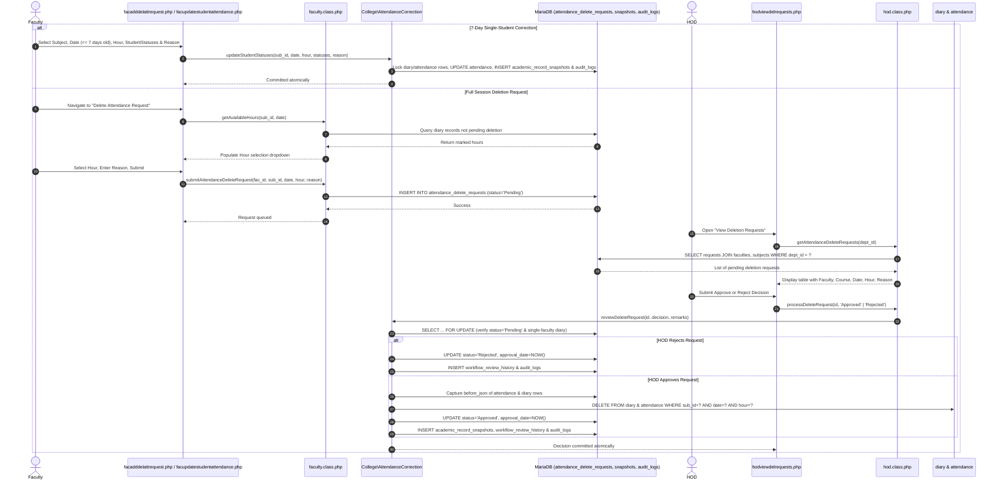

# Attendance Deletion & Correction Lifecycle

This document describes the governance, snapshot preservation, audit control, and execution sequence for single-student attendance corrections and session deletion requests.

---

## 1. Overview & Policy Rationale

To maintain academic integrity and prevent unauthorized or unaudited alteration of official attendance records:
- **7-Day Single-Student Status Correction (`facupdatestudentattendance.php`)**: Faculty may correct individual student `P`/`A` statuses for sessions conducted within the last 7 calendar days (`\College\AttendanceCorrection::updateStudentStatuses()`). Every correction requires a non-empty justification reason (`reason`) and atomically persists a before/after snapshot in `academic_record_snapshots` (`entity_type = 'attendance_session'`) alongside an `ATTENDANCE_STUDENT_UPDATE` record in `audit_logs`.
- **No Direct Session Deletion by Faculty**: Faculty members cannot directly delete previously submitted attendance sessions (`attendance` & `diary` periods).
- **Audited Deletion Request Workflow (`facadddelattrequest.php`)**: Faculty must submit an explicit deletion request detailing the course (`subject_id`), `date`, `hour`, and justification (`reason`).
- **Row-Locked HOD Approval Gate (`hodviewdelrequests.php`)**: Only the Head of the Department (HOD) can approve or reject the request (`\College\AttendanceCorrection::reviewDeleteRequest()`). The review locks the request row (`FOR UPDATE`), rejects repeated reviews, refuses ambiguous co-teaching deletions (where multiple faculty diary entries exist for the same subject, date, and hour), snapshots the before/after attendance and diary rows in `academic_record_snapshots` (`entity_type = 'attendance_delete_request'`), records the state transition in `workflow_review_history`, and logs to `audit_logs` within a single transaction.

---

## 2. Sequence Diagram

---

## 3. Database Table Structure (`attendance_delete_requests`)

| Column | Type | Description |
|---|---|---|
| `id` | `int(11)` PK | Auto-increment unique request ID |
| `faculty_id` | `int(11)` FK | References `faculties.id` (requester) |
| `subject_id` | `int(11)` FK | References `subjects.id` |
| `date` | `date` | Class date (`YYYY-MM-DD`) |
| `hour` | `int(11)` | Period number (1 to 7) |
| `reason` | `text` | Faculty justification for why deletion is requested |
| `status` | `enum('Pending','Approved','Rejected')` | Current review status (`Pending` by default) |
| `request_date` | `timestamp` | Submission timestamp |
| `approval_date`| `timestamp` | HOD decision timestamp (`NULL` while pending) |

*(Note: Reviewer transition remarks and actor IDs are persisted in `workflow_review_history` and `audit_logs`, while purged attendance/diary rows are preserved in `academic_record_snapshots`.)*

---

## 4. Method Reference

### Shared Core (`core/AttendanceCorrection.php` — `\College\AttendanceCorrection`)
- `updateStudentStatuses(int $subjectId, string $date, int $hour, array $statuses, string $reason): void`: Enforces scope, 7-day correction window, and mandatory reason; updates changed student attendance rows; writes before/after JSON to `academic_record_snapshots` (`attendance_session`) and logs `ATTENDANCE_STUDENT_UPDATE` to `audit_logs`.
- `reviewDeleteRequest(int $requestId, string $decision, string $remarks = ''): void`: Locks the request row (`FOR UPDATE`), verifies `Pending` state, prevents ambiguous co-teaching period deletion, snapshots affected `attendance` and `diary` rows into `academic_record_snapshots` (`attendance_delete_request`), deletes the period rows on approval, and logs to `workflow_review_history` and `audit_logs`.

### Faculty Model (`faculty.class.php`)
- `submitAttendanceDeleteRequest($faculty_id, $sub_id, $date, $hour, $reason)`: Validates period and inserts a new row into `attendance_delete_requests` with status `'Pending'`.
- `getAvailableHours($sub_id, $date)`: Returns all hours for which attendance was marked in `diary` that do **not** already have a pending deletion request.
- `getSubmittedRequests($faculty_id)`: Fetches historical deletion requests submitted by that faculty member and their current statuses.

### HOD Model (`hod.class.php`)
- `getAttendanceDeleteRequests($dept_id)`: Fetches pending deletion requests for faculty members belonging to the HOD's department.
- `processDeleteRequest($request_id, $action)`: Delegates to `\College\AttendanceCorrection::reviewDeleteRequest()` to atomically process the approval or rejection.
- `getAttendanceDeleteAuditLogs($dept_id)`: Queries the institutional `audit_logs` table for all deletion request events (`ATTENDANCE_DELETE_REQUEST_APPROVED`, `ATTENDANCE_DELETE_REQUEST_REJECTED`) within the department.

---

## 5. Institutional Governance & Feature Normalization

- **Module Key Normalization**: `FeatureManager` normalizes the legacy alias `MOD_ATTENDANCE_DELETE_REQUESTS` to `MOD_ATT_REQUESTS` so both keys resolve to a single consistent module policy.
- **Single-Tier HOD Authorization Preserved**: Approval remains under departmental HOD authority (`hodviewdelrequests.php`) with granular action check `FeatureManager::requireAction('MOD_ATT_REQUESTS', 'approve')`.
- **Audit History Tab in `hodviewdelrequests.php`**: Department heads can switch between the "Pending Requests" queue and the "Audit Trail History" tab to inspect historical deletion decisions, faculty justifications, and decision timestamps.
