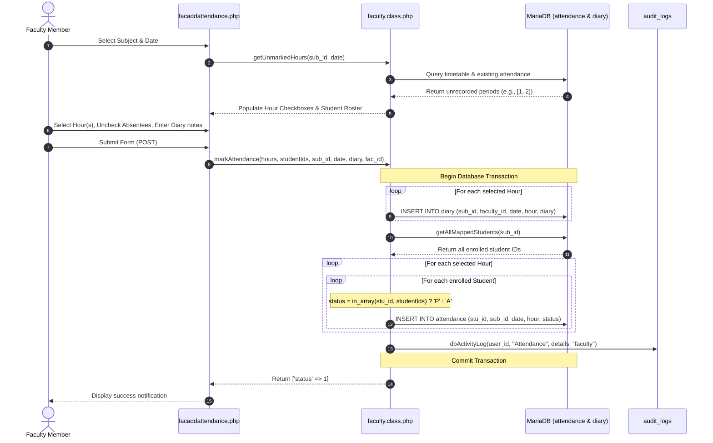

# Attendance Marking & Diary Entry Workflow

This document describes the complete lifecycle of marking daily class attendance, entering teaching diary logs, and computing regulatory attendance standing and student risk metrics.

---

## 1. Workflow Architecture & Sequence



---

## 2. Step-by-Step Execution

### Step 1: Subject Selection & Unmarked Hours Fetch
- Faculty logs in and navigates to `facaddattendance.php` (guarded by `FeatureManager::requireAccess('MOD_ATTENDANCE')`).
- The system loads the faculty's assigned subjects via the `Subject` service (`Subject::getOfferedSubjectsByFaculty($faculty_id)`).
- When a subject and date are picked, an AJAX request invokes `Faculty::getUnmarkedHours($sub_id, $date)`.
- The method compares the class timing periods configured in `class_timing_schedule` against periods already marked in `attendance` for that `sub_id` and `date`.
- Only unrecorded hours are displayed as selectable checkboxes, preventing accidental duplicate attendance submissions.

### Step 2: Student Enrollment Verification
- The roster displayed to the faculty is populated from the `student_sub` junction table via `Faculty::getMappedStudents($sub_id)`.
- By default, all enrolled students are pre-checked as "Present".
- The faculty unchecks the checkboxes corresponding to students who are absent.

### Step 3: Frictionless Daily Teaching Diary
- Faculty enters a natural free-text summary of syllabus topics covered during the selected periods.
- **Zero-Friction Design**: Daily marking is 100% focused on natural topic logging with zero friction (no mandatory CO selection or popup prompts during daily attendance).
- Lesson plan alignment and CO tagging are performed systematically at the end of the semester during the reconciliation phase (`faclessonplanreconciliation.php`), linking `diary.lesson_plan_id` to planned lectures.
- Submitting attendance without a diary entry is prevented by client-side and server-side validation.

### Step 4: Transactional Database Insertion
When the faculty submits the form:
1. `Faculty::markAttendance()` starts a transaction: `$this->conn->begin_transaction()`.
2. A record is inserted into the `diary` table for each selected period:
   ```sql
   INSERT INTO diary (sub_id, faculty_id, date, hour, diary) VALUES (?, ?, ?, ?, ?);
   ```
3. All enrolled students for that subject are fetched via `getAllMappedStudents($sub_id)`.
4. For every selected period, an attendance record is created for every mapped student:
   ```sql
   INSERT INTO attendance (stu_id, sub_id, date, hour, status) VALUES (?, ?, ?, ?, ?);
   ```
   - If the student's ID was in the checked array, `status = 'P'`.
   - If not checked, `status = 'A'`.
5. An audit entry is recorded in `audit_logs` via `dbActivityLog()`.
6. `$this->conn->commit()` is executed. If any insert fails, `$this->conn->rollback()` runs, preventing partial or inconsistent data.

---

## 3. Exceptional Attendance & 7-Day Single-Student Corrections

- **Exceptional Attendance (`facexceptionalattendance.php`)**:
  - Uses `Faculty::getStudentsForExceptionalAttendance($sub_id, $date, $hour)` and `Faculty::markExceptionalAttendance()`.
  - Allows faculty to mark or update attendance for designated students (such as late entrants or students with sanctioned `student_permissions` duty leaves).
- **7-Day Single-Student Status Correction (`facupdatestudentattendance.php`)**:
  - Powered by `\College\AttendanceCorrection::updateStudentStatuses()`.
  - Permits correcting individual student `P`/`A` statuses within the last 7 calendar days when a mandatory justification reason is supplied, atomically storing before/after state in `academic_record_snapshots` and `audit_logs`.

---

## 4. Shared Attendance Engine, Reports & Official Bluebook Exports

The shared core classes `\College\AttendanceService` (`core/AttendanceService.php`) and `\College\AttendanceCalculator` (`core/AttendanceCalculator.php`) provide deterministic attendance counting and classification across portals:
- **Joining Date & Enrollment Scope**: Only counts sessions conducted on or after `students.date_of_joining` for subjects mapped to the student in `student_sub`.
- **Unrecorded Periods & Provisional Flag**: Detects conducted diary periods where a mapped student has no `attendance` row (`missing_periods`), flagging the standing as `PROVISIONAL` until reconciled.
- **Sanctioned Permissions (`student_permissions`)**: Evaluates sanctioned on-duty/medical permissions according to configured regulation policy (`credit` vs. `neutral`), or returns `POLICY_REVIEW` if a student's eligibility boundary depends on permissions when no explicit regulation permission treatment is configured.
- **Unrounded Boundary Classification**:
  - `ELIGIBLE`: Aggregate attendance $\ge 75\%$ (unrounded) and every mapped subject meets the regulation single-course minimum (e.g., $\ge 40\%$ UG / $\ge 50\%$ PG).
  - `CONDONATION`: Aggregate attendance in $[65\%, 75\%)$ and single-course minimums satisfied.
  - `DETAINED`: Aggregate attendance $< 65\%$ or any course below the single-course floor.

### Key Reporting Touchpoints:
- **`facshowattendance.php`**: Daily period-by-period attendance view and monthly summary.
- **`adminshowallclsattendance.php` / `hodshowallclsattendance.php` / `academicsectionshowallclsattendance.php`**: Aggregate class percentage reports across combined, enhanced, and subject-wise views.
- **Attendance Condonation & Detention Gazette PDF (`MOD_ATTENDANCE_CONDONATION_GAZETTE`)**:
  - Exported via `download_attendance_gazette.php?class_id=X` from `hodshowclsattendance.php` using `\College\AttendanceService::classSummary()`.
  - Classifies the enrolled cohort into **Eligible**, **Condonation**, **Detained**, **Provisional**, or **Policy Review** with signature blocks for HOD, Principal, and Controller of Examinations.
- **Student Attendance Risk Gauge (`MOD_STUDENT_ATTENDANCE_RISK`)**:
  - Displayed on `jntuaceastudents/studenthome.php` via `StudentAttendanceService` (`\College\AttendanceService::studentSummary()`), computing real-time **Safe Margin** ($\max(0, \lfloor(P - 0.75T)/0.75\rfloor)$) and **Recovery Periods Needed** ($\max(0, \lceil(0.75T - P)/0.25\rceil)$).
- **`download_bluebook.php`**: Generates the official university e-Bluebook via `EBluebookPDFService`:
  - **Section 2B ('DIARY OF LECTURER CLASSES')**: Rendered in a clean 4-column format (`S.No`, `Date`, `Time`, `Topics Covered`).
  - **Section 3 ('ATTENDANCE REGISTER')**: Comprehensive student-by-student period roll with monthly aggregates and overall attendance percentages.

---

## 5. Student Portal Attendance Views & Security Hardening

Students track attendance and standing through dedicated, verified endpoints in `jntuaceastudents`:

### 5.1 Multi-View Subject Attendance Architecture
1. **Subject Attendance & Continuous Assessment Hub (`studentsubjectatt.php` & `studentsubatt1.php`)**:
   - Requires valid session and verified student ownership: `verifyStudentOwnership($student_id, $_SESSION['user'])`.
   - Validates class enrollment and active status: `verifyClassEnrollment($student_id, $class_id)`.
   - Validates subject enrollment: `verifySubjectEnrollment($student_id, $subject_id)`.
   - Renders interactive period roll, monthly attendance breakdowns, faculty diary topics, and continuous internal assessment (CIA) marks.
2. **Scraper Honeypot & DoS Protection (`studentcourseatt.php`)**:
   - Both `studentsubjectatt.php` and `studentsubatt1.php` inspect client headers via `isScraperBot()`.
   - If an automated scraper or crawler bot is detected, execution is silently diverted to `studentcourseatt.php`.
   - `studentcourseatt.php` generates a deterministic mock attendance ledger based on `crc32(subcode + student_id)`:
     - Zero database queries (`0.0 ms` DB overhead).
     - Renders realistic period times and syllabus topics.
     - Protects the live MariaDB server from connection exhaustion and data scraping attacks.
3. **Consolidated Subject Overview (`studentsubatt.php`)**:
   - Displays all registered subjects for the current semester with attended/conducted counts, attendance percentages, and examination grade badges when `MOD_RESULTS_PUBLISH` is enabled.

### 5.2 Predictive Risk Gauge & Snapshot Engine (`MOD_STUDENT_ATTENDANCE_RISK`)
- **Formula & Safe Margin Modeling**:
  - **Safe Margin** (classes a student can miss while remaining at or above 75%):
    $$\text{Safe Margin} = \max\left(0, \left\lfloor \frac{P - 0.75 \times T}{0.75} \right\rfloor\right)$$
  - **Recovery Periods Needed** (consecutive classes a student must attend to reach 75%):
    $$\text{Recovery Classes} = \max\left(0, \left\lceil \frac{0.75 \times T - P}{0.25} \right\rceil\right)$$
- **Snapshot Persistence (`student_risk_snapshots`)**:
  - Evaluated periodically by background batch tasks and stored in `student_risk_snapshots`.
  - Schema: `(student_id, class_id, cutoff_date, policy_hash, category, metrics_json, created_at)`.
  - Categories: `ELIGIBLE`, `CONDONABLE`, `DETAINED`, `POLICY_REVIEW`, `DATA_UNAVAILABLE`.
  - Eliminates repetitive query overhead on the main student dashboard while ensuring compliance auditability.
