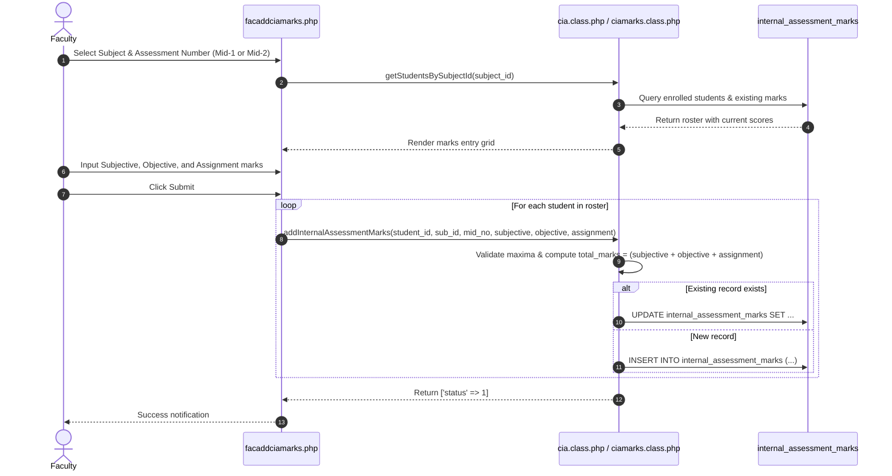

# Continuous Internal Assessment (CIA) & Semester End Examination (SEE) Marks Entry & Calculations

This document outlines the workflows, calculation rules, and database pipelines for entering and calculating internal assessment (CIA) and external examination (SEE) marks across Undergraduate (Theory & Lab), Postgraduate (PG), and Project courses.

---

## 1. Assessment Categories & Entry Interfaces

The application supports six distinct internal evaluation pipelines plus the external SEE pipeline based on the subject's curriculum structure and program level:

| Assessment Type | Entry Controller | Database Table | Component Breakdown |
|---|---|---|---|
| **UG Theory** | `facaddciamarks.php`, `facciamarks.php`, `facmarksentry.php`, `facciamarkscondensed.php` | `internal_assessment_marks`, `student_marks` | Descriptive (Subjective), Objective/Quiz, Assignment |
| **UG Laboratory** | `facaddcialabmarks.php`, `facbulkd2dmarks.php`, `facuglabciamarkscondensed.php` | `uglab_internal_assessment_marks`, `lab_rubric_evaluations` | Day-to-Day performance (with optional Rubrics or rapid bulk entry), Internal Lab Examination |
| **Postgraduate (PG)** | `pg_cia_form.php`, `pg_cia_components.php`, `facaddpgciamarks.php` | `pg_internal_assessment_marks` | Separate components: Mid-1 (1), Mid-2 (2), Assignment (3), Continuous Evaluation (4), Lab Internal (11), Lab Record (12) |
| **Design Thinking & Innovation (DTI)** | `facadddticiamarks.php`, `facdticiamarkscondensed.php` | `internal_assessment_marks` | Innovation reviews, presentation, design prototype, and condensed internal score |
| **UG Project** | `facaddprojectciamarks.php`, `facviewprojectciamarks.php` | `ugproject_internal_assessment_marks` | Project Phase Reviews (Review-1, Review-2, etc.) |
| **Consolidated Course Register** | `facviewmarks.php`, `facviewmarkscsv.php` | `internal_assessment_marks`, `uglab_internal_assessment_marks`, `pg_internal_assessment_marks` | Unified course marks award sheet across all students with authenticated CSV export |
| **Semester End Exam (SEE)** | `facseemarks.php`, `facseecompques.php`, `facseemarksentry.php`, `facseedirectmarks.php`, `attainmentimport.php` | `external_assessment_marks`, `student_marks`, `attainment_import_batches` | Question-level blueprint (Mode A), Direct ledger (Mode B), Published Result Sync (Mode C), or Attainment CSV Import |

---

## 2. Marks Entry Lifecycle (UG Theory Example)

---

## 3. Regulation Calculation Rules & CIA Policy Architecture

### 3.1 Exact Regulation Scoping & Shared Core Calculator (`core/CiaCalculator.php`)
Under autonomous regulations, internal assessment marks must be calculated strictly according to regulation rules and exact program levels, without borrowing fallback values across regulations:
- **Exact Regulation Resolution**: Principal CIA, report export, and CO analysis paths resolve the exact `regulations.id` (`DBCredentials::getRegulationIdForSubject()`) rather than ambiguous regulation code strings (e.g., distinguishing B.Tech R20 from MCA R20).
- **Independent State per Offering**: `\College\CiaCalculator` maintains isolated calculation state for each course and student, preventing variable leakage across subjects in bulk class exports.
- **Strict Incompleteness & Zero Preservation**:
  - All configured required assessments must exist for a final internal score to be generated. If an assessment is missing, the student's final total remains blank and incomplete; missing marks are **never** silently treated as zero.
  - Zero scores (`0.0`) are preserved and distinguished from missing marks.
  - If any entered component exceeds configured maxima or violates schema constraints, the final total remains blank with an explicit diagnostic status.
  - If no complete totals exist in a cohort, exports return an explicit error rather than fabricated or empty ledgers.

### 3.2 Regulation CIA Scheme Engine (`cia_policy.php` & `core/CiaPolicySettings.php`)
The CIA Policy Settings console (`cia_policy.php`) provides administrative governance (`superadmin`, `academic_section`, `admin`) over regulation-scoped evaluation schemes stored in `academic_settings.cia_scheme_json`:
- **Verified Statutory Formulas (`core/VerifiedRegulations.php`)**:
  Loaded directly from reviewed autonomous regulation PDF documents, verified against immutable SHA-256 PDF hashes:
  - **MCA R20** ([Source PDF](../regulations/mca_r20_regulations.pdf)):
    - Theory: $0.70 \times \max(\text{Mid}_1, \text{Mid}_2) + 0.30 \times \min(\text{Mid}_1, \text{Mid}_2) + \text{Assignment}$ (Mids out of 30, Assignment out of 10 &rarr; Total 40M CIE).
    - Practical: 40M internal assessment.
    - Rounding: Nearest integer whole mark.
  - **M.Tech R21** ([Source PDF](../regulations/mtech_r21_regulations.pdf)):
    - Theory: $0.70 \times \max(\text{Mid}_1, \text{Mid}_2) + 0.30 \times \min(\text{Mid}_1, \text{Mid}_2) + \text{Assignment}$ (Mids out of 30, Assignment out of 10 &rarr; Total 40M CIE).
    - Practical: Day-to-Day (10M) + Internal Lab Test (20M) + Lab Record (10M) &rarr; Total 40M CIE.
  - **M.Tech R25** ([Source PDF](../regulations/mtech_r25_regulations.pdf)):
    - Theory: $0.80 \times \max(\text{Mid}_1, \text{Mid}_2) + 0.20 \times \min(\text{Mid}_1, \text{Mid}_2) + \text{Continuous Evaluation}$ (Mids out of 30, Continuous Evaluation out of 10 &rarr; Total 40M CIE).
    - Practical: Day-to-Day (10M) + Internal Lab Test (20M) + Lab Record (10M) &rarr; Total 40M CIE.
  - **B.Tech R23 (and R20 / R26)** ([Source PDF](../regulations/btech_r23_regulations.pdf)):
    - Theory: $0.80 \times \max(\text{Mid}_1, \text{Mid}_2) + 0.20 \times \min(\text{Mid}_1, \text{Mid}_2)$ (each Mid combines Subjective 15M, Objective 10M, Assignment 5M &rarr; Total 30M CIE).
    - Practical: Day-to-Day (15M) + Internal Test (15M) &rarr; Total 30M CIE.
- **Transactional Policy Versioning**:
  Saving a CIA scheme requires a mandatory administrative reason and active concurrency check (`version`), recording changes to `academic_settings_audit` and `academic_policy_versions`.

### 3.3 Condensed Views & Course File Services Separation

The platform enforces a strict separation between operational and accreditation course file generation:

- **Official 14-Page Operational Course File (`services/EBluebookPDFService.php` - STRICTLY IMMUNE)**:
  - Downloaded via `download_bluebook.php` (`MOD_OBE_ANALYSIS`).
  - **Section 1**: Course Bio & Student Nominal Roll.
  - **Section 2A**: Lecture Lesson Plan (Estimated Diary).
  - **Section 2B**: Diary of Lecturer Classes (4-column statutory format).
  - **Section 2C**: Course Delivery Compliance & Deviation Report (NBA 2.2 milestone dates, deviations, compensatory classes, and signatures).
  - **Section 3**: Student Attendance Register.
  - **Section 4**: Continuous Internal Assessment (CIA) Marks Register with component breakdowns.

- **Autonomous Course Master File (`services/CourseMasterFilePDFService.php` - DEDICATED SERVICE)**:
  - Downloaded via `download_coursemasterfile.php?sub_id=X` (`MOD_COURSE_MASTER_FILE`, depends on `MOD_LESSON_PLAN`).
  - Generates a 7-section accreditation dossier (Cover Page, Course Syllabus & COs, Lesson Plan Schedule, Class Diary Execution Ledger, Lesson Plan Delivery Reconciliation, Course Review & Compliance Status, and Consolidated CIA Marks Award Sheet).
  - **Persisted Review Evidence**: Displays the actual persisted faculty submission state (`faculty_signoff_status`, `faculty_signoff_at`) and HOD review decision (`hod_approval_status`, `hod_reviewed_by`, `hod_approval_at`, `hod_remarks`) from `course_completion_audits`—never inventing synthetic DAAC approval when review is still pending.

- **Condensed Marks Grids**:
  - **`facciamarkscondensed.php`**: Renders side-by-side Mid-1, Mid-2, and final weighted aggregate scores.
  - **`facuglabciamarkscondensed.php`**: Consolidates Day-to-Day and Lab Exam marks into final lab internal score.
  - **`download_cls_cia.php`**: Tabular class CIA marks summary report.

---

## 4. Assessment Question & CO Tagging with Bloom's Cognitive Advisory

For NBA accreditation, faculty configure question papers with cognitive domain tagging:
- **`facciacomp.php`**: Configures assessment components (`MOD_CIA_METADATA`).
- **`facciacompques.php`**: Defines question labels (`Q1a`, `Q1b`, `Q2`), maximum marks (`decimal(12,5)`), and Bloom's cognitive level (`blooms_level_id`).
- **`facquestionco.php`**: Maps each question to Course Outcomes (`course_outcomes`).
- **Real-Time Bloom HOTS/LOTS Advisory Indicator (`MOD_BLOOM_ANALYSIS`)**:
  - Live calculation in `facquestionco.php` and `facaddciamarks.php`.
  - Calculates mark percentage for Higher Order Thinking Skills (`L4-Analyze`, `L5-Evaluate`, `L6-Create`) vs Lower Order Thinking Skills (`L1-Remember`, `L2-Understand`, `L3-Apply`):
    $$\text{HOTS \%} = \frac{\sum \text{Marks}_{\text{L4--L6}}}{\sum \text{Marks}_{\text{Total}}} \times 100$$
  - Displays a dynamic badge: Green ($\ge 40\%$) or Yellow ($< 40\%$).
  - Submissions are non-blocking unless `academic_settings.bloom_hots_lots_enforce = 1`.
- **`facmarksentry.php`**: Enables granular question-by-question marks entry stored in `student_marks` (`marks_obtained` `decimal(12,5)`).

---

## 5. Continuous Laboratory Evaluation: Atomic Dual-Mode Rubrics Engine (`MOD_LAB_RUBRICS`)

Managed in `facaddcialabmarks.php` and backed by `Services\LabAssessmentService` (`services/LabAssessmentService.php`):
- **Direct Manual Entry**: Direct input of `day_to_day_marks[]` and `internal_test_marks[]` remains fully supported.
- **Rubrics Assistant Modal (`MOD_LAB_RUBRICS`, depends on `MOD_CIA_MARKS`)**:
  - Fetches criteria from `lab_rubric_criteria` (or course-specific overrides in `lab_subject_rubrics`).
  - Standard tripartite criteria: Conduction (5M), Observation/Record (5M), Viva Voce (5M).
  - **Atomic Validation & Persistence**: `LabAssessmentService::saveMarks()` validates enrolled students, stored criteria, component maxima, and rubric sums, committing both `uglab_internal_assessment_marks` and `lab_rubric_evaluations` (constrained by `uq_lab_evaluation (uglab_mark_id, criterion_name)`) in a single atomic transaction along with `audit_logs`.

---

## 6. File Attachments Subsystem (`facciaattachments.php`)

Faculty can attach digital documentation to each assessment (question papers, answer keys, assignment prompts):
- Files are saved in `uploads/cia_attachments/`.
- Stored in `cia_attachments`:
  - `subject_id`, `assessment_number`, `file_title`, `file_path`, `updated_on`.
- Managed via `Faculty::addCIAAttachment()` and `Faculty::deleteCIAAttachment()`.

---

## 7. Semester End Examination (SEE) & External Attainment Pipeline

Managed via `SEEAssessment` (`seeassessment.class.php`), `Services\SEEBlueprintService`, `Services\QuestionMarksService`, `Services\SeeMarksWriter`, `Services\AttainmentPolicyService`, and `Services\AttainmentImportService`, storing records in `external_assessment_marks` (`decimal(12,5)` precision):

- **Attainment Profiles & Subject Overrides (`superadminattainmentsettings.php`)**:
  - SuperAdmin configures regulation/subject-type profiles in `attainment_policies` and per-subject overrides in `subject_attainment_overrides` (supporting custom maxima, `grade_bands`, `choice_groups`, and grade estimation policy).
- **Mode A (`DETAILED`) — Question Blueprint & Protected Revisions (`facseecompques.php` & `facseemarksentry.php`)**:
  - Granular entry of compulsory questions and elective choice groups (`choice_groups`), supporting question-level direct external attainment via `QuestionMarksService`.
  - **Protected Blueprint Revisions (`SEEBlueprintService`)**: Regenerating or revising a blueprint when marks already exist requires explicit confirmation and a mandatory reason, archives the prior blueprint/grid/totals into `academic_record_snapshots`, preserves scores for retained questions, validates revised maxima, and sets `external_assessment_marks.is_current = 0` until reconsolidated.
- **Mode B (`DIRECT`) — Direct Marks Ledger (`facseedirectmarks.php`)**:
  - Direct entry of consolidated university marks via `SeeMarksWriter`, recording before/after snapshots when replacing existing marks.
- **Mode C — Published Results Auto-Sync (`facseemarks.php`)**:
  - `ExamResultsService::syncResultsToSeeMarks()` pulls external marks from an explicitly selected `PUBLISHED` `REGULAR` examination notification (`exam_notifications`), requiring confirmation and a reason before replacing existing marks and recording provenance in `source_notification_id`, `raw_marks`, `raw_max_marks`, `normalisation_json`, and `evidence_basis`.
- **Independent Attainment CSV Import (`attainmentimport.php`)**:
  - `AttainmentImportService` previews and commits external aggregate, scaled gross/net, grade-derived (`GRADE_ESTIMATE`), or question-wise CSV evidence (`attainment_import_batches`) independently of examination result publication.
- **Consolidated External Review (`facseemarkscondensed.php`)**: Side-by-side ledger displaying scored external marks, provenance (`evidence_basis`), and status.

---

## 8. Postgraduate Continuous Assessment Pipeline (`PgCiaService.php`)

Postgraduate assessment differs fundamentally from undergraduate programs by requiring separate evidence tracks across mid evaluations, assignments, continuous evaluations, laboratory tests, and record submissions (`core/PgCiaService.php`):

### 8.1 Discrete Component Identities
In `pg_internal_assessment_marks`, each assessment event is stored with a distinct integer component identity:
- **`1`**: Mid assessment 1 (out of 30M)
- **`2`**: Mid assessment 2 (out of 30M)
- **`3`**: Assignment (out of 10M, for M.Tech R21 and MCA R20)
- **`4`**: Continuous evaluation (out of 10M, for M.Tech R25)
- **`11`**: Lab internal assessment (out of 30M combined day-to-day & internal test, or 40M)
- **`12`**: Lab record (out of 10M for M.Tech R21/R25)

### 8.2 PG Form & Components UI (`pg_cia_form.php` & `pg_cia_components.php`)
- **`pg_cia_components.php`**: Renders configured components for the subject based on the regulation's verified CIA scheme, displaying maximum marks, active weightages, and entry progress.
- **`pg_cia_form.php`**: Provides whole-cohort entry grid with transactional validation, checking score boundaries, precision (`decimal(12,5)`), student enrollment, and recording before/after audit entries upon modification.
- **R25 Specialization Invariant**: R25 theory strictly utilizes component `4` (Continuous Evaluation) and ignores old component `3` (Assignment) to prevent double-counting.

---

## 9. Specialized Evaluation Pipelines: Bulk Day-to-Day & DTI CIA

### 9.1 Laboratory Bulk Day-to-Day Marks Entry (`facbulkd2dmarks.php`)
- For laboratory courses requiring rapid weekly logging across large student cohorts.
- Directly updates `uglab_internal_assessment_marks.day_to_day_marks` in a single spreadsheet-like grid.
- Enforces subject-level day-to-day maximum marks retrieved from active regulation course types.
- Commits atomically with `audit_logs` entries.

### 9.2 Design Thinking & Innovation (DTI) CIA Pipeline (`facadddticiamarks.php` & `facdticiamarkscondensed.php`)
- Specialized continuous evaluation pipeline for experiential and innovation-focused curricula (e.g. B.Tech R23 DTI).
- **`facadddticiamarks.php`**: Evaluates individual student innovation prototypes, design briefs, ideation logs, and team presentations.
- **`facdticiamarkscondensed.php`**: Consolidates multiple evaluation cycles into a verified internal score conforming to regulation maxima.

### 9.3 Unified Marks Register & CSV Export (`facviewmarks.php` & `facviewmarkscsv.php`)
- Comprehensive faculty course ledger uniting theory CIA, lab day-to-day, PG discrete components, and external SEE scores in a unified student roster.
- Secure CSV export via `facviewmarkscsv.php` with session, ownership, and CSRF protection.
