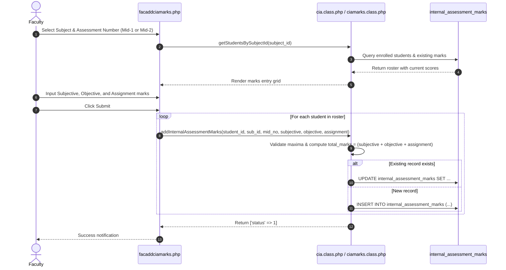

# Continuous Internal Assessment (CIA) & Semester End Examination (SEE) Marks Entry & Calculations

This document outlines the workflows, calculation rules, and database pipelines for entering and calculating internal assessment (CIA) and external examination (SEE) marks across Undergraduate (Theory & Lab), Postgraduate (PG), and Project courses.

---

## 1. Assessment Categories & Entry Interfaces

The application supports four distinct internal evaluation pipelines plus the external SEE pipeline based on the subject's curriculum structure:

| Assessment Type | Entry Controller | Database Table | Component Breakdown |
|---|---|---|---|
| **UG Theory** | `facaddciamarks.php`, `facciamarks.php`, `facmarksentry.php` | `internal_assessment_marks`, `student_marks` | Descriptive (Subjective), Objective/Quiz, Assignment |
| **UG Laboratory** | `facaddcialabmarks.php` | `uglab_internal_assessment_marks`, `lab_rubric_evaluations` | Day-to-Day performance (with optional Rubrics), Internal Lab Examination |
| **Postgraduate (PG)** | `facaddpgciamarks.php` | `pg_internal_assessment_marks` | Mid Test, Assignment, Seminar presentation |
| **UG Project** | `facaddprojectciamarks.php` | `ugproject_internal_assessment_marks` | Project Phase Reviews (Review-1, Review-2, etc.) |
| **Semester End Exam (SEE)** | `facseemarks.php`, `facseecompques.php`, `facseemarksentry.php`, `facseedirectmarks.php`, `attainmentimport.php` | `external_assessment_marks`, `student_marks`, `attainment_import_batches` | Question-level blueprint (Mode A), Direct ledger (Mode B), Published Result Sync (Mode C), or Attainment CSV Import |

---

## 2. Marks Entry Lifecycle (UG Theory Example)

---

## 3. Regulation Calculation Rules & Condensed Views

### 3.1 Exact Regulation Resolution & Dynamic Policy Settings
Under autonomous academic regulations (e.g., R19, R20, R23, R25, R26), final internal marks are computed across Mid-1 and Mid-2 using weightage formulas retrieved dynamically via `Services\SettingsService` and `\College\AssessmentPolicy` (`academic_settings` table):
- **Exact Regulation Scoping**: Principal CIA and CO paths resolve the exact `regulations.id` (`DBCredentials::getRegulationIdForSubject()`) rather than ambiguous regulation code strings (such as shared `R20` codes across UG and PG), and refuse to silently borrow another regulation's fallback values when a policy setting is missing.
- **Immutable Policy Versioning**: Supported policy mutations record a SHA-256 policy snapshot in `academic_policy_versions`.
- **Combined Internal Calculation**:
  $$\text{Final Internal} = (W_{\text{best}} \times \max(\text{Mid}_1, \text{Mid}_2)) + (W_{\text{worst}} \times \min(\text{Mid}_1, \text{Mid}_2))$$
  - Under R19/R20/R23: $W_{\text{best}} = 0.80$ and $W_{\text{worst}} = 0.20$ (configurable via `superadminacademicsettings.php`).

### 3.2 Condensed Views & Course File Services Separation

The platform enforces a strict separation between operational and accreditation course file generation:

- **Official 14-Page Operational Course File (`services/EBluebookPDFService.php` - STRICTLY IMMUNE)**:
  - Downloaded via `download_bluebook.php` (`MOD_OBE_ANALYSIS`).
  - **Section 1**: Course Bio & Student Nominal Roll.
  - **Section 2A**: Lecture Lesson Plan (Estimated Diary).
  - **Section 2B**: Diary of Lecturer Classes (4-column statutory format).
  - **Section 2C**: Course Delivery Compliance & Deviation Report (NBA 2.2 milestone dates, deviations, compensatory classes, and signatures).
  - **Section 3**: Student Attendance Register.
  - **Section 4**: Continuous Internal Assessment (CIA) Marks Register with component breakdowns.

- **Autonomous Course Master File (`services/CourseMasterFilePDFService.php` - DEDICATED SERVICE)**:
  - Downloaded via `download_coursemasterfile.php?sub_id=X` (`MOD_COURSE_MASTER_FILE`, depends on `MOD_LESSON_PLAN`).
  - Generates a 7-section accreditation dossier (Cover Page, Course Syllabus & COs, Lesson Plan Schedule, Class Diary Execution Ledger, Lesson Plan Delivery Reconciliation, Course Review & Compliance Status, and Consolidated CIA Marks Award Sheet).
  - **Persisted Review Evidence**: Displays the actual persisted faculty submission state (`faculty_signoff_status`, `faculty_signoff_at`) and HOD review decision (`hod_approval_status`, `hod_reviewed_by`, `hod_approval_at`, `hod_remarks`) from `course_completion_audits`—never inventing synthetic DAAC approval when review is still pending.

- **Condensed Marks Grids**:
  - **`facciamarkscondensed.php`**: Renders side-by-side Mid-1, Mid-2, and final weighted aggregate scores.
  - **`facuglabciamarkscondensed.php`**: Consolidates Day-to-Day and Lab Exam marks into final lab internal score.
  - **`download_cls_cia.php`**: Tabular class CIA marks summary report.

---

## 4. Assessment Question & CO Tagging with Bloom's Cognitive Advisory

For NBA accreditation, faculty configure question papers with cognitive domain tagging:
- **`facciacomp.php`**: Configures assessment components (`MOD_CIA_METADATA`).
- **`facciacompques.php`**: Defines question labels (`Q1a`, `Q1b`, `Q2`), maximum marks (`decimal(12,5)`), and Bloom's cognitive level (`blooms_level_id`).
- **`facquestionco.php`**: Maps each question to Course Outcomes (`course_outcomes`).
- **Real-Time Bloom HOTS/LOTS Advisory Indicator (`MOD_BLOOM_ANALYSIS`)**:
  - Live calculation in `facquestionco.php` and `facaddciamarks.php`.
  - Calculates mark percentage for Higher Order Thinking Skills (`L4-Analyze`, `L5-Evaluate`, `L6-Create`) vs Lower Order Thinking Skills (`L1-Remember`, `L2-Understand`, `L3-Apply`):
    $$\text{HOTS \%} = \frac{\sum \text{Marks}_{\text{L4--L6}}}{\sum \text{Marks}_{\text{Total}}} \times 100$$
  - Displays a dynamic badge: Green ($\ge 40\%$) or Yellow ($< 40\%$).
  - Submissions are non-blocking unless `academic_settings.bloom_hots_lots_enforce = 1`.
- **`facmarksentry.php`**: Enables granular question-by-question marks entry stored in `student_marks` (`marks_obtained` `decimal(12,5)`).

---

## 5. Continuous Laboratory Evaluation: Atomic Dual-Mode Rubrics Engine (`MOD_LAB_RUBRICS`)

Managed in `facaddcialabmarks.php` and backed by `Services\LabAssessmentService` (`services/LabAssessmentService.php`):
- **Direct Manual Entry**: Direct input of `day_to_day_marks[]` and `internal_test_marks[]` remains fully supported.
- **Rubrics Assistant Modal (`MOD_LAB_RUBRICS`, depends on `MOD_CIA_MARKS`)**:
  - Fetches criteria from `lab_rubric_criteria` (or course-specific overrides in `lab_subject_rubrics`).
  - Standard tripartite criteria: Conduction (5M), Observation/Record (5M), Viva Voce (5M).
  - **Atomic Validation & Persistence**: `LabAssessmentService::saveMarks()` validates enrolled students, stored criteria, component maxima, and rubric sums, committing both `uglab_internal_assessment_marks` and `lab_rubric_evaluations` (constrained by `uq_lab_evaluation (uglab_mark_id, criterion_name)`) in a single atomic transaction along with `audit_logs`.

---

## 6. File Attachments Subsystem (`facciaattachments.php`)

Faculty can attach digital documentation to each assessment (question papers, answer keys, assignment prompts):
- Files are saved in `uploads/cia_attachments/`.
- Stored in `cia_attachments`:
  - `subject_id`, `assessment_number`, `file_title`, `file_path`, `updated_on`.
- Managed via `Faculty::addCIAAttachment()` and `Faculty::deleteCIAAttachment()`.

---

## 7. Semester End Examination (SEE) & External Attainment Pipeline

Managed via `SEEAssessment` (`seeassessment.class.php`), `Services\SEEBlueprintService`, `Services\QuestionMarksService`, `Services\SeeMarksWriter`, `Services\AttainmentPolicyService`, and `Services\AttainmentImportService`, storing records in `external_assessment_marks` (`decimal(12,5)` precision):

- **Attainment Profiles & Subject Overrides (`superadminattainmentsettings.php`)**:
  - SuperAdmin configures regulation/subject-type profiles in `attainment_policies` and per-subject overrides in `subject_attainment_overrides` (supporting custom maxima, `grade_bands`, `choice_groups`, and grade estimation policy).
- **Mode A (`DETAILED`) — Question Blueprint & Protected Revisions (`facseecompques.php` & `facseemarksentry.php`)**:
  - Granular entry of compulsory questions and elective choice groups (`choice_groups`), supporting question-level direct external attainment via `QuestionMarksService`.
  - **Protected Blueprint Revisions (`SEEBlueprintService`)**: Regenerating or revising a blueprint when marks already exist requires explicit confirmation and a mandatory reason, archives the prior blueprint/grid/totals into `academic_record_snapshots`, preserves scores for retained questions, validates revised maxima, and sets `external_assessment_marks.is_current = 0` until reconsolidated.
- **Mode B (`DIRECT`) — Direct Marks Ledger (`facseedirectmarks.php`)**:
  - Direct entry of consolidated university marks via `SeeMarksWriter`, recording before/after snapshots when replacing existing marks.
- **Mode C — Published Results Auto-Sync (`facseemarks.php`)**:
  - `ExamResultsService::syncResultsToSeeMarks()` pulls external marks from an explicitly selected `PUBLISHED` `REGULAR` examination notification (`exam_notifications`), requiring confirmation and a reason before replacing existing marks and recording provenance in `source_notification_id`, `raw_marks`, `raw_max_marks`, `normalisation_json`, and `evidence_basis`.
- **Independent Attainment CSV Import (`attainmentimport.php`)**:
  - `AttainmentImportService` previews and commits external aggregate, scaled gross/net, grade-derived (`GRADE_ESTIMATE`), or question-wise CSV evidence (`attainment_import_batches`) independently of examination result publication.
- **Consolidated External Review (`facseemarkscondensed.php`)**: Side-by-side ledger displaying scored external marks, provenance (`evidence_basis`), and status.
