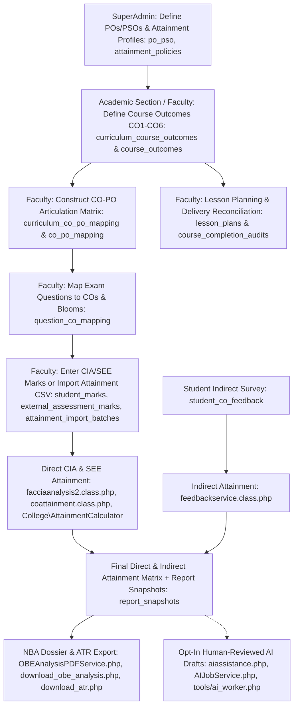

# Outcome-Based Education (OBE) & CO-PO Attainment Analysis

This document describes the Course Outcome (CO) and Program Outcome (PO) attainment computation engine, independent attainment evidence import, reproducible report snapshots, and optional AI draft assistance designed to satisfy National Board of Accreditation (NBA) compliance.

---

## 1. OBE Architecture & Flow

---

## 2. Core Components

### 2.1 Course Outcomes Setup & Dual-Sync (`facaddcos.php` & `academicsectioncurriculumsubjects.php`)
- Instructors and Academic Section formulate between 4 and 6 measurable Course Outcomes (CO1 through CO6).
- **Curriculum Master Dual-Sync**: Master COs and CO-PO mappings are stored in `curriculum_course_outcomes` (`uq_cco_curr_num (curr_sub_id, co_number)`) and `curriculum_co_po_mapping`, and are synchronized with offering-scoped records in `course_outcomes` (`curr_sub_id`, `sub_id`) and `co_po_mapping`.
- Each outcome specifies:
  - `co_number`: Sequence index (1 to 6).
  - `co_description`: Detailed action-verb outcome statement.
  - `bloom_level`: Default Bloom's taxonomy cognitive target (e.g., `L3-Apply`).
  - `target_threshold_percent`: Benchmark threshold (defaults to `60.00%`).

### 2.2 CO-PO Articulation Matrix (`facarticulationmatrix.php`)
- Establishes correlations between each CO and the 12 Graduate Attributes (PO1 to PO12) plus Program Specific Outcomes (PSO1 to PSO4).
- Correlation levels stored in `co_po_mapping` (`weightage`) and `curriculum_co_po_mapping`:
  - `3`: High / Substantial correlation.
  - `2`: Medium / Moderate correlation.
  - `1`: Low / Slight correlation.
  - `0` / unmapped: No correlation.

### 2.3 Cognitive Domain Tagging with Bloom's Taxonomy
Each assessment question created in `assessment_questions` is categorized:
- **Bloom's Level (`blooms_level_id`)**: L1 (Remember) through L6 (Create).
- **Target COs (`question_co_mapping`)**: One or more COs evaluated by that question. When a question maps to multiple COs, `\College\MarksNormalizer` and `\College\AttainmentCalculator` share the question's marks equally across the mapped COs (`EQUAL_SHARE`).
- **Maximum Marks (`decimal(12,5)`)**: High-precision weightage of that question.

---

## 3. Direct Attainment Computation Engine

Internal and external direct computations are performed via `facciaanalysis2.class.php`, `coattainment.class.php`, `seeassessment.class.php`, `\College\MarksNormalizer` (`core/MarksNormalizer.php`), and `\College\AttainmentCalculator` (`core/AttainmentCalculator.php`):

1. **Single-Selection Choice Attribution (`choice_groups`)**:
   - For Either/Or question paper patterns, `\College\MarksNormalizer::selectChoiceQuestions()` resolves the winning option once per student for each choice group (respecting optional `max_marks` caps). The exact same selected questions feed both the student's total score and per-CO attainment calculations.
2. **Individual Student Evidence Mode Handling**:
   - Mixed cohorts are evaluated student by student (never applying the first student's entry mode to everyone):
     - **Measured Question-Wise (`DETAILED`)** and **Measured Aggregate (`DIRECT` / `IMPORT_DIRECT` / `IMPORT_SCALED` / `PUBLISHED_RESULT_SYNC`)** counts are tracked under `measured_students`.
     - **Grade-Derived Estimates (`GRADE_ESTIMATE`)** are tracked separately under `estimated_students` and never conflated with measured CO scores.
     - **Missing vs. Explicit Zero**: An explicit `0` is an evaluated zero; blank scores or unimported enrolled students are tracked under `missing_students`, marking the attainment calculation as `provisional = true`.
3. **Target Threshold & Attainment Levels**:
   - For every evaluated student $s$ on $\text{CO}_k$, determine if the percentage achieved meets or exceeds the target threshold (e.g., $60\%$):
     - **Level 3**: $\ge 70\%$ of evaluated students scored at or above target.
     - **Level 2**: $60\% - 69.99\%$ of evaluated students scored at or above target.
     - **Level 1**: $50\% - 59.99\%$ of evaluated students scored at or above target.
     - **Level 0**: $< 50\%$ of evaluated students scored at or above target.

---

## 4. Attainment Visualization, Accreditation Dossiers & Optional AI Assistance

- **`facciaanalysis2.php` / `hodciaanalysis2.php` / `adminciaanalysis2.php`**: Faculty, HOD, and Principal views of direct and indirect CO attainment tables, CO-PO matrices, and interactive charts.
- **Independent External Attainment Import (`attainmentimport.php`)**: Allows Faculty, HOD, and Academic Section users to preview and commit external aggregate, gross/net scaled, grade-only, or question-wise CSV evidence (`attainment_import_batches`) without requiring the Examination Results Publication module.
- **Standalone NBA SAR Form C-3 PDF Export (`MOD_SAR_FORM_C3`)**: Generated via `download_obe_analysis.php?action=sar_form_c3&sub_id=X` powered by `Services\OBEAnalysisPDFService`. Formats NBA Criterion 3.1 & 3.2 course files with CIA & SEE CO attainment, indirect survey marks, target comparisons, and provisional labels when review/execution evidence is incomplete.
- **PO/PSO Program Articulation Matrix — NBA Table 3.2 & 3.3.2 (`MOD_PO_PSO_ATTAINMENT`)**: Computed via `BatchOBEService::computePOPSOArticulationMatrix()` and rendered in `views/popso_department_tab.php`.
- **Longitudinal Multi-Batch Quality Analytics (`MOD_BATCH_OBE`)**: Powered by `BatchOBEService::getLongitudinalCohortAnalytics()` and visualized in `superadminbatchobe.php`.
- **Closed-Loop CQI Action Tracking & ATR PDF (`MOD_CQI_ACTION_TRACKING`)**: Managed in `faclessonplanreconciliation.php` and `reviewqueue.php` (`Services\AcademicReviewService`), tracking remedial actions from proposal (`PENDING`) through HOD review (`APPROVED` / `REVISION_REQUESTED`), faculty execution evidence (`COMPLETED`), HOD verification closure (`CLOSED`), and snapshot-backed Action Taken Report PDF generation (`download_atr.php`).
- **Opt-In Human-Reviewed AI Draft Assistance (`MOD_AI_ASSISTANCE`)**:
  - Configured by SuperAdmin in `superadminaiproviders.php` (`ai_providers`) and accessed by opted-in Faculty/HOD users in `aiassistance.php` (`ai_job_consents`, `ai_jobs`) and `tools/ai_worker.php`.
  - Transmits only curated, PII-free CO summary snapshots (`report_snapshots`) to generate draft attainment narratives (`CO_ATTAINMENT_ANALYSIS`) or remedial action proposals (`ATR_ACTION_PROPOSAL`). Numeric hallucinations and ungrounded evidence IDs are automatically rejected, and every draft requires explicit human review before approval.

---

## 5. Related Workflows
- **[Lesson Planning, Reconciliation & Compliance Workflow](./lesson-plan-and-compliance.md)**
- **[Student Feedback & Institutional Surveys Workflow](./feedback-surveys.md)**
- **[CIA & SEE Marks Entry & Calculations Workflow](./cia-marks-entry.md)**
