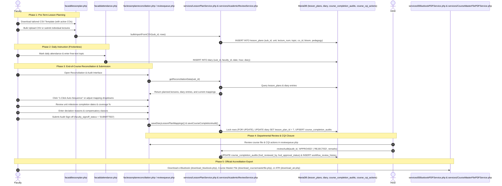

# Lesson Planning, Reconciliation & Course Delivery Compliance Workflow

This document details the complete end-to-end lifecycle for lecture lesson planning, daily topic reconciliation, course completion compliance auditing, and closed-loop Continuous Quality Improvement (CQI) tracking designed to fulfill National Board of Accreditation (NBA) Criterion 2.2 and Criterion 3 requirements.

---

## 1. Overview & Policy Rationale

To ensure educational quality and meet NBA Criterion 2.2 ("Teaching-Learning Process & Course Delivery") and Criterion 3 ("Course Outcomes & Continuous Improvement"):
- **Proactive Syllabus Planning**: Instructors plan lecture-by-lecture delivery schedules mapped to specific Course Outcomes (COs), cognitive Bloom levels, and pedagogical methods before or at the start of the term.
- **Frictionless Daily Execution**: Instructors log daily teaching diary topics in free-text with zero administrative overhead during daily attendance marking.
- **Systematic End-of-Course Reconciliation**: At the conclusion of instructional delivery, instructors reconcile actual diary logs against the planned schedule (`diary.lesson_plan_id`), identifying deviations, missed topics, and compensatory classes.
- **Serialized Compliance Sign-off & Review Queue**: Faculty submit a formal course completion audit (`course_completion_audits`), which computes syllabus completion deterministically from mapped evidence and locks the course file against edits until reviewed or returned by the Head of Department (HOD) via `reviewqueue.php` or `faclessonplanreconciliation.php`.
- **Closed-Loop CQI & Action Taken Reports (ATR)**: Remedial actions (`course_cqi_actions`) progress through a full review-to-closure state machine (`PENDING` &rarr; `APPROVED` / `REVISION_REQUESTED` &rarr; `COMPLETED` &rarr; `CLOSED`) backed by `workflow_review_history` and exportable as a snapshot-verified Action Taken Report PDF (`download_atr.php`).

---

## 2. Architecture & Workflow Sequence

---

## 3. Step-by-Step Implementation

### Step 1: Lesson Plan Formulation (`facaddlessonplan.php`)
- **Prerequisites**: Course Outcomes (CO1 to CO6) must be formulated first in `facaddcos.php`.
- **CSV Template Download**:
  - Emitted with UTF-8 BOM for clean Microsoft Excel opening without character corruption.
  - Dynamically populates sample rows referencing the subject's active Course Outcomes.
- **Bulk Upload Parser**:
  - Sanitizes user variations (e.g., handles "Unit 1", "Lec 1", "CO1", "Apply" vs "L3-Apply").
  - Verifies planned hours, pedagogy choices (`Chalk & Talk`, `PPT/LCD`, `Coding Demo`, `Video`, `Flipped`), and references.
  - Stored in `lesson_plans` table with unique constraint `(sub_id, lecture_number)`.
- **Ownership & Submission Lock**:
  - `Services\LessonPlanService` validates CO, lesson-plan, and diary ownership and locks lesson plan edits once the course completion audit is `SUBMITTED` or `APPROVED` (unless returned as `REJECTED` by the HOD).

### Step 2: Daily Instruction & Diary Logging (`facaddattendance.php`)
- Daily attendance is marked with 100% natural free-text topic entry.
- Diary records are stored in `diary` with `lesson_plan_id = NULL` initially.

### Step 3: End-of-Course Reconciliation (`faclessonplanreconciliation.php`)
- Instructors navigate to **Course Delivery Reconciliation & Audit** at semester end.
- The interface presents side-by-side matching of planned lectures against chronological daily diary entries.
- **1-Click Auto-Sequence**: Automatically binds chronological diary entries to sequential planned lectures, establishing `diary.lesson_plan_id`.

### Step 4: Course Delivery Compliance & Deviation Audit (`course_completion_audits`)
- **Deterministic Quantitative Metrics**:
  - Total Planned Lectures vs Total Actual Conducted.
  - Number of Compensatory / Extra Classes conducted.
  - Syllabus Completion Percentage computed deterministically from mapped lecture evidence: $\min\left(100, \frac{\text{Mapped Planned Lectures}}{\text{Total Planned Lectures}} \times 100\%\right)$.
- **Unit Milestone Completion Dates**:
  - Completion dates for Unit 1, Unit 2, Unit 3, Unit 4, and Unit 5.
- **Qualitative Justifications**:
  - `deviations_reason`: Detailed reasons for topic sequence changes or syllabus pacing adjustments.
  - `compensatory_actions`: Extra classes, tutorial sessions, or LMS materials provided to cover syllabus shortfalls.
  - `topics_beyond_syllabus`: Advanced state-of-the-art topics covered beyond prescribed syllabus.
- **Governance Gate (`Services\AcademicReviewService::reviewAudit()`)**:
  - Faculty submits with `faculty_signoff_status = 'SUBMITTED'`, `hod_approval_status = 'PENDING'`.
  - Department HOD reviews in `reviewqueue.php` or `faclessonplanreconciliation.php`, recording `hod_reviewed_by`, `hod_approval_at`, `hod_remarks`, `workflow_review_history`, and `audit_logs`.

---

## 4. Official Course File Integrations & Accreditation Separation

### 4.1 Official Operational Course File (`services/EBluebookPDFService.php` - STRICTLY IMMUNE)
When generating the statutory university course Bluebook via [`download_bluebook.php`](../../jntuacea/download_bluebook.php), the reconciled data renders as three cohesive sections:
1. **Section 2A: Lecture Lesson Plan (Estimated Diary)**: Full tabular schedule of planned lectures with Unit, Lecture No, Topic Description, Target CO, Bloom Level, Pedagogy, and References.
2. **Section 2B: Diary of Lecturer Classes (Actual Conducted Diary)**: Standard 4-column university register layout: `S.No`, `Date`, `Time / Period`, and `Topics Covered`.
3. **Section 2C: Course Delivery Compliance & Deviation Report (NBA 2.2)**: Executive metrics table comparing planned vs conducted classes, milestone completion dates across all 5 units, recorded deviations and compensatory measures, and dual formal signature blocks for Course Instructor and Head of Department.

### 4.2 Autonomous Course Master File (`services/CourseMasterFilePDFService.php` - DEDICATED SERVICE)
Exported via `download_coursemasterfile.php?sub_id=X` (`MOD_COURSE_MASTER_FILE`, depends on `MOD_LESSON_PLAN`):
- Dedicated 7-section accreditation dossier incorporating Cover Page, Syllabus, Lesson Plans, Daily Class Diary, Lesson Plan Delivery Reconciliation, Course Review & Compliance Status (displaying persisted faculty submission, HOD decision, reviewer, and timestamps from `course_completion_audits` without inventing synthetic DAAC approval), and Consolidated CIA Marks.
- Keeps `services/EBluebookPDFService.php` 100% immune and untouched.

---

## 5. Closed-Loop Continuous Quality Improvement (CQI) & ATR Export (`MOD_CQI_ACTION_TRACKING`)

Integrated into `faclessonplanreconciliation.php`, `reviewqueue.php` (`Services\AcademicReviewService`), and `download_atr.php`, persisted in `course_cqi_actions`:
- **Attainment Gap Recognition**: For Course Outcomes falling short of target thresholds ($\Delta = \text{Target} - \text{Attained} > 0$), faculty enter formal remedial action plans (`action_proposed`, `action_type`, `due_date`).
- **Categorization**: Classifies proposed actions (`REMEDIAL_CLASS`, `PEDAGOGICAL_CHANGE`, `TUTORIAL_HOURS`, `ASSIGNMENT_REVISION`, `CONTENT_BEYOND_SYLLABUS`).
- **Full Review-to-Closure Lifecycle**:
  1. **Submission (`PENDING`)**: Faculty submits the proposed action plan.
  2. **HOD Review (`AcademicReviewService::reviewCqi()`)**: HOD either approves (`APPROVED`) or returns for revision (`REVISION_REQUESTED` with `hod_remarks`, `reviewed_by`, `reviewed_at`).
  3. **Faculty Revision or Execution (`AcademicReviewService::reviseCqi()` / `recordCqiExecution()`)**: If returned, faculty revises the proposal (`REVISED` &rarr; `PENDING`). Once approved, faculty executes the intervention and records `execution_evidence` and `completed_at` (`COMPLETED`).
  4. **HOD Verification & Closure (`AcademicReviewService::closeCqi()`)**: HOD verifies the execution evidence, records `followup_measure`, and closes the action (`closed_by`, `closed_at`).
- **Evidence-Based Action Taken Report (ATR) PDF (`download_atr.php`)**:
  - `AcademicReviewService::renderAtrPdf()` uses a `REPEATABLE READ` consistent snapshot transaction, persists a reproducible record in `report_snapshots` (`report_key = 'cqi_atr'`), and generates a formal TCPDF Action Taken Report distinguishing proposed actions from verified execution and closed loops.
