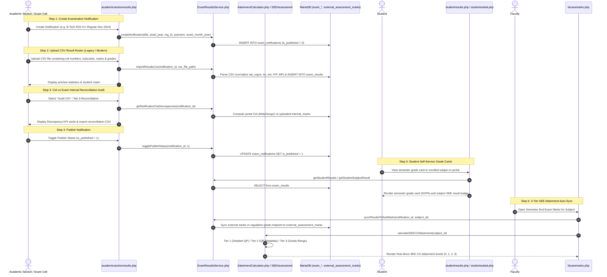

# Examination Results Publication & SEE Auto-Sync Workflow

This document details the lifecycle for examination notification creation, bulk result ingestion via CSV, UGC 10-point scale grade conversion, legacy exam result scheme normalization, 3-tier Semester End Examination (SEE) Course Outcome attainment distribution, CIA vs Exam Internal reconciliation audit, and student self-service grade card viewing across general and subject portals.

---

## 1. Overview & Policy Rationale

### 1.1 The Challenge of Disconnected Systems
In many autonomous institutions, semester end examinations are evaluated centrally by the Examination Branch, while department faculty separately evaluate Continuous Internal Assessment (CIA) and Course Outcome attainment:
- Without integration, faculty are forced to manually transcribe hundreds of external marks from paper lists or separate spreadsheets into the OBE software.
- Manual re-entry introduces clerical transcription errors, delays accreditation reporting, and wastes hundreds of faculty hours each semester.
- Furthermore, legacy examination result dumps (such as JNTUACEA `resultsold` archives) use heterogeneous column naming conventions (`std_regno`, `im`, `em`, `result`, etc.) and sentinel values (`im = -7` for exempt, `em = -1` for absent) that cause traditional strict parsers to reject imports.

### 1.2 The Integrated Solution
The Results Publication subsystem bridges the Examination Branch, Department Faculty, and Students:
1. **Academic Section / Exam Cell**: Publishes official semester exam notifications, uploads verified university CSV result rosters (fully backward compatible with legacy university formats), reviews preview tables, audits CIA discrepancies, and toggles results live (`is_published = 1`).
2. **Autonomous 3-Tier SEE Attainment**: As SEE completes the direct attainment cycle, external marks are ingested and mapped across Course Outcomes through three complementary tiers: Question-wise entry (Tier 1), QP metadata distribution (Tier 2), or Regulation grade band midpoint distribution across all COs (Tier 3).
3. **Continuous Internal Assessment (CIA) Reconciliation Audit**: Live portal-calculated internal assessment marks (Mid 1, Mid 2, Assignments, Quizzes, Lab Day-to-Day) are audited against final uploaded internal marks (`im`), highlighting rounding variances ($\le 1.0$) and significant discrepancies ($> 1.0$).
4. **Student Portal**: Students immediately access their official semester grade cards with letter grades, credits, grade points, and automatically calculated SGPA in `studentresults.php`, view subject-specific SEE results in `studentsubatt.php`, and check exam statuses in `studentsubjects.php`.
5. **Faculty SEE Marks Auto-Sync**: In `facseemarks.php`, faculty select **Mode C (Sync from Published Results)** to pull external examination scores directly into `external_assessment_marks`, automatically populating direct SEE attainment models.

---

## 2. UGC 10-Point Scale & SGPA Computation

The system uses standard autonomous UGC grading scales implemented inside `ExamResultsService::getGradePoints()`:

| Letter Grade | Description | Marks Range (%) | Grade Points ($GP_i$) | Result Status |
| :---: | :---: | :---: | :---: | :---: |
| **O** | Outstanding | $\ge 90\%$ | 10 | PASS |
| **S** | Excellent | $80\% - 89\%$ | 9 | PASS |
| **A** | Very Good | $70\% - 79\%$ | 8 | PASS |
| **B** | Good | $60\% - 69\%$ | 7 | PASS |
| **C** | Fair | $50\% - 59\%$ | 6 | PASS |
| **D** | Satisfactory | $40\% - 49\%$ | 5 | PASS |
| **E** | Pass | $35\% - 39\%$ | 4 | PASS |
| **F** | Fail | $< 35\%$ | 0 | FAIL |
| **ABSENT** / **Ab** | Absent | Absent | 0 | ABSENT |
| **MP** | Malpractice | Disqualified | 0 | MALPRACTICE |
| **W** / **WH** | Withheld | Pending | 0 | WITHHELD |

### Semester Grade Point Average (SGPA) Formula
$$\text{SGPA} = \frac{\sum_{i=1}^{n} (C_i \times GP_i)}{\sum_{i=1}^{n} C_i}$$
Where:
- $C_i$ = Credits assigned to course $i$
- $GP_i$ = Grade points earned in course $i$
- Courses with letter grade `F`, `ABSENT`, or `MP` are included in the denominator $\sum C_i$ with $GP_i = 0$, properly reflecting academic standing.

---

## 3. Workflow Sequence Diagram

---

## 4. Step-by-Step Implementation

### Step 1: Notification Creation (`academicsectionresults.php`)
- **Access Guard**: Authorized for `academic_section`, `admin`, and `superadmin`.
- **Form Parameters**:
  - `notification_code`: Institutional identifier (e.g., `BTECH_R20_3_1_NOV2025`).
  - `title`: Examination title (e.g., `B.Tech III Year I Sem (R20) Regular & Supple Exams - Nov 2025`).
  - `program_id`: Degree program (B.Tech, M.Tech, MCA).
  - `regulation_id`: Regulatory code (e.g., R20, R23).
  - `academic_year`: Active academic calendar year (e.g., `2024-2025`).
  - `yearsem`: Academic level (`III Yr - I Sem`, `3-1`).
  - `month_year`: Examination session period (e.g., `November 2025`).
  - `release_date`: Gazette date.

### Step 2: CSV Data Ingestion & Legacy Scheme Normalization
The ingestion engine in `core/ResultsCsv.php` seamlessly supports modern headers as well as legacy `resultsold` archives:

| Legacy Header (`resultsold`) | Modern Header | Canonical Property | Notes & Transformations |
| :--- | :--- | :--- | :--- |
| `std_regno`, `stdregno`, `regno` | `roll_number`, `htno`, `hallticket` | `htno` | Upper-cased and trimmed. |
| `std_name`, `studentname` | `student_name`, `name` | `student_name` | Preserved or looked up from `students`. |
| `sub_code`, `subjectcode` | `subject_code`, `subcode` | `subject_code` | Upper-cased. |
| `sub_name`, `subjectname` | `subject_name`, `subname` | `subject_name` | Optional. |
| `im` | `internal_marks`, `internals` | `internal_marks` | `-7` parsed as `NULL` (exempt/not applicable). |
| `em` | `external_marks`, `externals` | `external_marks` | `-1` / `AB` / `A` parsed as Absent; `-5` parsed as `NULL`. |
| `total` | `total_marks`, `total` | `total_marks` | Evaluated or summed from internal + external. |
| `grade` | `grade_letter`, `grade` | `grade_letter` | `Ab` mapped to `ABSENT`, `F` to `FAIL`, `S`/`A`/`B`/`C`/`D`/`E` to UGC grade. |
| `grade_points` | `grade_points`, `gradepoints` | `grade_points` | Computed from UGC scale if missing. |
| `credits` | `credits_registered`, `credits` | `credits_registered`| In legacy dumps, failed students have `credits = 0`; parsed safely without triggering curriculum mismatch rejections. |
| `result` | `result_status`, `status` | `result_status` | `P` &rarr; `PASS`, `F` &rarr; `FAIL`, `MP` &rarr; `MALPRACTICE`, `W` &rarr; `WITHHELD`. |

### Step 3: Continuous Internal Assessment (CIA) Reconciliation Audit
Autonomous regulations stipulate that Continuous Internal Assessment (CIA) marks compiled by course instructors must conform with the final internal marks submitted to the Controller of Examinations:
- **Audit Tool**: Tab 3 ("CIA vs Exam Internal Reconciliation & Discrepancies") in `academicsectionresults.php`.
- **Logic**:
  1. For each student and enrolled subject, `ExamResultsService::calculateStudentPortalCia()` calculates live CIA from faculty assessment entries (Mid 1, Mid 2, Assignments, Lab Day-to-Day) according to regulation rules (80:20 best/second mid weighting for R20/R23 UG theory, continuous evaluation for labs).
  2. The calculated CIA is compared against `exam_results.internal_marks` (`uploaded_internal`).
  3. Discrepancies are categorized:
     - `MATCH`: Exact match ($\Delta = 0$).
     - `VARIANCE`: Minor rounding variance ($|\Delta| \le 1.0$), attributable to integer rounding in Mid exams.
     - `DISCREPANCY`: Significant divergence ($|\Delta| > 1.0$) requiring verification by the Academic Section or Controller of Examinations.
     - `MISSING_PORTAL_CIA`: Result row present with internal marks, but faculty has not finalized CIA in the portal.
     - `EXEMPT_OR_MISSING`: Subject is exempt from internals (`im = -7`).
- **CSV Export**: Academic Section administrators can download the reconciliation audit log via `?action=export_cia_discrepancy`.

### Step 4: 3-Tier SEE Attainment Distribution Strategy
Semester End Examinations complete direct Course Outcome attainment in Outcome-Based Education (OBE). To ensure attainment calculation is never blocked, `seeassessment.class.php` and `AttainmentCalculator.php` implement a resilient 3-tier model:

#### Tier 1: Detailed Question-Wise Marks
- **Precondition**: Faculty have recorded question-by-question marks for Q1 and optional Unit questions (Q2 through Q9) in `external_assessment_marks`.
- **Allocation**: Marks are allocated directly to the specific COs mapped to each individual question.
- **Evidence Basis**: `DETAILED_QP`.

#### Tier 2: SEE Question Paper Metadata Distribution
- **Precondition**: Examination Branch or faculty upload the question paper schema into `see_question_paper_questions` (specifying question numbers, maximum marks, and mapped COs).
- **Allocation**: Each question's marks are divided equally among its mapped COs:
  $$\text{Marks}(CO_k) = \sum_{Q \to CO_k} \frac{\text{Marks}(Q)}{|\text{COs}(Q)|}$$
  Proportions $W_{CO} = \frac{\text{Marks}(CO)}{\text{TotalQP}}$ are computed, and each student's overall external examination score is distributed proportionally across the COs.
- **Evidence Basis**: `METADATA_DISTRIBUTION`.

#### Tier 3: Published Results & Regulation Grade Band Midpoint Distribution
- **Precondition**: Only consolidated published results or grade points are available.
- **Allocation**:
  - If raw external marks are available: scaled to net maximum marks (70.0 for UG) and distributed across all course COs.
  - If only letter grade / grade points are available (common in autonomous university dumps where raw external marks are suppressed): the engine queries `regulations.grade_bands_json` (or default autonomous bands) to find the grade band midpoint:
    $$\text{Midpoint\%} = \frac{\text{Min\%} + \text{Max\%}}{2}$$
    (e.g., S Grade = 85%, A Grade = 75%, B Grade = 65%). Scaled external marks are computed as $\text{Midpoint\%} \times \text{NetMaxMarks}$ and distributed across all course COs.
- **Evidence Basis**: `RESULT_SCALE`.

### Step 5: Student Portal Subject-Level Visibility
Students can view examination results across multiple touchpoints:
1. **Semester Grade Cards (`studentresults.php`)**: Full printable grade sheet with credit points, letter grades, and SGPA.
2. **Subject Attendance & Assessment Portal (`studentsubatt.php`)**: When `MOD_RESULTS_PUBLISH` is visible, an official **Semester End Examination (SEE) Results & Grade Card** is embedded in the subject overview, displaying internal marks, external marks, total score, letter grade, credits earned, and result status.
3. **Enrolled Subjects Register (`studentsubjects.php`)**: Displays an **Exam Result** badge alongside class attendance, giving students immediate feedback on course completion.

### Step 6: Advisory Credit-Based Promotion Pipeline Simulation (`MOD_CREDIT_PROMOTION`)
- **Safety Guardrail**: Governed by `MOD_CREDIT_PROMOTION` (default disabled, `is_enabled_globally = 0`). Purely an advisory dry-run simulation tool that **never blocks** CSV result ingestion, student grade cards, or result notifications.
- **Rules Evaluated (R23 Regulation Section 18)**:
  - **Year 1 &rarr; Year 2**: Admitted students proceed to Year 2 (subject to statutory $75\%$ attendance). Minimum credit threshold: $0\%$.
  - **Year 2 &rarr; Year 3**: Must earn at least $40\%$ of credits prescribed for Year 1 (Semesters I and II).
  - **Year 3 &rarr; Year 4**: Must earn at least $40\%$ of total credits prescribed for Years 1 and 2 (Semesters I through IV).
- **Service Methods (`ExamResultsService.php`)**:
  - `evaluateCreditPromotionSimulation($classId, $regulationCode)`: Analyzes earned credits across past terms for enrolled students in the target class, flags at-risk students, and checks for prior committee clearances.
  - `savePromotionCommitteeOverride($studentId, $classId, $action, $remarks, $userId)`: Records manual academic committee clearance into `audit_logs` (`PROMOTION_COMMITTEE_OVERRIDE_SAVED`), displaying `CLEARED BY COMMITTEE` on subsequent simulation evaluations.
- **UI Integration**: Accessible via Tab 2 ("Credit Promotion Simulation (R23 Sec 18)") in `academicsectionresults.php`.

---

## 5. Database Schema Reference

| Table Name | Description | Key Foreign Keys & Indexes |
| :--- | :--- | :--- |
| `exam_notifications` | Master examination event notifications | `program_id` &rarr; `programs(id)`, `regulation_id` &rarr; `regulations(id)` |
| `exam_results` | Student subject scores, grades, credits, grade points | `notification_id` &rarr; `exam_notifications(id)`, Indexes: `idx_er_student_subject`, `idx_er_htno_subcode` |
| `external_assessment_marks` | Faculty external assessment register & evidence basis | `sub_id` &rarr; `subjects(id)`, `student_id` &rarr; `students(id)`, `evidence_basis` |
| `see_question_paper_questions` | Question paper schema and CO mapping metadata | `sub_id` &rarr; `subjects(id)` |
| `audit_logs` | Forensic audit log tracking promotion committee overrides | `user_id` &rarr; `users(id)` |
