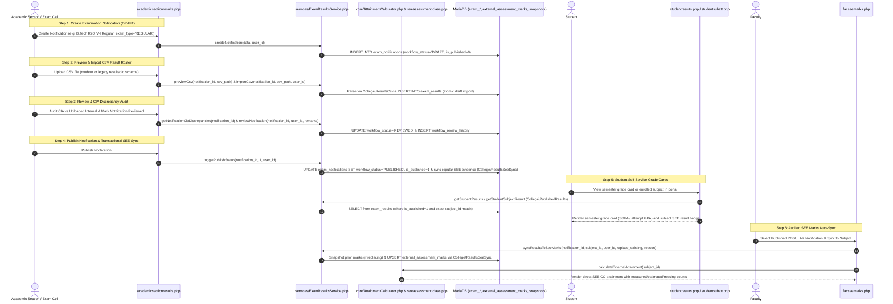

# Examination Results Publication & SEE Auto-Sync Workflow

This document details the lifecycle for examination notification creation, multi-step draft/review/publication governance, bulk result ingestion via CSV (`core/ResultsCsv.php`), fractional grade point conversion, legacy exam result scheme normalization, Semester End Examination (SEE) Course Outcome attainment distribution, CIA vs Exam Internal reconciliation audit, and student self-service grade card viewing across general and subject portals.

---

## 1. Overview & Policy Rationale

### 1.1 The Challenge of Disconnected Systems
In many autonomous institutions, semester end examinations are evaluated centrally by the Examination Branch, while department faculty separately evaluate Continuous Internal Assessment (CIA) and Course Outcome attainment:
- Without integration, faculty are forced to manually transcribe hundreds of external marks from paper lists or separate spreadsheets into the OBE software.
- Manual re-entry introduces clerical transcription errors, delays accreditation reporting, and wastes hundreds of faculty hours each semester.
- Furthermore, legacy examination result dumps (such as JNTUACEA `resultsold` archives) use heterogeneous column naming conventions (`std_regno`, `im`, `em`, `result`, etc.) and sentinel values (`im = -7` for exempt, `em = -1` for absent) that cause traditional strict parsers to reject imports.

### 1.2 The Integrated Solution
The Results Publication subsystem bridges the Examination Branch, Department Faculty, and Students:
1. **Academic Section / Exam Cell (`academicsectionresults.php`)**: Creates semester exam notifications (`workflow_status = 'DRAFT'`, `exam_type = 'REGULAR' | 'SUPPLEMENTARY' | 'REVALUATION'`), previews and imports verified university CSV result rosters (`previewCsv()` &rarr; `importCsv()` via `\College\ResultsCsv`, `\College\ResultsPolicy`, and `\College\ResultRow`), reviews imported rosters (`reviewNotification()` &rarr; `REVIEWED`), audits CIA discrepancies, and publishes results (`togglePublishStatus()` &rarr; `PUBLISHED`, `is_published = 1`). Publishing a `REGULAR` notification automatically synchronizes available SEE evidence inside the same database transaction via `\College\ResultsSeeSync` while preserving manual and question-wise SEE marks. Withdrawing a published notification marks dependent SEE evidence stale (`is_stale = 1`) without invalidating manual/question-wise marks.
2. **Independent Attainment CSV Import (`attainmentimport.php`)**: For colleges or courses not using central result publication, `Services\AttainmentImportService` previews and commits external aggregate, gross/net scaled, grade-derived, or question-wise CSV evidence (`attainment_import_batches`) directly into SEE attainment records.
3. **Multi-Mode SEE Attainment (`core/AttainmentCalculator.php` & `seeassessment.class.php`)**: Evaluates each student's SEE evidence individually across detailed question scores (`DETAILED_QP`), aggregate direct/synced/imported marks (`DIRECT_ENTRY`, `PUBLISHED_RESULT_SYNC`, `IMPORT_DIRECT`, `IMPORT_SCALED`), or grade-band estimates (`GRADE_ESTIMATE`), reporting measured, estimated, and missing student counts separately.
4. **Continuous Internal Assessment (CIA) Reconciliation Audit**: Live portal-calculated internal assessment marks (Mid 1, Mid 2, Assignments, Quizzes, Lab Day-to-Day) are audited against final uploaded internal marks (`im`), highlighting rounding variances ($\le 1.0$) and significant discrepancies ($> 1.0$).
5. **Student Portal (`studentresults.php`, `studentsubatt.php`, `studentsubjects.php` via `\College\PublishedResults`)**: Students access only their own published results matched to exact course offerings. Regular, supplementary, and revaluation attempts are rendered as separate attempt cards (with supplementary/revaluation averages labeled as attempt GPA and withheld results marked with pending GPA).
6. **Audited Faculty SEE Marks Auto-Sync (`facseemarks.php` via `\College\ResultsSeeSync`)**: Faculty can also trigger synchronization from a published `REGULAR` notification in Mode C (`SUPPLEMENTARY` and `REVALUATION` results never overwrite regular OBE evidence). Replacing existing marks requires explicit confirmation and a mandatory reason, preserving before/after snapshots in `academic_record_snapshots`.

---

## 2. UGC Grade Scale & Fractional SGPA Computation

The system supports standard autonomous UGC 10-point grading scales as well as regulation-specific fractional grade points (`exam_results.grade_points` `decimal(13,3)`) and custom `grade_bands` configured via `AttainmentPolicyService`:

| Letter Grade | Description | Marks Range (%) | Default Grade Points ($GP_i$) | Result Status |
| :---: | :---: | :---: | :---: | :---: |
| **O** / **S** | Outstanding | $\ge 90\%$ | 10 | PASS |
| **A+** / **EX** | Excellent | $80\% - 89\%$ | 9 | PASS |
| **A** | Very Good | $70\% - 79\%$ | 8 | PASS |
| **B+** | Good | $60\% - 69\%$ | 7 | PASS |
| **B** | Above Average | $50\% - 59\%$ | 6 | PASS |
| **C** | Average | $45\% - 49\%$ | 5 | PASS |
| **D** / **P** / **E** | Pass | $35\% / 40\% - 44\%$ | 4 | PASS |
| **F** | Fail | $< 35\% / 40\%$ | 0 | FAIL |
| **ABSENT** / **Ab** | Absent | Absent | 0 | ABSENT |
| **MP** | Malpractice | Disqualified | 0 | MALPRACTICE |
| **W** / **WH** | Withheld | Pending | 0 | WITHHELD |

### Semester Grade Point Average (SGPA) Formula
$$\text{SGPA} = \frac{\sum_{i=1}^{n} (C_i \times GP_i)}{\sum_{i=1}^{n} C_i}$$
Where:
- $C_i$ = Credits assigned to course $i$
- $GP_i$ = Grade points earned in course $i$ (preserving fractional precision when configured)
- Courses with letter grade `F`, `ABSENT`, or `MP` are included in the denominator $\sum C_i$ with $GP_i = 0$, properly reflecting academic standing.

---

## 3. Workflow Sequence Diagram

---

## 4. Step-by-Step Implementation

### Step 1: Notification Creation & Lifecycle (`academicsectionresults.php`)
- **Access Guard**: Authorized for `academic_section`, `admin`, and `superadmin` (`MOD_RESULTS_PUBLISH`).
- **Form Parameters**:
  - `notification_code`: Institutional identifier (e.g., `BTECH_R20_3_1_NOV2025`).
  - `title`: Examination title.
  - `program_id`: Degree program (`programs.id`).
  - `regulation_id`: Exact regulation ID (`regulations.id`).
  - `academic_year`: Active academic calendar year (e.g., `2024-2025`).
  - `yearsem`: Academic level (`III Yr - I Sem`, `3-1`).
  - `month_year`: Examination session period (e.g., `November 2025`).
  - `exam_type`: `REGULAR`, `SUPPLEMENTARY`, or `REVALUATION`.
  - `release_date`: Gazette date.
- **Workflow States (`exam_notifications.workflow_status`)**:
  - `DRAFT` &rarr; `REVIEWED` (`reviewNotification()`) &rarr; `PUBLISHED` (`togglePublishStatus()`). Published notifications lock their imported result rows against overwrite.

### Step 2: CSV Data Ingestion & Legacy Scheme Normalization (`core/ResultsCsv.php`)
The ingestion engine in `\College\ResultsCsv` seamlessly supports modern headers as well as legacy `resultsold` archives:

| Legacy Header (`resultsold`) | Modern Header | Canonical Property | Notes & Transformations |
| :--- | :--- | :--- | :--- |
| `std_regno`, `stdregno`, `regno` | `roll_number`, `htno`, `hallticket` | `htno` | Upper-cased and trimmed. |
| `std_name`, `studentname` | `student_name`, `name` | `student_name` | Preserved or looked up from `students`. |
| `sub_code`, `subjectcode` | `subject_code`, `subcode` | `subject_code` | Upper-cased. |
| `sub_name`, `subjectname` | `subject_name`, `subname` | `subject_name` | Optional. |
| `im` | `internal_marks`, `internals` | `internal_marks` | `-7` parsed as `NULL` (exempt/not applicable). |
| `em` | `external_marks`, `externals` | `external_marks` | `-1` / `AB` / `A` parsed as Absent; `-5` parsed as `NULL`. |
| `total` | `total_marks`, `total` | `total_marks` | Evaluated or summed from internal + external. |
| `grade` | `grade_letter`, `grade` | `grade_letter` | `Ab` mapped to `ABSENT`, `F` to `FAIL`, `S`/`A`/`B`/`C`/`D`/`E` to UGC grade. |
| `grade_points` | `grade_points`, `gradepoints` | `grade_points` | Preserves fractional `decimal(13,3)` points or computes from grade bands. |
| `credits` | `credits_registered`, `credits` | `credits_registered`| In legacy dumps, failed students have `credits = 0`; parsed safely without triggering curriculum mismatch rejections. |
| `result` | `result_status`, `status` | `result_status` | `P` &rarr; `PASS`, `F` &rarr; `FAIL`, `MP` &rarr; `MALPRACTICE`, `W` &rarr; `WITHHELD`. |

### Step 3: Continuous Internal Assessment (CIA) Reconciliation Audit
- **Audit Tool**: Tab 3 ("CIA vs Exam Internal Reconciliation & Discrepancies") in `academicsectionresults.php`.
- **Logic**:
  1. For each student and enrolled subject, `ExamResultsService::calculateStudentPortalCia()` calculates live CIA from faculty assessment entries according to regulation rules.
  2. The calculated CIA is compared against `exam_results.internal_marks` (`uploaded_internal`).
  3. Discrepancies are categorized into `MATCH` ($\Delta = 0$), `VARIANCE` ($|\Delta| \le 1.0$), `DISCREPANCY` ($|\Delta| > 1.0$), `MISSING_PORTAL_CIA`, or `EXEMPT_OR_MISSING` (`im = -7`).
- **CSV Export**: Academic Section administrators can download the reconciliation audit log via `?action=export_cia_discrepancy`.

### Step 4: Multi-Mode SEE Attainment & Audited Auto-Sync
- **Explicit Notification & Offering Validation (`ExamResultsService::syncResultsToSeeMarks()`)**:
  - Requires an explicitly selected `PUBLISHED` notification with `exam_type = 'REGULAR'` (supplementary/revaluation imports are refused until attempt-selection policy is configured).
  - Resolves the configured external maximum from `AttainmentPolicyService` / `curriculum_subjects` / `regulation_course_types` (ignoring missing or stale curriculum links when an explicit policy maximum exists).
  - If `external_assessment_marks` already exist for the subject, replacement requires `$replaceExisting = true` and a non-empty `$reason`, atomically archiving before/after rows in `academic_record_snapshots` (`entity_type = 'external_marks_sync'`).
- **Three Complementary Evidence Tiers (`\College\AttainmentCalculator` & `seeassessment.class.php`)**:
  1. **Detailed Question-Wise Blueprint (`DETAILED_QP`)**: Uses `internal_assessments` (`assessment_number = 'SEE'`), `assessment_components` (`SEE-Theory`, `SEE-Split-A`, `SEE-Split-B`, `SEE-Lab`), `assessment_questions`, `question_co_mapping`, and `student_marks` with per-student choice resolution (`choice_groups`) and equal sharing (`EQUAL_SHARE`) across multi-CO questions.
  2. **Measured Aggregate External Marks (`DIRECT_ENTRY`, `PUBLISHED_RESULT_SYNC`, `IMPORT_DIRECT`, `IMPORT_SCALED`)**: Scales raw external marks to the course's net external maximum and evaluates against CO thresholds (`measured_students`).
  3. **Grade-Band Estimate (`GRADE_ESTIMATE:<Grade>:<Policy>`)**: When only letter grades are supplied and a grade-band estimation policy (`midpoint`, `lower`, `upper`) is configured, estimates external score from the grade interval and reports it separately under `estimated_students`.

### Step 5: Student Portal Subject-Level Visibility
Students can view examination results across multiple touchpoints:
1. **Semester Grade Cards (`studentresults.php`)**: Full printable grade sheet with credit points, letter grades, fractional grade points, and SGPA.
2. **Subject Attendance & Assessment Portal (`studentsubatt.php`)**: Displays the subject's **Semester End Examination (SEE) Results & Grade Card** when `MOD_RESULTS_PUBLISH` is visible.
3. **Enrolled Subjects Register (`studentsubjects.php`)**: Displays an **Exam Result** badge alongside class attendance.

### Step 6: Advisory Credit-Based Promotion Pipeline Simulation (`MOD_CREDIT_PROMOTION`)
- **Safety Guardrail**: Governed by `MOD_CREDIT_PROMOTION` (default disabled, `is_enabled_globally = 0`). Purely an advisory dry-run simulation tool that **never blocks** CSV result ingestion, student grade cards, or result notifications.
- **Service Methods (`services/ExamResultsService.php`)**:
  - `evaluateCreditPromotionSimulation($classId, $regulationCode)`: Analyzes earned credits across past terms for enrolled students in the target class, flags at-risk students, and checks for prior committee clearances.
  - `savePromotionCommitteeOverride($studentId, $classId, $action, $remarks, $userId)`: Records manual academic committee clearance into `audit_logs` (`PROMOTION_COMMITTEE_OVERRIDE_SAVED`), displaying `CLEARED BY COMMITTEE` on subsequent simulation evaluations.

---

## 5. Database Schema Reference

| Table Name | Description | Key Foreign Keys & Indexes |
| :--- | :--- | :--- |
| `exam_notifications` | Master examination event notifications (`workflow_status`, `exam_type`) | `program_id` &rarr; `programs(id)`, `regulation_id` &rarr; `regulations(id)` |
| `exam_results` | Student subject scores, grades, credits, fractional grade points | `notification_id` &rarr; `exam_notifications(id)`, Indexes: `idx_er_student_subject`, `idx_er_htno_subcode` |
| `external_assessment_marks` | Faculty external assessment register, raw/scaled scores & `evidence_basis` | `subject_id` &rarr; `subjects(id)`, `student_id` &rarr; `students(id)`, `source_notification_id`, `source_batch_id` |
| `attainment_import_batches` | Independent external CSV evidence preview & commit ledger | `subject_id` &rarr; `subjects(id)`, `owner_user_id` &rarr; `users(id)` |
| `internal_assessments` / `assessment_components` / `assessment_questions` | SEE question paper blueprint (`assessment_number = 'SEE'`) and CO mapping metadata | `sub_id` &rarr; `subjects(id)`, `component_id` &rarr; `assessment_components(id)` |
| `academic_record_snapshots` & `audit_logs` | Forensic before/after snapshots for result sync replacements and promotion committee overrides | `actor_user_id` / `user_id` &rarr; `users(id)` |
