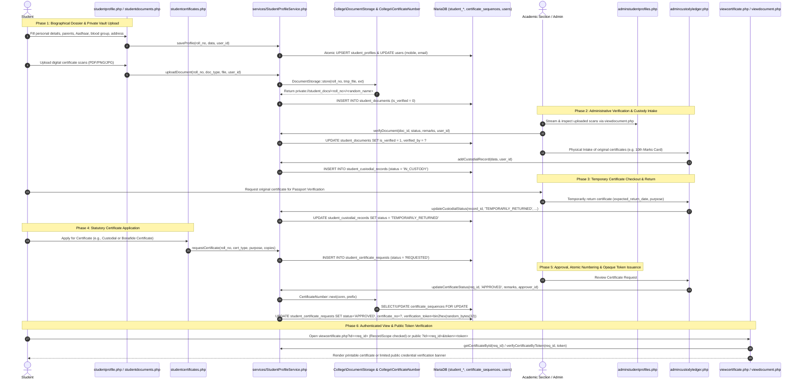

# Student Biographical Dossier, Document Vault, Custody Ledger & Statutory Certificates Workflow

This document details the lifecycle for student biographical profiling, private document vault storage (`COLLEGE_DOCUMENT_ROOT` via `\College\DocumentStorage`), physical original certificates custody governance, atomic certificate numbering (`certificate_sequences`), and opaque CSPRNG token verification (`viewcertificate.php`).

---

## 1. Overview & Policy Rationale

Autonomous engineering colleges and university constituent colleges are legally accountable for maintaining statutory student identity records and safely managing original student certificates submitted at the time of admission:
1. **Biographical Dossier**: Centralizes personal, parental, demographic, category/quota, and contact records (`student_profiles`).
2. **Private Cloud Document Vault**: Provides students a secure digital vault (`studentdocuments.php`) to upload PDF/PNG/JPG scans of prerequisite certificates (Aadhaar, SSC, Intermediate/Diploma, Entrance Rank Cards, Caste, Income) stored outside the web root (`COLLEGE_DOCUMENT_ROOT`) and streamed only through authenticated ownership checks (`viewdocument.php`).
3. **Physical Custody Ledger**: Under autonomous university rules, original certificates are retained in college custody until degree completion (`student_custodial_records`). When students require original certificates temporarily (e.g., for Passport verification, Visa interviews, or Education Loans), a formal audited custody ledger tracks checkout, expected return date, return, or permanent clearance.
4. **Statutory Certificate Generation & Opaque Verification**: Automates the request, administrative review, atomic numbering (`\College\CertificateNumber`), and issuance of official institutional certificates (`student_certificate_requests`):
   - **Bonafide Certificate** (`BONAFIDE`)
   - **Study & Conduct Certificate** (`STUDY_CONDUCT`)
   - **Custodial Certificate** (`CUSTODIAL` — formally certifying all original certificates held in institutional custody)
   - **Transfer Certificate (TC)** (`TRANSFER_CERTIFICATE`)
   - **No Dues Clearance Certificate** (`NO_DUES`)

---

## 2. Architecture & Workflow Sequence

---

## 3. Step-by-Step Implementation

### Step 1: Biographical Dossier (`studentprofile.php`)
- **Demographics**: Father's name, Mother's name, Date of Birth, Gender, Blood Group, Aadhaar Number, Category/Quota (`CONVENOR`, `ECET`, `SPOT`, `NRI`, `GATE`), Entrance Rank, Admission Hall Ticket.
- **Contact & Coordinates**: Admission Date, Roll Number (`roll_no`), Permanent Address, Current Address, Mobile, Email, Emergency Parental Contact.
- **Transactional Integrity**: `StudentProfileService::saveProfile()` updates both `student_profiles` and `users` inside an atomic database transaction with `audit_logs` tracking.

### Step 2: Private Cloud Document Vault (`studentdocuments.php` & `viewdocument.php`)
- Supported document types (`doc_type`): `SSC_MEMO`, `INTER_DIPLOMA_MEMO`, `ALLOTMENT_ORDER`, `CASTE_CERTIFICATE`, `INCOME_CERTIFICATE`, `AADHAR_CARD`, `STUDY_CERTIFICATES`, `TRANSFER_CERTIFICATE`, `OTHER`.
- **Private Repository (`\College\DocumentStorage`)**:
  - New uploads require `COLLEGE_DOCUMENT_ROOT` to be configured in `.env.php` pointing to a persistent directory outside the web document root, storing files under `private://student_docs/<roll_no>/<random_hash>.<ext>`.
  - Direct web access to `uploads/student_docs/` is blocked by `.htaccess`. All document downloads stream through `viewdocument.php`, which verifies `RecordScope::document()` ownership before reading the file.
- **Soft-Delete Retention**: Deleting a document via `StudentProfileService::deleteDocument()` records `deleted_at = NOW()` and `deleted_by = <user_id>` rather than unlinking the physical file, preserving forensic audit evidence.

### Step 3: Physical Custody Ledger (`admincustodyledger.php`)
- Records physical documents surrendered upon admission (`student_custodial_records`):
  - Document name & serial/certificate number (`certificate_serial_no`).
  - Lifecycle state machine:
    - `IN_CUSTODY`: Secured in college records room.
    - `TEMPORARILY_RETURNED`: Checked out with `issued_date`, `expected_return_date`, and `purpose_of_withdrawal`.
    - `PERMANENTLY_RETURNED`: Released permanently upon graduation or formal exit.

### Step 4: Statutory Certificate Engine (`StudentProfileService`) & Opaque Token Verification (`MOD_CERTIFICATE_QR`)
- Supported certificate categories (`student_certificate_requests.cert_type`): `BONAFIDE`, `STUDY_CONDUCT`, `CUSTODIAL`, `TRANSFER_CERTIFICATE`, `NO_DUES`.
- **Concurrency-Safe Certificate Numbering (`\College\CertificateNumber`)**:
  - Uses `certificate_sequences` (`prefix`, `last_number`) with row-level `FOR UPDATE` locking to allocate unique sequential numbers (e.g., `JNTUACEA/BON/2026/0001`), preventing duplicate certificate numbers under concurrent requests.
- **Opaque CSPRNG Token Verification (`viewcertificate.php`)**:
  - Upon approval/generation, `StudentProfileService` generates an unpredictable 64-character hexadecimal token (`bin2hex(random_bytes(32))`) stored in `student_certificate_requests.verification_token` (`uq_certificate_verification_token`).
  - No external QR image service is contacted, preventing third-party leakage of certificate URLs.
  - Public verification via `viewcertificate.php?id=<REQ_ID>&token=<TOKEN>` validates the opaque token via `hash_equals` and returns limited verification metadata (masking the roll number on unauthenticated public lookup while requiring authenticated `RecordScope::certificate()` ownership for full printable certificate rendering).

---

## 4. Student Attendance Risk Gauge (`MOD_STUDENT_ATTENDANCE_RISK`)

Integrated directly into `jntuaceastudents/studenthome.php` powered by `StudentAttendanceService::getStudentAttendanceRiskMetrics()` and `\College\AttendanceService`:
- **Aggregate Attendance Standings**: Real-time display of total conducted periods ($T$), attended periods ($P$), and overall aggregate percentage ($A = \frac{P}{T} \times 100$) from the student's `date_of_joining` across mapped subjects.
- **Safe Margin Metric**: When $A \ge 75.0\%$, calculates how many upcoming lecture periods the student can afford to miss without breaching the $75\%$ regulatory floor:
  $$\text{Safe Margin} = \max\left(0, \left\lfloor \frac{P - 0.75 \times T}{0.75} \right\rfloor\right)$$
- **Recovery Periods Needed**: When $A < 75.0\%$, calculates consecutive future class periods the student must attend without absence to restore attendance back to $\ge 75.0\%$:
  $$\text{Recovery Periods} = \max\left(0, \left\lceil \frac{0.75 \times T - P}{0.25} \right\rceil\right)$$
- **Regulatory Standing Badges**: Renders status badges for `ELIGIBLE` ($\ge 75\%$), `CONDONATION` ($65.0\% \le A < 75.0\%$), `DETAINED` ($< 65.0\%$ or single course below floor), `PROVISIONAL` (when unrecorded periods exist), or `POLICY_REVIEW`.

---

## 5. Database Schema Reference

| Table Name | Description | Key Foreign Keys & Unique Constraints |
| :--- | :--- | :--- |
| `student_profiles` | Demographic & biographical student records | `roll_no` &rarr; `users(username)` (`fk_sp_user`) |
| `student_documents` | Private digital document vault metadata & soft-delete state (`deleted_at`, `deleted_by`) | `roll_no` &rarr; `users(username)` (`fk_sd_user`) |
| `student_custodial_records` | Physical original certificate custody tracking | `roll_no` &rarr; `users(username)` (`fk_scr_user`) |
| `student_certificate_requests` | Self-service certificate applications, approvals & opaque `verification_token` | `roll_no` &rarr; `users(username)` (`fk_sc_req_user`), Unique: `certificate_no`, `verification_token` |
| `certificate_sequences` | Atomic per-prefix sequence counter (`prefix`, `last_number`) | Primary Key: `prefix` |
