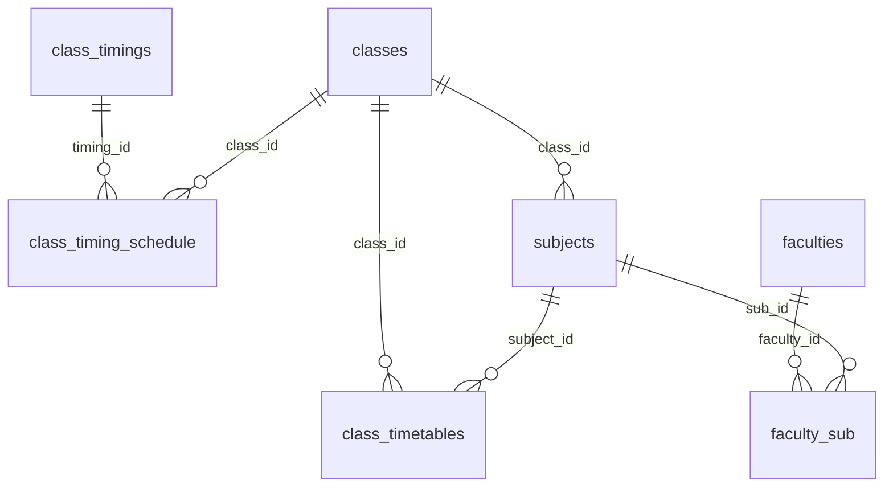
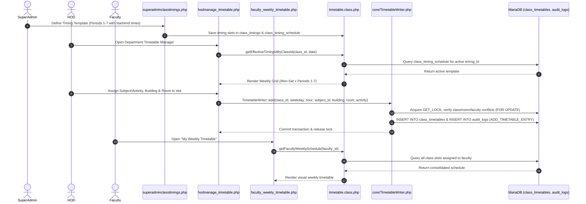

# Timetable Management & Scheduling

This document details the configuration of bell schedules, class timing schedules, conflict-checked weekly timetable allocation (`\College\TimetableWriter`), support for parallel electives/labs and shared open electives, and faculty schedule views.

---

## 1. System Structure

Timetable operations are governed by three interacting layers:
1. **Timing Templates (`class_timings`)**: Global period schedules defining the start and end times for each period/hour (Periods 1 to 7).
2. **Class-Timing Schedule (`class_timing_schedule`)**: Maps a class cohort (`class_id`) to a specific timing template (`timing_id`) for a defined date range (`from_date` to `to_date`).
3. **Weekly Timetable Allocations (`class_timetables`, `timetable.class.php` & `core/TimetableWriter.php`)**: Day-by-day, period-by-period allotment of subjects, activities, buildings, and classrooms (`building_name`, `class_hall_name`).



---

## 2. Timetable Configuration Sequence



---

## 3. Effective Timing Resolution

Because colleges often change period timings during summer or examination terms:
- Timings are not hardcoded.
- `Timetable::getEffectiveTimingIdByClassId($class_id, $for_date)` resolves the active timing template using chronological date ranges:
```sql
SELECT timing_id
FROM class_timing_schedule
WHERE class_id = ?
  AND from_date <= ?
  AND (to_date IS NULL OR to_date >= ?)
ORDER BY from_date DESC, id DESC
LIMIT 1;
```

---

## 4. Transactional Conflict Validation (`\College\TimetableWriter`)

All timetable slot insertions in `hodmanage_timetable.php` and `Timetable` delegate to `\College\TimetableWriter::add()` (`jntuacea/core/TimetableWriter.php`), which enforces:
1. **Scope & Role Authorization**: Verifies `RecordScope::classRecord($class)` and ensures the actor holds `hod`, `admin`, `superadmin`, or `academic_section` authority.
2. **Mutex Concurrency Serialization**: Acquires a database-level named lock (`GET_LOCK(CONCAT(DATABASE(),':timetable-write'), 10)`) and begins a transaction with `SELECT ... FOR UPDATE`.
3. **Period & Schedule Validation**: Verifies that the selected `class_timings` row has `start_time < end_time` and belongs to the class's active `timing_id`.
4. **Multi-Dimensional Conflict Rules**:
   - **Same-Class Parallel Electives & Labs**: Prevents scheduling the exact same `subject_id` twice in the same period or overlapping a non-subject class activity (`subject_id IS NULL`), while **allowing multiple distinct subjects in the same period** within the same class so parallel elective tracks and split laboratory batches (Batch A / Batch B) can run simultaneously.
   - **Cross-Class Room & Faculty Collisions (with Shared Open Elective Exception)**: Rejects overlapping bookings of the same room (`building_name` + `class_hall_name`) or the same assigned instructor (`faculty_sub`) across different classes whose semester date ranges overlap, **except** when those classes are co-attending a shared Open Elective or common course with the same `subcode` or `curr_sub_id` in the same room/faculty.
5. **Forensic Audit Logging**: Writes `ADD_TIMETABLE_ENTRY` into `audit_logs` within the same transaction before committing.

---

## 5. Key Interfaces & Scripts

- **`superadminclasstimings.php`**: SuperAdmin interface to configure master bell timings (Period 1: 09:00 - 09:50, Period 2: 09:50 - 10:40, etc.).
- **`hodmanage_timetable.php`**: HOD interface to build and manage weekly class schedules with real-time room and faculty conflict prevention.
- **`hodtimetable.php`**: Departmental master timetable grid allowing HODs to inspect all active class schedules and lab sessions across semesters.
- **`viewtimetable.php`** & **`jntuaceastudents/studenttimetable.php`**: Staff and student views of section timetables.
- **`faculty_weekly_timetable.php`**: Personalized schedule for instructors summarizing their weekly teaching commitments across multiple classes and departments.
